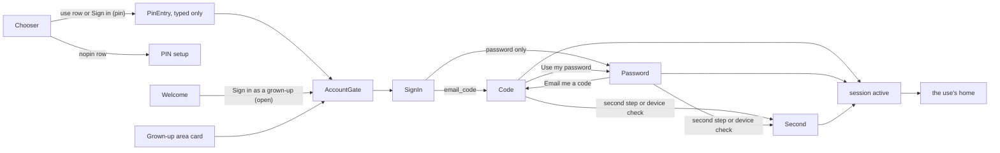

# Account/Native-sign-in — grown-up sign-in on iOS and Android, and the rows that lead to it (wireframe v1)

Spec: `docs/specs/F-AUTH-004-native-sign-in.md` sections 6.3, 6.4, 6.5, 7.1, 12, 14, 17.1 (rows NS-3, NS-4) · native builds only, behind `EXPO_PUBLIC_NATIVE_SIGNIN` and a valid publishable key (CS-N13)
Audience: **grown-up** (parent, caregiver, teacher, school admin) on a family tablet, a parent's phone or a class iPad; the chooser rows sit on a screen learners see, so they carry generic labels only
Route: learner app `SignIn { use? }` inside the Grown-up area stack (`GrownUpStack`), behind `AccountGate`; entries: the chooser's Grown-ups rows (`WhoIsUsing`), Welcome's grown-up row, the Grown-up area account card
Mock: `design/screens/account/sign-in.md` (`mock/sign-in.html`, boards 1 to 18) and `design/screens/account/entries.md` (`mock/entries.html`, boards 1 to 9) (row NS-0b)

## Scenario (Given-When-Then)

Given: a parent who also teaches, on the family iPad that holds two children's profiles and a grown-up PIN, with an account made on the web (Google or email)
When: they pick **Sign in as a grown-up** on "Who is using this?", type the PIN, then their email and the 6-digit code Clerk emails them
Then: the Family home opens; the next time, **Family** or **Teacher** on the chooser and the PIN are enough (2 taps and 4 digits, NG1); nothing on any of these screens offers to buy, make an account, or go anywhere else

## Screen goal

"Sign in with what you already have." Email code first, password when the account has one, any code Clerk asks for next. No sign-up, no social button, no link out.

## Box diagram

Panel A — email step (phone 360)

```
+--------------------------------+
| < Back   Grown-up sign-in ( Aa)|  <- ScreenHeader; Back cancels to where sign-in was opened
| Sign in with the grown-up      |  <- intro, secondary text
| account of your family, class  |
| or school.                     |
| Email                          |  <- visible label (not a placeholder)
| [ dana@example.com          ]  |  <- emailAddress / email, no autocorrect, focus starts here
| (        Continue           )  |  <- primary; aria-disabled until the field holds an @
|--------------------------------|
| Learners don't need an account.|  <- two quiet lines, no link
| This app doesn't make new      |
| grown-up accounts.             |
+--------------------------------+
```

Panel B — code step (the account has the email code; Use my password only when it also has a password)

```
| < Back   Grown-up sign-in ( Aa)|
| We sent a 6-digit code to      |
| dana@example.com.              |
| Code                           |  <- oneTimeCode / one-time-code, digits; name "Sign-in code, 6 digits"
| [ 482139    ]                  |
| (         Sign in           )  |  <- primary
| (      Send a new code      )  |  <- secondary
| (      Use my password      )  |  <- secondary, password accounts only
|        Use another email       |  <- quiet text button: back to Panel A, field kept
```

Panel C — password step

```
| Password                       |
| [ ••••••••  ]                  |
| (         Sign in           )  |
| (      Email me a code      )  |  <- only when the account has the email code
|        Use another email       |
```

Panel D — second step or new-device check

```
| Enter the code from your       |  <- needs_second_factor; or "We sent a code to check this new device."
| second sign-in step.           |     for needs_client_trust (with Send a new code)
| Code                           |
| [           ]                  |
| (         Sign in           )  |
| (     Use a backup code     )  |  <- only when the account has backup codes; then a plain text field
| (      Send a new code      )  |  <- only when this step's code was sent (device check, emailed or texted step)
|        Use another email       |
```

Panel E — an error line (every step)

```
| [ 482130    ]                  |  <- aria-invalid; the line below carries the words, never a danger look
| | That code didn't work. Check |  <- the strip: role alert, tied to the field (aria-describedby),
| | it and try again.            |     announced; the field cleared and focused on a wrong code or password
| (         Sign in           )  |
```

Lines by Clerk answer (spec 6.3): `wrongCode`, `codeExpired`, `wrongPassword`, `cantSignIn`, `tooMany`, `generic`; a status that is not a code step ends in `unsupported` with **Use another email** only.

Panel F — offline (any step)

```
| < Back   Grown-up sign-in ( Aa)|
| | Needs the internet           |  <- learner.welcome.grownUps.needsInternet, a status strip
| ... the step as it was ...     |  <- typed values kept
| (    Continue / Sign in     )  |  <- every button that calls Clerk aria-disabled (also Send a new code,
|                                |     Email me a code); Use my password, Use a backup code, Use another
|                                |     email stay enabled; all back when the network returns
```

Panel G — "Who is using this?", Grown-ups section on native (switch on)

```
| Grown-ups                      |
| [L] Family                   > |  <- known uses, fixed order (uses record, PIN devices only)
| [L] Teacher                  > |
| [L] School                   > |
| [L] Grown-up area            > |  <- as today
```

or, from the uses record:

```
| [L] Grown-up account         > |  <- a record with no use (account with no space)
| [L] Sign in as a grown-up    > |  <- no record
```

Panel H — `nopin` (child profiles, no PIN) and offline

```
| [L] Sign in as a grown-up    > |
|     Set a grown-up PIN first.  |  <- caption; opens PIN setup (Grown-up area destination), never the account
| [L] Grown-up area            > |
|     A grown-up sets a PIN here.|
```

```
| [L] Family         (disabled)  |  <- offline: aria-disabled, no chevron
|     Needs the internet         |     (offline wins over nopin: the row's purpose is the account)
| [L] Grown-up area            > |  <- works offline
```

Panel I — Welcome (no learner profile on the device)

```
|        (Hoya) Hi! I'm Hoya.    |  <- unchanged
| (         Let's start         )|  <- the only filled button
| (    I already have progress  )|
|--------------------------------|
|   Here to support a learner?   |
| (    Sign in as a grown-up    )|  <- outlined; never a use row here (no session is kept, ND-9)
```

## Interaction points

- Continue (email): `signIn.create({ identifier })`; with `email_code` among the first factors, `prepareFirstFactor` and the code step; with `password` only, the password step; neither, the unsupported line.
- Sign in (code, password, second): the matching `attemptFirstFactor` / `attemptSecondFactor`; `complete` sets the session active, writes the records on a `pin` device with a real epoch (subject to the re-trust rule) and opens the home of the use the grown-up came for (`nativeHomeFor(uses)` otherwise).
- Send a new code: prepares the same factor again; the field is cleared and focused. Use my password / Email me a code: switches the first factor, keeping the email. Use a backup code: the backup strategy on the same step. Use another email: back to the email step with the typed email kept.
- Back (header), or leaving the screen: cancels to where sign-in was opened (the chooser, Welcome or the Grown-up area); one `auth.native.signin` per flow (`cancelled` when the flow had no result).
- A chooser row: `PinEntry { next: 'GrownUpUse', use }` typed (no face or fingerprint), then `AccountGate`; a `nopin` row opens `PinEntry { next: 'ParentDashboard' }` (setup); the Welcome row opens SignIn directly (no PIN can exist yet).

## Entry and exit

Enter from: `profiles/who-is-using` (Grown-ups rows) · `onboarding/welcome` (Welcome row, devices with no learner profile) · the Grown-up area account card (`native-lock.md` Panel C) · `native-lock.md` Panel B (Sign in again)
Exit to: `account/home` (`native-homes.md`) · back to the entry (Cancel) · PIN setup (`nopin` rows)



## States

- Sign-in: email (empty, typed, waiting) · code · password · second (second step, device check, backup code) · unsupported · each error line · offline on any step (the step and typed values kept).
- Rows: uses known · Grown-up account (record, no use) · Sign in as a grown-up (no record) · `nopin` · offline · an open device (no lock glyph) · switch off (the basis).
- Welcome: the outlined row · offline (disabled with Needs the internet).

## Data needs

- Reads: the gate state (`nativeGateState`), the uses record `hr:grownup:deviceUses` (PIN devices only, no names), online state (`platform/online.ts`), Clerk's sign-in resource (first factors, status).
- Writes (after a completed sign-in only): `hr:grownup:deviceUses` and `hr:grownup:trust` on a `pin` device with a real epoch, `ui-store.lastAccountSignInAt` in memory; Clerk's token cache (keychain or keystore on a PIN device, memory otherwise). Nothing on a refusal.

## Open questions

- None open. The decisions this pass took (Continue dimmed until the field holds an @, no busy string and offline per button, offline wins over `nopin`, backup codes in a plain field, amber strips with a `border.shape` field) are D1 to D5, and the password step first while a re-trust is pending is D21, in `design/screens/account/README.md`.

## Accessibility

- Fields have visible labels; the code field's accessible name "Sign-in code, 6 digits" contains its visible label "Code" in en, es and ko (WCAG 2.5.3) and reads digits one by one.
- An error line is announced (`announceForAccessibility`) and tied to its field (`accessibilityHint` / `aria-describedby`); a wrong code or password clears and refocuses the field.
- Row captions (Needs the internet, Set a grown-up PIN first.) are descriptions, never joined into the row's name; a `nopin` row is named by its label alone (entering runs PIN setup, so the name does not promise a PIN check).
- Every control at least `touchTarget.min`; nothing truncates at Largest.
