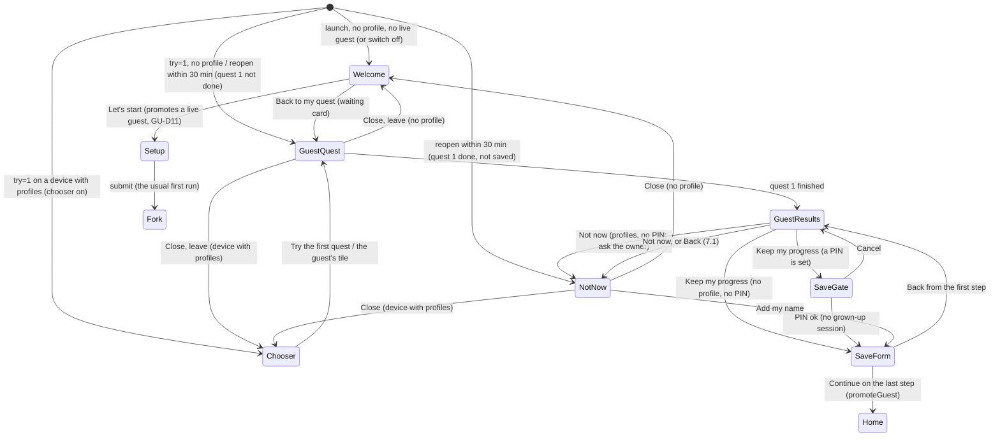

Status: ready (spec only; rows GU-0b to GU-7 implement it; owner decision (d) of 2026-10-21; every open question has a default that applies until the owner answers, section 21)

Design: row GU-0b (agent design pass approved by multi-agent review, CLAUDE.md section 5, 2026-10-12 owner decision). Wireframes in this PR: `design/wireframes/onboarding/guest-first-quest.md` (entry from the site, the guest run, Welcome with a waiting quest, reload, offline, storage blocked), `design/wireframes/onboarding/guest-save.md` (Results with Keep my progress, the gate on a device with a PIN, the ask-the-owner card on a device with profiles and no PIN, the name step, the Privacy step with the email behind **Add an email**, Not now, the first Home), `design/wireframes/profiles/who-is-using-guest.md` (the **Try the first quest** tile and the guest's own tile on the chooser). Mocks (GU-0b): `design/screens/onboarding/` (README, `guest-first-quest.md`, `guest-save.md`), `design/screens/profiles/who-is-using-guest.md` and `design/screens/site/guest/`, in en, es and ko.

# Amendment: try the first quest now, without a profile ("guest first quest")

> **Owner decision (d) of 2026-10-21 (in chat, translated):** "Build a no-profile 'try the first lesson now' guest path. Spec first."
>
> Every change below is marked **[GU]** where it lands in a spec, test or code comment.
>
> Amends F-LEARN-001 (first-run setup), F-APP-001 (the learner entry, the device gate marker, the boot intents), `AMENDMENTS-ONE-ACCOUNT-MANY-USERS.md` (the chooser) and F-SITE-002 with `AMENDMENTS-SITE-NEWUSER.md` (the site's Start learning link and one claim line).
>
> Basis: `origin/main` `49efb010b` (2026-10-21, with `AMENDMENTS-SITE-NEWUSER.md` (#810), the F-CURR-002 phase-0 integration (#802) and the /learners level-check line behind the `levelCheck` claim (#807, claim on by owner decision (a)) merged, then #805, which moves none of the cited lines). Every `file:line` below is at that commit. The OA rows this amendment builds on (#801 integration, OA-4a #795, OA-5 #797, OA-7a #803) are open PRs at that commit; section 20 orders every row after them.

**Standing rules that apply here:**
- Audience is anyone of any age; no age wording anywhere new. Learners never sign in (F-APP-001 OD-2). "Guest" is a word of this spec and of code only: no screen says "guest". The owner's "try a lesson" is worded **Try the first quest** on screen, since a lesson is a quest in the learner app's glossary (F-I18N-001 section 3.10).
- UI strings come from `packages/i18n` (`useMessages()`), with English, Spanish and Korean in the same PR (es and ko coverage ratchets), written to the F-I18N-001 section 3.10 style guide. The review ledger of a changed `en` namespace is re-signed (`enSha`, `reviewedBy: MAR`) only in that row's fix stage, after an independent reviewer passed its es and ko strings. Tokens only. No emoji.
- Anti-shame: nothing here counts down, scolds or takes back an earned item. A guest's card and stars are never removed by the save, by Not now or by leaving; only the sweep of a never-saved record (30 days without play, 7 on a device with learner profiles), **Remove the first quest** chosen by the person who uses the device, or the browser's own clearing removes them, and the screens say so before it can happen.
- No PII in URLs, page titles or telemetry. A guest has no name, no email and no server record. No event of a guest run carries a `profileId`.
- Consent before personal data: a guest's run collects no personal data and sends nothing to the server except anonymous counts. The name, the agreement and the optional email are asked only after the first quest, and nothing about the learner reaches the server before that agreement (F-LEARN-001 section 3.3 rules unchanged, latch included).
- D1 changes additive only. **This amendment adds no D1 migration and no route.** The Worker change is payload rules for the new telemetry names and their daily counts in the existing `telemetry_daily` table (`AMENDMENTS-ONE-ACCOUNT-MANY-USERS.md` section 15.1), and it deploys first (row GU-1).
- Site claims live in `apps/web/src/data/site-claims.ts` as code constants with tests pinning both states; the claim of this amendment flips only in the flag-flip row (GU-7).
- No price or commercial claim beyond the facts. Copy never claims native-speaker, expert or legal review. Stripe stays in sandbox; nothing here touches billing.
- The es and ko values below are drafts for the multi-agent review (MAR) of each row.

---

## 0. Summary

Today a visitor who presses **Start learning** on hangulroute.com answers four setup screens (who is learning, a name, the agreement, the level-check fork) and a preview before the first Korean letter appears: **11 taps and a typed name** on the shortest path (section 1.1). This amendment lets them **play Stage 1 quest 1 first**:

1. **Start learning goes straight into quest 1.** The site link carries a `try=1` boot intent. On a device with no learner profile the learner app opens quest 1 at once, for a **guest**: a local, nameless run held in its own record (`hr:guest`), never in the profile list, never synced. First letter in **2 taps** (Start learning, then Continue on Hoya's hello).
2. **After the first quest, Keep my progress.** Results shows the card and the stars, then asks for a name and the Privacy step (who is learning and the agreement, with the optional email folded behind **Add an email**). Saving turns the guest into an ordinary profile **with the same id**, so every per-profile record (progress, card, stars, session log, word memory) is already the learner's: nothing is copied and nothing can be lost.
3. **Leaving, reloading, going offline** keep the run: the record survives a reload, a reload within 30 minutes reopens where the guest was, Welcome later offers **Back to my quest**, and a never-saved record is cleared by the app when it next opens after 30 days without play (7 on a device that has learner profiles).
4. **Shared devices fit "Who is using this?"** A device that already has learner profiles never starts a guest by itself: Start learning opens the chooser with one extra tile, **Try the first quest**, and a live guest shows as its own nameless tile. A guest never reaches a grown-up screen and never opens a grown-up session. Saving a guest on a device that holds a PIN asks that PIN, without opening a grown-up session; on a device that holds learner profiles but no PIN, the guest never sets one: the person who uses the device keeps the quest for them from People on this device (section 8.2).

Native builds keep today's first run (the guest path is web only; section 21, OQ-G1).

---

## 1. Goals and how they are measured

| # | Goal | Measure | Target | Baseline source |
|---|---|---|---|---|
| G1 | **The first letter comes fast.** | Taps from the site's **Start learning** to ㅏ on the first Discover page of Stage 1 quest 1, on the release build, counted by the e2e helper (a tap is a press on a control; no typing is needed on the guest path) | **at most 3**: 2 on a device with no learner profile, 3 on a device with profiles and the chooser on (Start learning, Try the first quest, Continue) | **11** today (section 1.1), e2e `guest-first-quest.spec.ts` records both |
| G2 | **Nothing is lost at the save.** | After a save, the new profile's progress snapshot, cards, stars and session log equal the guest's, key for key (unit over every per-profile store) and on screen (e2e: the card is in Library, the quest shows done on Journey) | 100 % | unit `guest-promotion.test.ts`, e2e |
| G3 | **Most visitors who start reach the letter.** | `guest.first_letter` over `guest.started` with `resumed: false` (new runs only; a reopen or resume is the same run and is not counted), by day, from the daily counters | at least 0.9 within 4 weeks of the flip | GU-7 on |
| G4 | **Many who finish keep their progress.** | `guest.saved` over `guest.quest_done`, by day | at least 0.5 within 4 weeks of the flip (owner may tune, OQ-G5) | GU-7 on |
| G5 | **The new path does not cost profiles.** | `onboarding.started` with `firstRun: true` per day (every first profile, saved guest or not), 7-day mean | not below 80 % of the 14-day mean before the flip | counted from GU-1 on, at least 14 days before GU-7 |
| G6 | **A guest never reaches a grown-up surface.** | The child-safety suite (section 10, CS-G1 to CS-G9) on every row | 100 % pass | unit and e2e |

Every telemetry measure above is computed from the Worker's daily counters (`telemetry_daily`), which keep no profile id, device id or time finer than a day.

**Kill criteria** (any one turns the guest path off with its switches, section 15): G5 below 80 % of its baseline for 7 days in a row; any CS-G test failing on a production build; a support report of lost progress at a save, or of a guest reaching a grown-up surface.

### 1.1 Baseline: the shortest path today (empty device, web, production flags of 2026-10-21, level check on)

| Tap | Screen | Control | Code |
|---|---|---|---|
| 1 | hangulroute.com | **Start learning** | `learnerStart` (`apps/web/src/lib/site-links.ts:75`) |
| 2 | Welcome | **Let's start** | `WelcomeScreen.tsx:89` |
| 3 | CreateProfile step 1 | **Me** | `CreateProfileScreen.tsx` (`whoStep`) |
| 4 | step 1 | **Continue** | |
| 5 | step 2 | the name field (then typing) | |
| 6 | step 2 | **Continue** | |
| 7 | step 3 Privacy | the agreement box | |
| 8 | step 3 | **Continue** | `onSubmit` → `profileCreatedNext` |
| 9 | PlacementInvite | **I am new to Korean** | `PlacementInviteScreen.tsx` (`choose('new')`) |
| 10 | FirstQuestPreview | **Start my journey** | `FirstQuestPreviewScreen.tsx:37` |
| 11 | QuestPlayer step 1 (intro, "Hi from Hoya") | **Continue** | `apps/mobile/src/content/quests.ts:27` |
| — | QuestPlayer step 2, Discover "Four New Letters", page 1 | ㅏ (a) is on screen | `quests.ts:29-38` |

The **Someone I look after** path adds the PIN twice (8 digit presses): 19. The guest path (section 6) is taps 1 and 11 only.

---

## 2. Why: learning-science and privacy grounding

- **Value before effort.** The first minutes decide whether a beginner comes back. Every screen between the decision to try and the first success is a place to drop out; a habit forms around a short path from cue to a small win (Fogg's behaviour model: lower the effort while motivation is high). The first letter, heard and seen, is that win. G1 and G3 target it.
- **A first success raises commitment.** People who already hold progress finish more often than people who start from zero (the endowed-progress effect, Nunes and Drèze 2006). Asking for a name right after the first Heritage card and stars, to keep them, asks at the moment the learner has something worth keeping. G4 targets it.
- **Generation and retrieval belong to one history.** Spaced review (F-VOC-005, F-CURR-002) schedules each item from the learner's own answers. Because the guest's answers are written under the id that later becomes the profile, the first quest's items enter the learner's review schedule unchanged, and nobody else's history is touched on a shared device (the reason a guest never plays inside an existing profile, section 9).
- **Data minimisation and consent after value.** Nothing personal is needed to play quest 1. Collecting the name and the agreement only once the learner chooses to keep their progress follows the principle of collecting the least data for the shortest time; until then nothing about the learner leaves the device, and the agreement step is the same one F-LEARN-001 asks today, with the same wording and the same under-13 latch.
- **Safety by default.** A guest is treated as a learner who may be a child: the device marker never reads `none` while a guest lives (CS-G6), a guest's screens contain no grown-up entry (CS-G1), saving on a device with a PIN asks that PIN, and a guest never sets a device's PIN (CS-G10).

---

## 3. Where things stand (basis `49efb010b`)

1. **The site link.** Every Start learning on the site calls `learnerStart(locale)` (`site-links.ts:75`), which is `appEntryUrl(appUrl(), locale)` (`site-path.ts:25`): the app root, plus `?lang=` off English. No intent rides along.
2. **The first run.** `RootNavigator` opens `Onboarding` when the profile list is empty (`navigation/root.tsx:99`). Welcome's **Let's start** opens `CreateProfile { firstRun: true }` (`WelcomeScreen.tsx:89`), three steps in one screen (F-LEARN-001 section 3.15), then `PlacementInvite` (level check on) and `FirstQuestPreview`, which resets to `Main → QuestPlayer` for the first quest of the lowest shipped grid episode (`logic/onboarding/first-quest.ts`, `FirstQuestPreviewScreen.tsx:37-47`).
3. **Every learner is a profile.** The quest player, Results and every per-profile store read the active profile (`activeProfileSelector`, `QuestPlayerScreen.tsx`); per-profile data lives under `<store>:<profileId>` keys (`progress:<id>`, `progress-store.ts:31`, and the stores listed in `AMENDMENTS-ONE-ACCOUNT-MANY-USERS.md` section 10.4). Profile ids are `profile:<8 chars>` (`profile-model.ts:81`, `schemas/profile.ts:27`).
4. **Sync reads the profile list only.** The sync store registers and backs up learners from `useProfileStore.profiles` filtered to `role: 'learner'` (`store/sync-store.ts:335-338`, `:458`). A record outside `hr:profiles` is never registered or sent.
5. **A quest in progress is memory only.** `useQuestRunStore` (`store/quest-run-store.ts:55`) is not persisted: a reload mid-quest returns to Home and the quest starts again from step 1, for every learner. Finished quests are written by `recordQuestComplete` (`progress-store.ts:495`).
6. **Boot intents.** `parseBootIntent` (`logic/shell/boot-intent.ts:73`) reads `gate=grown-up` and `gate=browse`; the join link is `parseJoinBootIntent`. `[OA]` adds `who=1` and `gate=pin-reset`.
7. **The device gate marker** (`store/device-gate.ts`, F-APP-001 section 3.9) is `none` with no learner profile, so a grown-up already signed in on this browser opens grown-up pages without a lock.
8. **Telemetry** events may carry a `profileId` (`platform/telemetry.ts`, `TelemetryEvent`). `[OA]` OA-1 adds per-name payload rules that drop it for the OA names and counts the kept codes in `telemetry_daily`. F-CURR-002's `learning_rollups` (`packages/backend/src/lib/learning-rollups.ts`) is handed the kept payload only, never the envelope. `session.start` is sent by `progress-store.ts:613`.
9. **Card awards read the profile record.** The awards reconcile (`withAwards`, `progress-store.ts:350-360`) returns without awards when the id has no entry in `profiles`; the welcome card (F-STORY-006 section 3.3) is derived from `profile.createdAt`. The quest's own card is decided on Results from the stars (`decideCardAward`, `logic/reward.ts:26`, `CARD_UNLOCK_MIN_STARS` 2) and written by `recordQuestComplete`, which needs no profile record.
10. **The grown-up gate reads the profile list.** `gateRequired` (`logic/profiles/learner-type.ts:52`) is true with a PIN or while any learner is effectively a child (`deviceAudience`, an unset `learnerType` reads as `child`). Its callers: `logic/profiles/gate-route.ts:16` (every grown-up entry), `logic/shell/device-gate.ts:100` (the marker), `logic/transfers/consent-gate.ts:53` and `screens/placement/PlacementScreen.tsx:362,415,511`. `deviceAudience` is also read for wording (`store/audience.ts:22`, `logic/reports/voice.ts:21`, `logic/transfers/transfer-views.ts:144`). `gateOpensDirectly` (`logic/profiles/gate-route.ts:11`) opens a grown-up destination at once when a grown-up session is open (`sessionOpen`) or no gate is required.
11. **The site's start copy names today's first run** (#807, `levelCheck` claim on by owner decision (a)): the /learners FAQ `persona.learners.faq.level.a` says "When you start, tap I already know some Korean and take a short level check" (the `learner.placement.invite.knowSome` label word for word, `landing.ts:244-250`); Home's How it works step 1 is `how.levelBody` "Pick who learns, or check your level." (`landing.ts:149`, claim on) or `how.steps.start.body` "Choose who is learning and begin." (claim off), and step 3 is `how.steps.collect.body` "Earn Korean culture cards. Your progress is saved and backed up." Each describes the start of section 1.1; a guest's start differs (section 13.2).
12. **Screens of the guest's path read the active profile**: `QuestPlayerScreen` (the `learnerQuestSession` profile id), `MinigameScreen.tsx:83`, `CardDetailScreen.tsx:12` and `ResultsScreen.tsx:105` read `activeProfileSelector`; Results also draws `profile.displayName` (`ResultsScreen.tsx:400`) and routes a locked next quest to `Paywall` or `PinEntry` (`ResultsScreen.tsx:278-279`).

---

## 4. Decisions

| # | Decision | Why |
|---|---|---|
| GU-D1 | **A guest is a run, not a profile.** It is held in one record, `hr:guest` (`GuestRecordSchema`, section 5.1), outside `hr:profiles`. The profile list, the chooser's learner tiles, sync, backups, the console's `hr:profiles` check and every list of learners never see it. | Gap 4 makes this the one place where "never synced before consent" holds by construction. |
| GU-D2 | **The guest's id is an ordinary profile id** (`profile:<8 chars>`, made by the same `nextId`), and every per-profile store writes the guest's data under it, as for any learner. Nothing is keyed by "guest". | The save keeps the id (GU-D9), so no record is copied or renamed: G2 by construction. |
| GU-D3 | **One guest per device at a time.** A second start (another tab, a second Start learning) adopts the live record. | Simple model; no orphaned half-runs. |
| GU-D4 | **The guest plays Stage 1 quest 1 only** (`firstQuestFor`, `first-quest.ts`). The guest's screens are the quest player, its games, Results and the card page; nothing else (section 7.1). Quest 2 and every other screen need a saved profile. | Scope: the first win, then the save. |
| GU-D5 | **Entry is the `try=1` boot intent**, added to the site's Start learning links when the claim `guestLesson` is on (section 13). It is read once and removed from the address with `history.replaceState`, like `gate=grown-up`. With the app's switch off it is ignored (Welcome or the usual launch). | One link change; a direct visit to app.hangulroute.com keeps today's Welcome. |
| GU-D6 | **On a device with no learner profile**, `try=1` starts (or resumes) the guest and opens quest 1 at step 1. Hoya's hello (step 1, intro) stays: its Continue is also the user gesture the web needs before the first letter can be heard. | G1: 2 taps. |
| GU-D7 | **On a device with learner profiles**, `try=1` never starts a guest and never opens a profile by itself. With the chooser on (`EXPO_PUBLIC_WHO_CHOOSER`, OA-4a), it opens "Who is using this?" with the trigger `try`, where the **Try the first quest** tile shows (section 9.1). With the chooser off, `try=1` is ignored and the launch is today's. | A visitor on a family device must not play inside a child's profile, and the chooser is the device's one place that decides who is using it (OA-D1). |
| GU-D8 | **After quest 1, Results asks to save.** The guest's Results keeps the stars, the card and **See my card**, and replaces every next action with one primary, **Keep my progress**, and a quiet **Not now** (on a device with profiles and no PIN, only the ask-the-owner line and **Not now**, GU-D10). The label is not "Save my progress": that is the gated rescue-code action of the Grown-up area (`caregiver.save.cta`), and a saved learner must never meet one label with two meanings. | One next action (results/celebrate.md); the moment of most value (section 2). |
| GU-D9 | **The save makes an ordinary profile with the guest's id.** It asks a name, then the Privacy step: who is learning (no preselected answer, F-LEARN-001 L4) and the agreement card for the answer, with the optional email folded behind **Add an email** (section 8.3). Level and cub take the defaults (`DEFAULT_LEARNER_LEVEL`, `DEFAULT_AVATAR`) and stay changeable in Edit profile. The stores are written in F-LEARN-001 section 3.3's order, then `promoteGuest` writes the profile, then `hr:guest` is deleted. | Keeps every F-LEARN-001 consent rule; fewer questions after the win. |
| GU-D10 | **The save has three cases** (`guestSaveGate`, section 8.2): (1) **open**: no learner profile and no PIN on the device: the save is a first run and opens the form; (2) **verify**: a PIN is stored: the save asks it through a new PIN destination `SaveGuest`, whose success opens the save form only, never opens a grown-up session and never counts as a fresh PIN (the OA `verifyForLockedProfile` path, CS-G2); (3) **owner**: learner profiles but no PIN: the guest cannot save and is never offered PIN setup (CS-G10); Results says **The person who uses this device can add you.** with **Not now**, and the person who uses the device keeps the quest from People on this device (**Keep as a learner**, section 9.2), inside their own grown-up session. None of the three reads `sessionOpen`: an open grown-up session never skips the `SaveGuest` PIN (there is none during a guest run anyway, CS-G3). | Adding a learner to a device someone else already uses stays that person's choice, and the guest may be a child: a visitor must never create the owner's grown-up PIN and lock them out of their own Grown-up area. The guest never holds a grown-up session. |
| GU-D11 | **A first-run setup on a device whose only learner is a live guest promotes the guest.** Welcome's **Let's start** (and the class link's first run) runs the usual three steps and, on submit, writes the profile with the guest's id instead of a new one. | Two ways to the same first profile, one history. |
| GU-D12 | **Reload and return.** The record is written when the run starts and on every quest end. A boot with a live guest on a device with no profile reopens the guest where it was (quest 1 from step 1, or the Not now card `GuestLater` once quest 1 is done, section 8.6) when its last play was within `GUEST_REOPEN_MS` (30 min); later, Welcome shows the waiting card (section 6.3). | A reload is not a fresh start; a return days later sees Welcome first. |
| GU-D13 | **A never-saved guest is cleared after `GUEST_TTL_MS` (30 days) without play, or `GUEST_TTL_SHARED_MS` (7 days) on a device that holds learner profiles** (`guestTtlMs(profiles)`), by the next boot's sweep, through `notifyProfileRemoved(guestId)` (every per-profile store, the OA-7a key sweep). The sweep runs only when the app opens; until then the data stays in the browser, and the browser may remove it sooner (Safari and iOS cap script-written storage of a site not installed to the home screen at 7 days without a visit). The Not now card and the Privacy Policy bullet say exactly this: "up to" the days, counted from the last play, removed when the app next opens (sections 8.6, 13.3). The sweep runs whatever the switches say. | No unbounded orphan data; nothing removed without having been said; a shorter life on a shared device ends the nuisance of GU-D14 sooner. |
| GU-D14 | **A live guest counts as a learner whose `learnerType` is unset** (read as `child`) in every input of the grown-up gate: one helper, `gateProfiles(profiles, guest)` (`logic/guest/guest-model.ts`), feeds every `gateRequired` caller (section 3 item 10: the grown-up entries, the device gate marker, the transfer consent gate, the placement report gate) and `isSharedDevice` (OA section 6.4). So the marker is `nopin` or `pin`, never `none`; a device with a profile and a live guest is shared. The wording readers of `deviceAudience` (report voice, audience copy, transfer views) keep the profile list. Consequence, stated in the risks: on a self-only device without a PIN, while a guest lives, the Grown-up area asks a grown-up to set a PIN (L8) and the console on that browser asks a sign-in, until the guest is saved, removed or swept. That PIN setup then says why and offers the way out (section 9.2: **Remove the first quest**, ConfirmSheet only), so the owner is never forced to set a PIN to clear a stranger's record. | CS-G6: a child may be playing; a grown-up surface must not open without a lock on that browser, and one rule for every gate keeps the learner app and the console in step. |
| GU-D15 | **Guest telemetry is anonymous by construction**: `track()` drops `profileId` from every event whose `profileId` is the live guest's id and is not in `hr:profiles`, and from every event while `useGuestStore.running` is true (client; both checks, so Welcome's **Add my name**, a `GuestLater` reopen, the hydrate and the sweep are covered too), the new `guest.*` names have Worker payload rules that force it away (server), and `session.start` is not sent for a guest (section 12). Events sent before the save are never linked to the learner afterwards. | No PII; the OA G1 denominator stays a count of profile sessions. |
| GU-D16 | **Web only.** The switch `EXPO_PUBLIC_GUEST_LESSON` is never set in the native builds (OQ-G1). | The site's links open the web app; the store builds keep their reviewed first run. |

---

## 5. The model

### 5.1 The guest record (`packages/content-schema/src/schemas/guest.ts`, new)

```ts
export const GuestViaSchema = z.enum(['site', 'chooser', 'welcome']);
export const GuestRecordSchema = z.object({
  v: z.literal(1),
  /** An ordinary profile id: the id the saved profile keeps (GU-D2). */
  id: z.string().regex(/^profile:[a-z0-9-]+$/),
  startedAt: z.string(),          // ISO
  lastAt: z.string(),             // ISO, the last quest step entered or finished
  via: GuestViaSchema,            // how the run began; local only
  questDone: z.boolean(),         // quest 1 finished at least once
});
export type GuestRecord = z.infer<typeof GuestRecordSchema>;
export const GUEST_KEY = 'guest';                       // stored as hr:guest through platform/storage
export const GUEST_REOPEN_MS = 30 * 60 * 1000;         // reload and return window (GU-D12)
export const GUEST_TTL_MS = 30 * 24 * 60 * 60 * 1000;  // never-saved record life, no learner profile on the device (GU-D13)
export const GUEST_TTL_SHARED_MS = 7 * 24 * 60 * 60 * 1000; // the same on a device that holds learner profiles
export const GUEST_TTL_DAYS = 30;                       // the values the Not now card and the policy bullet show
export const GUEST_TTL_SHARED_DAYS = 7;
export const TRY_INTENT_PARAM = 'try';                  // ?try=1 (GU-D5)
```

No name, email, level, cub, `learnerType` or answer is in the record. The quest's results live where every learner's do, under the id.

### 5.2 States



### 5.3 Who is the active learner

- `useGuestStore` (`store/guest-store.ts`, new) holds `record: GuestRecord | null`, `running: boolean` (memory only: this tab is in a guest run) and `hydrated`.
- `activeLearnerIdSelector` (new, `store/active-learner.ts`): the guest's id while `running`, else `profile-store.activeId`. The quest player, its games, Results, the card page and every per-profile store they call take the learner id from it. GU-3 migrates the four screens of the guest stack that read `activeProfileSelector` today (section 3 item 12: `QuestPlayerScreen`'s `learnerQuestSession` id, `MinigameScreen.tsx:83`, `CardDetailScreen.tsx:12`, `ResultsScreen.tsx:105`) to it, with a render test for each given a guest id that has no profile record. Results' guest variant draws no name row and no `Paywall` or `PinEntry` hand-off (section 7.1). Every other screen that needs a name is not in the guest's navigator, so none of them can render for a guest.
- Starting a guest run (`startGuestRun(via)`), for every `via` (`site`, `chooser`, `welcome`) and for a reopen: first `closeGrownUpSession()` (clears `parentGateOpenedAt` and `lastPinVerifiedAt`, `clearGrownUpTab`, posts the `hr-grownup` lock, as OA section 6.3 does when the chooser opens); then adopt the live record, or write a new one with a fresh id, under the `hr:profiles` Web Lock (OA-D19) and post `hr-profiles` `changed`; set `running`; never call `profile-store.setActive`. So a grown-up who just used the Grown-up area from Welcome's grown-ups row, or a console tab on this browser, is locked before the first quest step renders (CS-G3).
- Ending a run (Close, leave, Not now's Close, a chooser pick, the save): `running` false. The record stays until the save or the sweep.
- **No profile record in a guest run.** Every per-profile path the guest's screens reach works with an id that has no entry in `profiles`: the awards reconcile (`withAwards`) adds nothing until the save, so the welcome card (F-STORY-006 section 3.3) is not given to a guest and arrives with the profile; the quest's own card is decided on Results and written by `recordQuestComplete` as for any learner (section 3 item 9). A guest run is in no F-CURR-002 experiment: it plays the default behaviour and sends no `exp.exposure`. A unit test runs quest 1 to Results for an id with no profile record and asserts the stars, the card and the session log are stored.

### 5.4 Promotion (`profile-store.promoteGuest`)

Pure plan in `logic/guest/guest-model.ts` (`promotionPlan`), shell in the stores:

1. The F-LEARN-001 submit order, unchanged: consent (`acceptGuardianConsent` or `acceptSelfConsent`), PIN hash when the card made one, the email when typed.
2. `promoteGuest(record, { displayName, ageGroup, avatar, learnerType })`: a `createProfile` reducer call with the id fixed to `record.id` and `createdAt` fixed to `record.startedAt` (the reducer's validation unchanged), appended to `hr:profiles` and made active, in one write under the `hr:profiles` lock. With the record in place, the next awards reconcile adds the welcome card (dated from `createdAt`, before quest 1's finish) and never announces it as a catch-up (`catchUpAfter` skips welcome cards).
3. Delete `hr:guest`; `running` false; `guest.saved`.
4. **Hydrate repair**: a boot that finds `hr:guest` whose `id` is already in `hr:profiles` (a crash between 2 and 3) deletes `hr:guest` and keeps the profile. A boot that finds the id in neither keeps the guest.
5. From the next sync pass the new learner registers like any other (F-SYNC-001), with the guest's progress already in its snapshot: the server learns it only now, after the agreement.

### 5.5 Pure modules (100 % covered)

- `logic/guest/guest-model.ts`: `guestEntry({ intent, profiles, guest, flags, chooserOn })` (section 6 table), `gateProfiles(profiles, guest)` (GU-D14), `guestOnlyGate({ profiles, guest, parentPinHash })` (the gate is required only because of the guest, section 9.2), `guestSaveGate({ profiles, parentPinHash })` → `'open' | 'verify' | 'owner'` (section 8.2; it takes no `sessionOpen`), `guestTtlMs(profiles)` and `guestTtlDays(profiles)` (GU-D13), `guestReopens(guest, now)`, `guestExpired(guest, now, profiles)`, `guestTelemetryAnonymous({ event, guest, profiles, running })` (GU-D15), `promotionPlan(guest, form)`, `isLiveGuest(guest, profiles)`, `guestResultsActions({ questDone, saveGate })`.
- `logic/shell/boot-intent.ts`: `parseBootIntent` gains `{ kind: 'try' }` for `try=1` (only `try` leaves the address; `lang` stays).
- `logic/profiles/who.ts` (OA-4a): `isSharedDevice` and `chooserTrigger` gain the guest input and the `try` trigger (section 9).

---

## 6. Entry

### 6.1 Where `try=1` lands

| Device | Guest switch | Chooser switch | Lands on | Trigger and event |
|---|---|---|---|---|
| no learner profile, no live guest | on | any | a new guest run, quest 1 step 1 | `guest.started { via: 'site', resumed: false }` |
| no learner profile, live guest, quest 1 not done | on | any | the guest run, quest 1 step 1 | `guest.started { via: 'site', resumed: true }` |
| no learner profile, live guest, quest 1 done | on | any | the Not now card `GuestLater` (section 8.6), whose **Add my name** opens the save | `guest.started { via: 'site', resumed: true }` |
| learner profiles (with or without a live guest) | on | on | "Who is using this?" with trigger `try` (section 9.1) | `who.shown { trigger: 'try' }` |
| learner profiles | on | off | today's launch; `try` ignored | none |
| any | off | any | today's launch; `try` ignored (a live record is kept, unseen, until the sweep) | none |

- **One profile counts.** The chooser row applies from one learner profile up, shared or not (like `who=1`, OA section 6.2): the site cannot tell whether the person who pressed Start learning is that learner or a visitor. The returning learner pays one tap (their own tile); nobody starts inside another person's history (OQ-G9).
- A `try` intent together with a `join` intent or a held join code: the join wins (OA-D20) and `try` is dropped. With `gate=grown-up`, `gate=browse` or `gate=pin-reset`: the gate wins and `try` is dropped. With `who=1`: the chooser is shown once with the trigger `return` and the **Try the first quest** tile.
- A locked active profile (OA-D9) changes nothing: the chooser opens, as at every launch.

### 6.2 The guest run's first screens

- `RootNavigator` gains a `Guest` stack (route `Guest`, above `Main`, with `QuestPlayer`, `Minigame`, `Results`, `CardDetail` and `GuestLater`; section 7.1). `initialRouteName` stays the profile rule; the boot intent hook navigates to `Guest` once the stores have hydrated, so the start screen never flashes (as `gate=grown-up` does today).
- Quest 1 opens at step 1 (Hoya's hello). Its Continue moves to Discover, page 1 shows ㅏ (G1). The quest header is the usual one: **Close** at the top left and the Display (Aa) control (AMENDMENTS-DISPLAY-NAV), so the language and text size stay reachable; the language is the device language, set from the site's `?lang=` as today.
- `guest.first_letter { secondsIn }` fires once per record, when Discover page 1 of quest 1 renders in a guest run (seconds since this run's start, bucketed).

### 6.3 Welcome with a live guest (device with no profile)

Welcome is unchanged except for one card above **Let's start** while a live guest exists and the switch is on:

- quest 1 not done: **Your first quest is waiting.** with an outlined **Back to my quest** (→ the guest run, `guest.started { via: 'welcome', resumed: true }`);
- quest 1 done: **Add your name to keep your first quest.** with an outlined **Add my name** (→ the save flow, section 8).

**Let's start** stays the only filled button, in its place (F-I18N-001 section 3.3), and under it one line: **What you did in the first quest stays with the profile you make.** (GU-D11). "I already have progress", "Got a class code?", the grown-ups' row and the language chips are unchanged.

### 6.4 Reload, leave and return

- **Reload during the run** (same tab, the address has no `try` any more): the boot finds the live record with `lastAt` within `GUEST_REOPEN_MS` and reopens it (quest 1 from step 1, since a quest in progress is memory only for every learner, section 3 item 5; or `GuestLater` once quest 1 is done). No new `guest.started` (a reopen is the same run).
- **Close or leave** (the quest's leave sheet, unchanged): `guest.left { at: 'quest' }`, then Welcome with the waiting card (no profile) or the chooser (device with profiles).
- **Tab closed, back within 30 minutes**: reopen as on reload. **Back later**: Welcome with the waiting card, or the site's Start learning (resume, section 6.1).
- **Two tabs**: the second tab adopts the record (GU-D3); both play the same id. Finished quests merge in `progress-store` as for one learner in two tabs today. A save in one tab posts `hr-profiles` `changed`; the other tab's guest run ends and it shows Home of the new profile on its next screen change.

---

## 7. The guest run

### 7.1 What a guest can reach

The `Guest` stack holds exactly: `QuestPlayer` (guest ports: the quest is `firstQuestFor`'s, the learner id is the guest's, Leave goes to section 6.4's targets), `Minigame`, `Results` (guest variant), `CardDetail`, `GuestLater` (Not now's card) and, for the save, `CreateProfile { from: 'guest' }` and `PinEntry { next: 'SaveGuest' }`. Nothing else is registered in it: no tabs, no Profile, no Grown-up area, no Paywall, no Join, no notes, no Learning Route, no level check, no Lecture mode, no All lessons. A static test walks the navigator's param list and every `navigate` target reachable from these screens (CS-G1). Since a static walk misses `getParent()?.navigate`, navigation helpers and `Linking.openURL` hand-offs, the GU-3 and GU-7 e2e add a runtime check: a navigation-state listener asserts that every route name reached during a guest run is in this list, and the network capture asserts that no console or persona sign-in page opens.

- **Results, guest variant**: stars, Hoya's line, the newly earned card with **See my card** (→ `CardDetail`, Back returns), then the save card (section 8.1). The next-quest teaser, Episode page, stage prize, practice, Back to Journey, the profile's name row (`ResultsScreen.tsx:400`) and the locked-quest `Paywall` or `PinEntry` hand-off (`ResultsScreen.tsx:278-279`) are not drawn. Results keeps its route header's Back; in a guest run that Back (and the browser's and the phone's back) opens `GuestLater`, as **Not now** does, so a back never drops the save offer and never leaves the `Guest` stack (GU-0b D4). `guest.quest_done { stars }` fires when the screen mounts after a finished quest 1, and `questDone` is written.
- **Free plan**: quest 1 is in the free plan (F-ENT-003); the player's access guard runs as for any learner, with the guest's id and no memberships.

### 7.2 Offline and storage

- **Offline after the app loaded**: quest 1 plays as it does for any learner offline (its content is in the start bundle or precached; where a lesson body cannot be loaded, the player shows today's state for that). Telemetry queues in the existing queue. The save works offline: the profile is created locally and registers when the network returns (F-SYNC-002). The Privacy Policy link keeps its fallback line.
- **Offline before the app ever loaded**: the browser's or the PWA's offline page, as today (F-PWA-001); no guest exists yet.
- **Storage blocked** (a write of `hr:guest` fails, as in some private windows): the run goes on in memory with one calm line under Hoya's hello, **This browser can't keep the quest after you close it. Add a name at the end to keep it.**; the save works while the tab stays open; nothing else changes.
- **Record unreadable** (present but not parsing): treated as no guest; it is overwritten by the next start; the sweep deletes a record that has not parsed for 30 days by its stored time, or at once when it has none.

---

## 8. The save

### 8.1 The save card on Results

Under the card and stars, by the case of section 8.2:

- **open** and **verify**: Hoya's line **Add a name so Hoya can keep your card and stars.** (when this run earned the card; otherwise **Add a name so Hoya can keep your first quest.**, since the card needs 2 stars or more), the primary **Keep my progress** and a quiet text button **Not now**. In the **verify** case a caption under the primary: **A grown-up on this device adds you with the PIN.**
- **owner** (learner profiles, no PIN): Hoya's line **The person who uses this device can add you.** and **Not now**, now the one button (filled). No PIN pad is offered.

The save card's first line is its heading for screen readers (`accessibilityRole="header"`); focus stays on Results' usual first element (the tier word) when the screen opens.

### 8.2 The gate (three cases)

`guestSaveGate({ profiles, parentPinHash })` in `guest-model.ts` owns the rule. It never reads `sessionOpen` and never goes through `gateOpensDirectly`: an open grown-up session cannot skip it (and none is open during a guest run, CS-G3).

| Case | Device | Keep my progress |
|---|---|---|
| `open` | no learner profile and no PIN | opens the form (a first run, `firstRun: true`), as Let's start does today |
| `verify` | a PIN is stored (with or without profiles) | opens `PinEntry { next: 'SaveGuest' }`, verify only. The success path is `verifyForLockedProfile` (OA-5): it resets `strikes`, clears a pending reset like any correct PIN, and **does not** call `markPinVerified()` or `openParentGate()`. **Forgot PIN?** is hidden (as for `GrownUpUse`). Cancel returns to the save card. `SaveGuest` is appended to `GrownUpDestination` (append-only); `PinEntry` refuses `SaveGuest` when no PIN is stored (never setup) |
| `owner` | learner profiles and no PIN | not drawn; the ask-the-owner line of 8.1. The person who uses the device keeps the quest from People on this device (**Keep as a learner**, section 9.2), which opens the same form inside their grown-up session; the guest never sets the device's PIN (CS-G10) |

Why no PIN setup for a guest: on a self-only device today, Add a learner opens at once (no PIN, no child, `gateOpensDirectly`). A live guest makes that device read as family (GU-D14); if the save then offered L8 setup, a visitor (perhaps a child) would create the owner's PIN and lock the owner out of their own Grown-up area until the 24-hour Forgot PIN wait or a sign-in reset.

### 8.3 The form (`CreateProfile { firstRun, from: 'guest' }`)

The same screen and rules as F-LEARN-001 section 3.15, with two steps instead of three (`setupSteps` gains the `guest` variant):

| Step | Shows | Continue needs |
|---|---|---|
| 1 `name` | caption "Step 1 of 2", heading **Keep your progress**, the name field labelled **Name** (`validateDisplayName`, `NAME_MAX`, the hints of today), the line **You can pick a Hoya and a reading level later in Profile.** | a valid name: "Type a name" |
| 2 `privacy` | caption "Step 2 of 2", heading **Privacy**, then **Who is learning?** with the two cards of section 3.15.2 (nothing preselected), then, after an answer, the agreement card of section 3.15.3 for it (the "Me" card with **I'm under 13** and its latch; the grown-up card with the PIN when `pinRequiredForNewProfile`), then the "Ready to go!" card (`readyLine`) | an answer, then the step's own gaps in today's order |

- **The email is folded**: inside either card the email field is replaced by a collapsed row **Add an email (optional)** (`accessibilityRole="button"`, `accessibilityState.expanded`, at least `touchTarget.min`), which opens the same field, caption and validation as today. Closing the row clears what was typed.
- When the device already holds the consent the answer needs (and a PIN for a child), step 2 shows only the who cards and the "Ready to go!" card (`formPlan(s).card === null`), as when adding a profile today.
- The line under the who cards is always `createProfile.lessons.plain` ("This doesn't change the lessons."), even with `placementEnabled` on: no level check follows a guest's save (8.4), so `lessons.withCheck` would be false. A GU-4 unit test pins it with `placementEnabled` on.
- **From People on this device** (`from: 'guest'`, opened by **Keep as a learner** inside a grown-up session, case `owner`): the same two steps; the grown-up session already holds the consent and PIN rules of Add a learner, so step 2 follows `formPlan` as Add a learner does today.
- Back on step 1 returns to the save card; Back on step 2 returns to step 1 with every value kept; the under-13 latch holds for the life of the form (F-LEARN-001 section 3.15.3).
- Continue on step 2 runs section 5.4. Events as today (`onboarding.who_selected`, `onboarding.consent_given`, `onboarding.started` with `firstRun` true when the device had no profile) plus `guest.saved`; `onboarding.started` gains `fromGuest: true` (section 12).

### 8.4 After the save

Home of the new profile (the `Main` stack reset, `Guest` removed), with one Hoya bubble on its first render: **{name}, your card is in your Library.** when the guest earned the card, otherwise **{name}, your first quest is saved.** The placement fork is not shown and nothing is recorded for it, so Home's level-check card (F-PLC-001 section 3.10: **Already know some Korean?** with **Take the level check**, `learner.placement.homeCard`) shows as for any new learner until three quests are done. The site's level-check copy is reworded for this start while `guestLesson` is on (section 13.2), since a guest never sees the PlacementInvite button **I already know some Korean** that today's FAQ names. From People on this device the save returns to People on this device (the grown-up stays in the Grown-up area) instead.

### 8.5 First-run setup with a live guest (GU-D11)

On a device with no profile and a live guest, **Let's start** and the class link's first run use `CreateProfile { firstRun: true }` as today (three steps, the fork after it); on submit, `promoteGuest` is called instead of `createProfile`. The waiting card's line (section 6.3) says so before the learner starts.

### 8.6 Not now (`GuestLater`)

A calm card: **Hoya can keep your quest in this browser for up to {days} days without play.** (`guestTtlDays(profiles)`: 30, or 7 on a device with profiles) and **It isn't backed up yet. Add a name to back it up and keep going.**, with **Add my name** (→ the save, 8.2; on an `owner` device the card shows the ask-the-owner line instead of **It isn't backed up yet…** and **Add my name**, and **Close** is then its one filled button) and **Close** (→ Welcome with the waiting card, or the chooser). Its route header has no leading control and keeps the Display control, as "Who is using this?" does: the card's **Close** is the way out (GU-0b D9). `guest.left { at: 'save' }`. Nothing is removed. The first line is the card's heading (`accessibilityRole="header"`) and focus starts on it.

---

## 9. Shared devices ("Who is using this?", grown-up PIN)

### 9.1 The chooser's guest tiles (fits `AMENDMENTS-ONE-ACCOUNT-MANY-USERS.md` section 6)

The chooser shows **at most one** guest tile, after **Add a learner** in the Learning section, and only when the guest switch is on:

| Condition | Tile | Pick |
|---|---|---|
| a live guest on the device | the guest's tile: the default cub (idle pose), the label **First quest** and the caption **Not saved yet**; never stars, a card count or a time (OA CS-6) | resume the guest run (`who.picked { kind: 'guest' }`, `guest.started { via: 'chooser', resumed: true }`) |
| no live guest, and the chooser was opened by the `try` trigger (the site's Start learning) or the `return` trigger together with `try` (section 6.1) | dashed **Try the first quest** tile with the line **No profile needed** | start a guest run (`who.picked { kind: 'try' }`, `guest.started { via: 'chooser', resumed: false }`) |
| otherwise (launch, resume, manual, `join`) | none | — |

- The tile is a learner-side tile: no PIN, no grown-up session, gated by nothing (a guest never touches another learner's data, GU-D1, GU-D2).
- Arrival at the chooser already closes the grown-up session (OA-D5), and `startGuestRun` closes it again for every entry (5.3), so a guest run never starts with a grown-up session open (CS-G3).
- **Classroom devices** (13 or more profiles): the same rule; the tile sits after Add a learner at the end of the grid.
- The `join` trigger (a held class code) never shows **Try the first quest**: joining needs a profile.
- Leaving the guest run on a device with profiles returns to the chooser (manual trigger), where the guest's tile now shows.

### 9.2 Device rules

- **`isSharedDevice`** counts a live guest as a learner profile with an unset `learnerType` (GU-D14): one profile plus a live guest is shared, so the chooser opens at launch and the site's Start learning reaches the tile. On a device with profiles an unsaved guest lives at most 7 days without play (GU-D13), and the owner can end it at once (below).
- **Locks** (OA-D9): a guest tile is never locked and never offers a lock; a guest run never opens a locked profile.
- **The grown-up PIN**: a guest never sees the PIN pad except for `SaveGuest` (8.2). Its pauses, the Rescue Code and the 24-hour wait follow OA section 8 unchanged.
- **People on this device** (OA-7a) shows one guest row (**First quest, not saved**) whenever a live record exists, whatever `EXPO_PUBLIC_GUEST_LESSON` says (so a grown-up can always see and remove the reason for a gate), with two actions:
  - **Keep as a learner**: opens `CreateProfile { from: 'guest' }` (8.3) inside the grown-up session; the case `owner` save. Shown only while the switch is on.
  - **Remove the first quest**: ConfirmSheet (**The card and stars of this quest are removed from this browser.**), then the same sweep (OQ-G4 default). A fresh PIN is asked first only when a PIN is stored; with no PIN, the ConfirmSheet alone (it deletes nobody's saved data).
- **Remove from this device** (OA-7a) lists profiles only; the guest record is not a profile and is cleared by the save, the sweep or **Remove the first quest**.
- **The guest-only gate** (`guestOnlyGate`: no PIN stored, no profile that reads as a child, and the gate required only because of the live guest, GU-D14): the L8 PIN setup the Grown-up area or a grown-up destination then shows gains one line, **Someone tried the first quest on this browser and didn't keep it. Set a PIN, or remove that quest.**, and a text button **Remove the first quest** (ConfirmSheet, the sweep, then the destination opens as it did before the guest: directly). This opens nothing that the same device did not open before the guest existed, and it never shows inside a guest run (CS-G1).
- **Who is joining?** (OA-7b) never lists the guest.
- **Native**: no guest (GU-D16); OA's native chooser is unchanged.

---

## 10. Child safety (tests in section 19 name these)

| # | Invariant |
|---|---|
| CS-G1 | No screen of the `Guest` stack reaches a grown-up route, a persona home, billing, All lessons, Paywall, Join, notes, the level check, Lecture mode, Profile or another learner's data; the only PIN destination it can open is `SaveGuest`. |
| CS-G2 | A `SaveGuest` PIN success opens the save form only: no `markPinVerified`, no `openParentGate`, no fresh-PIN credit for `openGrownUpArea` or the OA fresh-PIN controls. |
| CS-G3 | Starting or reopening a guest run, from the site, Welcome, the chooser or a reload, closes the grown-up session (`startGuestRun` calls `closeGrownUpSession()` for every `via`, 5.3); a guest run never begins or continues with `parentGateOpenedAt` set. |
| CS-G4 | The `try` intent never selects, creates or opens a learner profile, never skips the chooser on a shared device, and never wins over a gate or join intent. |
| CS-G5 | The guest tile shows no progress, stars, cards, level, streak or time (OA CS-6 applies to it). |
| CS-G6 | While a live guest exists the device gate marker is never `none`. |
| CS-G7 | Before the save, no request to `/api/sync/**` or `/api/spaces/**` is made for the guest's id, no backup holds it, and no event carries a `profileId` (e2e network capture and unit over `track`). |
| CS-G8 | The save keeps every F-LEARN-001 consent rule: no preselected who answer, the under-13 latch, the guardian PIN when required, the email optional and never carried from the "Me" card. |
| CS-G9 | On a device in the case `verify` the save cannot complete without the PIN, and in the case `owner` it cannot complete from the guest path at all (section 8.2); `guestSaveGate` and `SaveGuest` ignore `sessionOpen` and never take the `gateOpensDirectly` shortcut. |
| CS-G10 | A guest never sets, changes or resets the device's grown-up PIN: `PinEntry { next: 'SaveGuest' }` is verify only, and no screen of the `Guest` stack opens PIN setup. |

---

## 11. Privacy and data

| Data | Where | When it leaves the device |
|---|---|---|
| `hr:guest` (id, times, `via`, `questDone`) | the learner app's storage, this browser, until the save, **Remove the first quest**, the next boot after its days without play, or the browser's own clearing (Safari's 7-day cap, the person clearing site data) | never |
| Quest 1 results, card, stars, session log, item memory, under the guest's id | the per-profile stores, this browser | after the save, as the new learner's backup (F-SYNC-002) |
| Name, who is learning, agreement, PIN, email | asked at the save only | as today (F-LEARN-001: the name, level and cub sync; `learnerType`, the PIN and the email never leave) |
| Telemetry | the existing queue | as codes without a `profileId` (section 12) |

- No cookie, no new storage outside the learner namespace, no fingerprint of the device.
- Learner backups (`logic/sync/backup.ts`) never contain `hr:guest`: they export profiles, and a guest is not one until it is saved.
- The site's Privacy Policy gains one bullet (row GU-6, shown from GU-7, section 13.3). It is English-authoritative like the rest of the Policy (decision L10): no es or ko value; `/es` and `/ko` show the English under the existing `legal.englishAuthoritative` notice. Its effective date (`landing.legal.privacy.effective`, English only, L10) moves to GU-7's merge date. No wording says that a legal review happened or is pending.

---

## 12. Telemetry (Worker first, no PII)

New names are appended to `TELEMETRY_EVENT_NAMES` (`packages/content-schema/src/schemas/telemetry.ts`) and get Worker payload rules in row GU-1, before any client sends them. `GUEST_PAYLOAD_RULES` sit beside `OA_PAYLOAD_RULES` in `keptEventFields` (`server-events.ts`): for each name the Worker forces `profileId` to `undefined` and keeps only the keys below (enum values from their lists, booleans, integers in bounds); anything else is dropped. Each kept event is counted in `telemetry_daily` (OA section 15.1), with its write budget.

| Event | New or existing | Payload | Row |
|---|---|---|---|
| `guest.started` | new | `{ via: 'site' \| 'chooser' \| 'welcome', resumed: boolean }` | GU-3, GU-5 |
| `guest.first_letter` | new | `{ secondsIn: '0-15' \| '15-30' \| '30-60' \| '60+' }` | GU-3 |
| `guest.quest_done` | new | `{ stars: 0 \| 1 \| 2 \| 3 }` | GU-3 |
| `guest.left` | new | `{ at: 'quest' \| 'save' }` | GU-3, GU-4 |
| `guest.saved` | new | `{ gated: boolean, consent: 'new' \| 'existing', via: 'results' \| 'welcome' \| 'later' \| 'setup' }` (never `learnerType`, F-LEARN-001 section 3.8) | GU-4 |
| `guest.expired` | new | `{ questDone: boolean }` | GU-2 |
| `onboarding.started` | existing | gains `fromGuest: boolean`; GU-1 also counts it in `telemetry_daily` with only `firstRun` and `fromGuest` kept as dims (the other keys stay in the event, not in the count) | GU-1, GU-4 |
| `who.shown`, `who.picked`, `profile.switch` | existing (OA-1) | `who.shown.trigger` and `profile.switch.trigger` gain `'try'` (a learner tile picked on a chooser the site opened); `who.picked.kind` gains `'try'` and `'guest'`. A guest pick sends no `profile.switch` (no profile is selected) | GU-1, GU-5 |

- **Client**: `track()` removes `profileId` from an event before validation and queueing when `useGuestStore.running` is true, **or** when the event's `profileId` equals the live guest's id and that id is not in `hr:profiles` (`guestTelemetryAnonymous`), so the entries that use the guest's id without a run (Welcome's **Add my name**, a `GuestLater` reopen, the hydrate repair, the sweep and `guest.expired`) cannot leak a pre-consent id. A unit test covers every name sent in a guest run (quest and game names included) and each of those entries. `progress-store` sends no `session.start` for the guest's id.
- No event names or counts taps; G1 is an e2e measure.
- Queries: G3 `SUM(n)` of `guest.first_letter` over `SUM(n)` of `guest.started` whose `dims` hold `"resumed":false`, by day (`guest.first_letter` fires once per record, so only new runs belong in the denominator); G4 `guest.saved` over `guest.quest_done`; G5 `onboarding.started` with `dims` holding `"firstRun":true`.

---

## 13. The site (amends F-SITE-002 sections 3.8 and 3.9, and `AMENDMENTS-SITE-NEWUSER.md` sections 3.3, 3.8 and 3.11)

### 13.1 The claim

`SiteClaims` gains `guestLesson: boolean` (`false` until GU-7; `CLAIM_REQUIRES_PAID.guestLesson` false; live in every locale). The claims table comment gains the row "`guestLesson` | AMENDMENTS-GUEST-FIRST-LESSON GU-7 flag flip". Rollback (as LV-D1 for `lectureMode`): the app's kill switch alone makes `try=1` inert (Welcome), and for a short incident (off for less than a day) that is not a child-safety failure the claim may stay; withdrawn for more than a day, **or killed for a CS-G failure of any length**, means a PR setting `guestLesson` back to `false` and a site redeploy the same day, so the site's copy never describes a path that is off. The privacy bullet stays true of any record already kept in a browser.

### 13.2 The link and one line

- `learnerStart(locale, claims = SITE_CLAIMS)` appends `try=1` when `claims.guestLesson` is on (after `lang` when present): `https://app.hangulroute.com/?try=1`, `…/?lang=es&try=1`. Every caller (the header and its phone Start pill, the footer, the hero, the closing band, the persona pages, About, the 404) gets it. `site-links.test.ts` pins both states. `signIn` and `createAccount` never carry it.
- Home, in the hero right under the facts line and above the two grown-up links (AMENDMENTS-SITE-NEWUSER section 3.3 item 1), only with the claim on: **Start your first quest right away. Add a name at the end.** (`landing.home.hero.guest`, body size, `text.secondary`). The hero capture already shows the first quest's Discover page with ㅏ, the screen the guest reaches. The line fits the `/` headroom AMENDMENTS-SITE-NEWUSER section 3.11 keeps for later claim lines (about 185 px, at most 300 words); GU-7 re-measures the home height and word budgets with the claim on (`site-budgets.spec.ts`, `site-word-budget.test.tsx`) and changes no budget.
- **The first screen with the line.** AMENDMENTS-SITE-NEWUSER section 3.11's first-screen rules hold with the claim on in en, es and ko: at 375x812 the two grown-up links and the brand name are on the first screen; at 320x568 the header, h1, lead and Start learning are. GU-6 runs `site-budgets.spec.ts` and `landing-layout.spec.ts` with the claim forced on (test-only claims prop) and asserts those rules at 320, 375, 768, 1280 and 1920 px; GU-7 runs them again with the shipped value. If a locale fails, the line moves under the two grown-up links (still in the hero); no budget changes.
- **Start copy that describes today's first run gets a guest variant** (owner decision (a): the level check and its suggested Learning Route stay described, and stay true). While `guestLesson` is on, every combination of `levelCheck` and `guestLesson` shows a true start (section 3 item 11):

| Line | `guestLesson` off | `guestLesson` on, `levelCheck` on | `guestLesson` on, `levelCheck` off |
|---|---|---|---|
| Home, How it works step 1, title | `how.steps.start.title` (today) | `how.steps.start.guestTitle` **Start right away** (GU-0b) | the same |
| Home, How it works step 1 | `how.levelBody` / `how.steps.start.body` (today) | `how.guestLevelBody` **Play your first quest. Check your level after.** | `how.guestStartBody` **Play your first quest, then add a name.** |
| Home, How it works step 3 | `how.steps.collect.body` (today) | `how.steps.collect.guestBody` **Earn Korean culture cards. Add a name, and your progress is saved and backed up.** | the same |
| /learners FAQ "I already know some Hangul…" | `persona.learners.faq.level.a` (today; only with `levelCheck`) | `persona.learners.faq.level.guestA` **No. Play the first quest, add a name, then tap “Take the level check” on Home. Hoya suggests where to begin.** (`learner.placement.homeCard.take` word for word, so the learner finds the button the answer names) | not shown (as today) |

  Picked with `showsClaim(claims, 'guestLesson', locale)`. A GU-6 test renders the home and /learners for all four combinations in en, es and ko and fails if, with `guestLesson` on, the `knowSome` label, "Choose who is learning", step 1's shipped "Make a profile" or "Pick a name and a Hoya" (the step-1 words since SN-1, #813) or the unqualified "Your progress is saved and backed up" shows. The `routeBody` variant (`learningRoute`, off today) names no backup and needs none. The es and ko FAQ answers quote their locale's `homeCard.take` word for word.
- Nothing else on the site describes the first run's screens: "No email or password" (`persona.learners.faq.signIn`) stays true, since nobody signs in on the guest path either. No line names the free-tier seat numbers (owner decision (b)).

### 13.3 The Privacy Policy bullet

`landing.legal.privacy.sections.collect.bullets.guest` (`days`, `sharedDays`), shown under the claim, **English only** (decision L10: `es/landing.ts` holds no leaf under `legal.privacy`, and `ko-translation.test.ts` requires every `legal.privacy` leaf in ko to equal en; GU-6's tests reach the new path through the existing `isEnglishAuthoritative` check): **Trying the first quest before making a profile: the results of that quest are saved in this browser with no nickname and are not backed up to our servers. When a name is added, they become that learner's progress and are backed up like any other. A quest that is never saved is deleted by the app the next time it opens after {days} days without play ({sharedDays} days on a device that already has learner profiles); clearing this site's data in the browser removes it at once, and some browsers remove it sooner.** It passes `RETIRED_DATA_PROMISES` (`packages/i18n/src/data-promises.ts`) and the privacy-statements guard. The existing sentences that every learner's nickname and progress are backed up (`privacy.sections.short.paragraphs.p1`, `landing` `localFirst`) stay true, since they speak of learner profiles and a guest is not one until it is saved; the new bullet states the one case before a profile exists.

---

## 14. Accessibility

- The guest path uses today's screens and their rules (64 dp targets, `touchTarget.hero` tiles, focus on the step heading, text sizes up to Largest, reduced motion).
- Welcome's waiting card: one heading-free card read before **Let's start**; its button names the action ("Back to my quest").
- The save card: its first line is a heading; the primary first, then **Not now**; the gate caption is plain text read after the primary. Results' first focus is unchanged (the tier word).
- `GuestLater`: its first line is the heading and takes focus when the card opens.
- **Add an email** is a disclosure button with its state; opening it moves focus to the field.
- The guest's chooser tile has the accessible name "First quest, not saved yet. Tap to keep going."; the try tile "Try the first quest without a profile." Both tiles' label and line wrap inside a `touchTarget.hero` square in two columns at 320 px with text at Largest in en, es and ko, never truncated (GU-0b mocks it; a GU-5 component test checks it).
- The storage-blocked line is plain text in reading order, not a live region.

---

## 15. Rollout and kill switches

| Switch | Where | Default when its row lands | After GU-7 | Off means |
|---|---|---|---|---|
| `EXPO_PUBLIC_GUEST_LESSON` | learner app (web build only; `parseKillSwitch`) | off | **on** | `try=1` ignored; no Welcome card, no guest tiles; no guest run starts or reopens; a live record is kept (the sweep still runs), and People on this device still shows its row with **Remove the first quest**, as does the guest-only gate line (9.2), so a grown-up asked for a PIN because of it always sees why |
| `SITE_CLAIMS.guestLesson` | site, code constant | `false` | **`true`** (in GU-7, the flag-flip PR, never ahead of it) | no `try=1` on links, no hero line, no privacy bullet |
| `TELEMETRY_DAILY` | Worker (OA-1) | on | on | no counts (events still accepted) |

Always on, no switch: the sweep (GU-D13), the hydrate repair (5.4), the marker rule (GU-D14), the guest row and **Remove the first quest** in People on this device with the guest-only gate line (9.2), and the anonymous guest telemetry (GU-D15). They only make an existing record safe and removable.

- Order: GU-1 (Worker rules and counts) reaches production first; the client rows ship dark; GU-7 flips the app switch and the claim together after the CS-G suite and the G1 e2e pass on the merged release build. No owner action is needed (each switch is an environment value on Cloudflare Pages, or the code constant).
- Rollback: set `EXPO_PUBLIC_GUEST_LESSON` off and redeploy the learner bundle (minutes for a new visit). The value is baked in at build time, so an open tab or an installed PWA running a cached bundle keeps the guest path until its service worker takes the new bundle (the next launch after the update is found, F-PWA-001); a CS-G kill is therefore not instant. Then, if off for more than a day or killed for a CS-G failure, a PR setting `guestLesson` to `false` (13.1). No data needs repair: a saved guest is an ordinary profile; an unsaved record waits for the switch, **Remove the first quest** or the sweep. Because of the cached-bundle delay, the off-only remote `guest_lesson` override of section 22 is the first follow-up row once CM-2 is on `main`.
- Bundle: the guest store, model, Welcome card, Results variant and save variant add an estimated 3 to 5 KB gzip to the learner bundle (measured in GU-3 and GU-4 against the bundle budget).

---

## 16. Strings (en, es, ko)

Drafts. es neutral, "tú"; ko 해요체, no particle attached to a variable (comma or colon forms where a value leads). Glossary (existing): quest misión / 퀘스트; Heritage card tarjeta del patrimonio / 문화 카드; profile perfil / 프로필; grown-up adulto / 어른; Library la colección / 라이브러리 (as shipped in `learner.home`); add añadir / 추가하기 (as shipped: "+ Añadir un perfil", "Añadir un estudiante"); Not now Ahora no / 나중에 (as shipped in `placement.homeCard`); level check prueba de nivel / 수준 확인; Home Inicio / 홈; our servers nuestros servidores / 저희 서버. Headings are noun forms in ko ("호야 고르기"). The Privacy Policy is English-authoritative (L10): its new bullet has no es or ko value. Every English string passes `RETIRED_DATA_PROMISES` and the banned-word lists. Each row's MAR may improve these; the ledger is re-signed in that row's fix stage.

### 16.1 Guest run and Welcome (`learner.guest.*`, GU-3)

| Key | en | es | ko |
|---|---|---|---|
| `welcome.waiting` | Your first quest is waiting. | Tu primera misión te espera. | 첫 퀘스트가 기다리고 있어요. |
| `welcome.resume` | Back to my quest | Volver a mi misión | 내 퀘스트로 돌아가기 |
| `welcome.saveTitle` | Add your name to keep your first quest. | Añade tu nombre para conservar tu primera misión. | 이름을 넣으면 첫 퀘스트를 간직할 수 있어요. |
| `welcome.save` | Add my name | Añadir mi nombre | 내 이름 넣기 |
| `welcome.keeps` | What you did in the first quest stays with the profile you make. | Lo que hiciste en la primera misión pasa al perfil que crees. | 첫 퀘스트에서 한 것은 새로 만드는 프로필로 이어져요. |
| `memoryOnly` | This browser can't keep the quest after you close it. Add a name at the end to keep it. | Este navegador no puede guardar la misión cuando lo cierres. Añade un nombre al final para conservarla. | 이 브라우저는 창을 닫으면 퀘스트를 간직하지 못해요. 끝나고 이름을 넣으면 간직할 수 있어요. |

### 16.2 Results, save and Not now (`learner.guest.*`, `learner.createProfile.*`, GU-4)

| Key | en | es | ko |
|---|---|---|---|
| `guest.results.line` | Add a name so Hoya can keep your card and stars. | Añade un nombre para que Hoya guarde tu tarjeta y tus estrellas. | 이름을 넣으면 호야가 카드와 별을 간직해 줘요. |
| `guest.results.lineNoCard` | Add a name so Hoya can keep your first quest. | Añade un nombre para que Hoya guarde tu primera misión. | 이름을 넣으면 호야가 첫 퀘스트를 간직해 줘요. |
| `guest.results.keep` | Keep my progress | Conservar mi progreso | 내 진도 간직하기 |
| `guest.results.notNow` | Not now | Ahora no | 나중에 |
| `guest.results.askGrownUp` | A grown-up on this device adds you with the PIN. | Un adulto de este dispositivo te añade con el PIN. | 이 기기의 어른이 PIN으로 추가해 줘요. |
| `guest.results.askOwner` | The person who uses this device can add you. | La persona que usa este dispositivo puede añadirte. | 이 기기를 쓰는 사람이 추가해 줄 수 있어요. |
| `guest.later.title` (`days`) | Hoya can keep your quest in this browser for up to {days} days without play. | Hoya puede guardar tu misión en este navegador hasta {days} días sin jugar. | 호야가 이 브라우저에 퀘스트를 간직할 수 있어요. 퀘스트를 하지 않으면 최대 {days}일까지예요. |
| `guest.later.line` | It isn't backed up yet. Add a name to back it up and keep going. | Todavía no tiene copia de seguridad. Añade un nombre para respaldarla y seguir. | 아직 백업되지 않았어요. 이름을 넣으면 백업되고 계속할 수 있어요. |
| `guest.later.save` | Add my name | Añadir mi nombre | 내 이름 넣기 |
| `guest.later.close` | Close | Cerrar | 닫기 |
| `guest.saved` (`name`) | {name}, your card is in your Library. | {name}, tu tarjeta ya está en la colección. | {name}, 카드가 라이브러리에 있어요. |
| `guest.savedNoCard` (`name`) | {name}, your first quest is saved. | {name}, tu primera misión está guardada. | {name}, 첫 퀘스트를 저장했어요. |
| `createProfile.guest.title` | Keep your progress | Conserva tu progreso | 진도 간직하기 |
| `createProfile.guest.nameLabel` | Name | Nombre | 이름 |
| `createProfile.guest.later` | You can pick a Hoya and a reading level later in Profile. | Puedes elegir un Hoya y un nivel de lectura después en Perfil. | 호야와 읽기 수준은 나중에 프로필에서 고를 수 있어요. |
| `createProfile.email.add` | Add an email (optional) | Añadir un correo (opcional) | 이메일 추가하기 (선택) |

The Privacy step reuses `createProfile.title`, `who.*`, `privacy.*`, `guardian.*`, `self.*`, `email.*`, `ready.*` and `missing.*` unchanged, and under the who cards always `createProfile.lessons.plain`, never `lessons.withCheck` (8.3). The Not now card on an `owner` device reuses `guest.results.askOwner`.

### 16.3 Chooser (`learner.who.*`, `a11y.who.*`, GU-5)

| Key | en | es | ko |
|---|---|---|---|
| `learner.who.try` | Try the first quest | Prueba la primera misión | 첫 퀘스트 해 보기 |
| `learner.who.trySub` | No profile needed | Sin crear un perfil | 프로필 없어도 돼요 |
| `learner.who.guest` | First quest | Primera misión | 첫 퀘스트 |
| `learner.who.guestCaption` | Not saved yet | Aún sin guardar | 아직 저장 전이에요 |
| `a11y.who.try` | Try the first quest without a profile. | Prueba la primera misión sin crear un perfil. | 프로필 없이 첫 퀘스트를 해 봐요. |
| `a11y.who.guest` | First quest, not saved yet. Tap to keep going. | Primera misión, aún sin guardar. Toca para seguir. | 첫 퀘스트, 아직 저장 전이에요. 눌러서 계속해요. |
| `caregiver.people.guestRow` | First quest, not saved | Primera misión, sin guardar | 첫 퀘스트, 저장 전 |
| `caregiver.people.guestKeep` | Keep as a learner | Conservar como estudiante | 학습자로 간직하기 |
| `caregiver.people.guestRemove` | Remove the first quest | Quitar la primera misión | 첫 퀘스트 지우기 |
| `caregiver.people.guestOnlyGate` | Someone tried the first quest on this browser and didn't keep it. Set a PIN, or remove that quest. | Alguien probó la primera misión en este navegador y no la conservó. Crea un PIN o quita esa misión. | 누군가 이 브라우저에서 첫 퀘스트를 해 보고 간직하지 않았어요. PIN을 만들거나 그 퀘스트를 지워요. |
| `caregiver.people.guestRemoveAsk` | Remove the first quest? | ¿Quitar la primera misión? | 첫 퀘스트를 지울까요? |
| `caregiver.people.guestConfirm` | The card and stars of this quest are removed from this browser. | La tarjeta y las estrellas de esta misión se quitan de este navegador. | 이 퀘스트의 카드와 별이 이 브라우저에서 지워져요. |

### 16.4 Site (`landing.*`, GU-6)

| Key | en | es | ko |
|---|---|---|---|
| `home.hero.guest` | Start your first quest right away. Add a name at the end. | Empieza tu primera misión ya. Añade un nombre al final. | 첫 퀘스트를 바로 시작해요. 이름은 끝나고 넣어요. |
| `home.how.steps.start.guestTitle` | Start right away | Empieza ya | 바로 시작하기 |
| `home.how.guestLevelBody` | Play your first quest. Check your level after. | Juega tu primera misión. Después comprueba tu nivel. | 첫 퀘스트를 해요. 수준 확인은 그다음에 해요. |
| `home.how.guestStartBody` | Play your first quest, then add a name. | Juega tu primera misión y luego añade un nombre. | 첫 퀘스트를 하고 나서 이름을 넣어요. |
| `home.how.steps.collect.guestBody` | Earn Korean culture cards. Add a name, and your progress is saved and backed up. | Gana tarjetas de cultura coreana. Añade un nombre y tu progreso se guarda y se respalda. | 한국 문화 카드를 받아요. 이름을 넣으면 진도가 저장되고 백업돼요. |
| `persona.learners.faq.level.guestA` | No. Play the first quest, add a name, then tap “Take the level check” on Home. Hoya suggests where to begin. | No. Juega la primera misión, añade un nombre y luego toca «Hacer la prueba de nivel» en Inicio. Hoya te sugiere por dónde empezar. | 아니요. 첫 퀘스트를 하고 이름을 넣은 다음, 홈에서 ‘수준 확인하기’를 눌러요. 호야가 어디서 시작할지 알려 줘요. |
| `legal.privacy.sections.collect.bullets.guest` (`days`, `sharedDays`) | Trying the first quest before making a profile: the results of that quest are saved in this browser with no nickname and are not backed up to our servers. When a name is added, they become that learner's progress and are backed up like any other. A quest that is never saved is deleted by the app the next time it opens after {days} days without play ({sharedDays} days on a device that already has learner profiles); clearing this site's data in the browser removes it at once, and some browsers remove it sooner. | English only (L10): `/es` shows the English under `legal.englishAuthoritative` | English only (L10): `/ko` shows the English under `legal.englishAuthoritative` |

---

## 17. Risks

| Risk | Likelihood | Impact | Mitigation |
|---|---|---|---|
| Fewer profiles: visitors play and leave without saving | medium | fewer returning learners | G4 and G5 measured; Welcome's waiting card and the site link resume the run; kill criterion on G5 |
| A sibling on a family device keeps playing as a guest instead of their profile | low | progress split across a guest and a profile | the guest tile shows only after a site start or while a guest lives; one guest per device; the guest plays quest 1 only |
| A visitor sets the owner's grown-up PIN on a self-only device | high if the save offered PIN setup | the owner locked out of their Grown-up area | the save never offers PIN setup (case `owner`, 8.2, CS-G10); the owner keeps or removes the quest from People on this device; e2e on a one-profile device without a PIN |
| A one-profile device opens the chooser at every launch while a stranger's guest lingers | medium | an extra tap per launch | the guest lives 7 days without play on a device with profiles (GU-D13); **Remove the first quest** with a ConfirmSheet only when no PIN is set (9.2) |
| The browser removes the guest's data before the stated days (Safari and iOS 7-day cap on script-written storage outside a home-screen app) | medium on iOS | the quest is gone sooner than the card's number | the card and the policy say "up to" and "some browsers remove it sooner" (8.6, 13.3); nothing earned by a saved learner is affected |
| Site copy describes a start the guest path no longer has | high without the variants | an untrue line (owner decision (a)) | the `guestLesson` variants of section 13.2 and their all-combinations test in GU-6 |
| Lost progress at the save (crash between writes) | low | earned items lost | the id is kept, so the data never moves; write order and hydrate repair (5.4); G2 tests |
| A child saves a guest as "Me" on a family device without a grown-up | medium before GU-D10 | consent by the wrong person | the save asks the PIN when one is set and is not offered on a device with profiles and no PIN (8.2), CS-G9, CS-G10 |
| A grown-up session leaks into a guest run | low | grown-up pages in a child's reach | CS-G2, CS-G3; the guest stack has no grown-up entry (CS-G1) |
| A console on the same browser opens because the device looked empty | medium before GU-D14 | grown-up pages without a lock | a live guest makes the marker `nopin` or `pin` (CS-G6) |
| Pre-consent activity linked to the learner later | low | privacy promise broken | `profileId` dropped on the client in a guest run and by the Worker for `guest.*`; no `session.start` for guests (GU-D15, CS-G7) |
| Older cached bundle ignores `hr:guest` | low | the guest is invisible in that tab; its per-profile keys sit unused | the record and keys are untouched by older bundles; the sweep runs on the next current boot |
| A returning learner on a one-profile device meets the chooser after the site's Start learning | medium | one extra tap | their tile is first in the grid; OQ-G9 can return that case to today's launch |
| A self-only grown-up's device asks for a PIN while a visitor's unsaved guest waits (GU-D14) | low | a grown-up step they did not ask for | the PIN setup says why and offers **Remove the first quest** (ConfirmSheet only, 9.2), also with the guest switch off; **Keep as a learner** ends it too; the sweep clears it after 7 days without play |
| Two tabs both saving | low | a duplicate profile | `promoteGuest` runs under the `hr:profiles` lock and refuses when the id already exists (the second tab then shows that profile's Home) |
| The privacy text drifts from behaviour | low | an untrue sentence | the bullet is shown only under the claim, with the switch, and its words are checked by the privacy-statements guard |

---

## 18. Edits to the amended specs

Applied in this PR (GU-0) as notes at the top of each file: F-LEARN-001, F-APP-001, `AMENDMENTS-ONE-ACCOUNT-MANY-USERS.md`, F-SITE-002, `AMENDMENTS-SITE-NEWUSER.md` (on `main` since #810), `docs/specs/README.md`, and a pointer line in `design/wireframes/profiles/who-is-using.md`. In-body edits land with the row named:

| Spec | Section | Change | Row |
|---|---|---|---|
| F-LEARN-001 | 3.15.1 | `setupSteps` gains the `guest` variant (`name`, `privacy`; who is learning on the Privacy step); `CreateProfile` params gain `from: 'guest'` | GU-4 |
| F-LEARN-001 | 3.3, 3.15.3 | the email folded behind **Add an email** on the guest path; the submit order ends in `promoteGuest` when a live guest exists (GU-D11) | GU-4 |
| F-LEARN-001 | 3.3 | `gateRequired` callers take `gateProfiles(profiles, guest)` (GU-D14) | GU-2 |
| F-LEARN-001 | 3.8 | `onboarding.started` gains `fromGuest`; the `guest.*` names | GU-1 |
| F-APP-001 | 3.6 | Welcome's waiting card; the site's Start learning can open quest 1 | GU-3 |
| F-APP-001 | 3.9 | the device gate marker counts a live guest (GU-D14) | GU-2 |
| F-APP-001 | 3.11 | the `try` boot intent and its precedence | GU-3 |
| AMENDMENTS-ONE-ACCOUNT-MANY-USERS | 6.1, 6.2, 6.4 | the guest tiles, the `try` trigger, `isSharedDevice` with a guest | GU-5 |
| AMENDMENTS-ONE-ACCOUNT-MANY-USERS | 15 | `who.shown.trigger` `try`; `who.picked.kind` `try`, `guest` | GU-1 |
| AMENDMENTS-ONE-ACCOUNT-MANY-USERS | 10.4 | People on this device: the guest row and Remove the first quest | GU-5 |
| F-SITE-002 | 3.8, 3.9 | `learnerStart` with `try=1` under the `guestLesson` claim; the claims table row; the hero line; the `guestLesson` variants of How it works steps 1 and 3 and the /learners level FAQ (13.2) | GU-6, GU-7 |
| AMENDMENTS-SITE-NEWUSER | 3.3, 3.11 | the hero's guest line under the facts line; the first-screen rules and the `/` budgets checked with the claim on | GU-6, GU-7 |
| AMENDMENTS-ONE-ACCOUNT-MANY-USERS | 8 | `SaveGuest` is verify only; the guest-only gate line on L8 setup | GU-4, GU-5 |
| `docs/blueprints/10-app-map.md` | flow | the guest path | GU-7 |

---

## 19. Tests (per row)

| Row | Unit (pure, 100 % on new logic modules) | Component or integration | e2e (Playwright) |
|---|---|---|---|
| GU-1 | `GuestRecordSchema` parses and rejects junk; constants; the names in the shared list; `GUEST_PAYLOAD_RULES` for every name (a smuggled `profileId`, an extra key and an out-of-range value are dropped); `onboarding.started` counted with `firstRun` and `fromGuest` only; the new `who.*` and `profile.switch` enum values | Worker `POST /api/telemetry` accepts the names, counts them in `telemetry_daily` with codes only | — |
| GU-2 | `guestReopens`, `guestExpired` (30 days with no profile, 7 with profiles), `guestTtlDays`, `isLiveGuest`, `promotionPlan`, `gateProfiles`, `guestOnlyGate`, `guestSaveGate` (`open`, `verify`, `owner`; the same answer with a grown-up session open); marker with a live guest (`nopin`, `pin`, never `none`), including a self-only device without a PIN; `gate-route` asks the PIN on that device while the guest lives and not after the sweep; `isSharedDevice` input; quest 1 recorded for an id with no profile record (stars, card, session log), no welcome card before the save and the welcome card after it, never announced; the anonymous `track()` (every name sent in a guest run has no `profileId`; no `session.start`; also with `running` false for Welcome's Add my name, a `GuestLater` reopen, the hydrate repair, the sweep and `guest.expired`); `startGuestRun` for `via` `site`, `welcome` and `chooser` and for a reopen, each starting with a grown-up session open, leaves `parentGateOpenedAt` and `lastPinVerifiedAt` null and posts the `hr-grownup` lock (CS-G3) | guest store: start, adopt in a second tab, write failure falls back to memory; `promoteGuest` keeps the id, refuses a duplicate, the hydrate repair; the sweep calls `notifyProfileRemoved` and every per-profile key with the id is gone (`guest-promotion.test.ts` and the OA-7a sweep test seeded with a guest) | — |
| GU-3 | `parseBootIntent` with `try=1` (alone, with `lang`, with `gate`, with `join`, with `who=1`); `guestEntry` table of section 6.1; `guestResultsActions` for each save case | the `Guest` stack registers only the routes of 7.1 (CS-G1 static walk); `QuestPlayer`, `Minigame`, `CardDetail` and `Results` render for a guest id with no profile record (`activeLearnerIdSelector`); Results guest variant draws no teaser, Episode page, Back to Journey, name row or `Paywall` / `PinEntry` hand-off; Welcome's waiting card in both states | `guest-first-quest.spec.ts` (learner export, empty device): `/?try=1` reaches ㅏ in 2 taps (G1), `/?lang=ko&try=1` in Korean; reload within 30 min reopens quest 1; fake clock 31 min shows Welcome's card; Close shows Welcome's card; storage blocked shows the line; no `/api/sync` request (CS-G7); a navigation-state listener allows only the 7.1 routes during the run and no console or sign-in page opens (CS-G1 at run time); started from `/?try=1` and from Welcome's Back to my quest with a grown-up session open, the session is closed (CS-G3) |
| GU-4 | `setupSteps` guest variant; the folded email (closing clears it); `promotionPlan` with each consent state; the who cards' line is `lessons.plain` with `placementEnabled` on | the save card in its three cases (the `owner` case draws no Keep my progress and no PIN pad); the gate on a device with a PIN (`SaveGuest` verify, no `markPinVerified`, Cancel back, also with a grown-up session open: the PIN is still asked); `PinEntry` refuses `SaveGuest` without a stored PIN (CS-G10); the form's two steps and the under-13 latch; `GuestLater` heading and first focus | `guest-save.spec.ts`: empty device, Me, agreement, Home shows the card in Library and quest 1 done (G2); Someone I look after with PIN; family device asks the PIN (CS-G9) and opens no grown-up session (CS-G2); a device with one profile and no PIN shows the ask-the-owner line, never a PIN pad, and its PIN stays unset (CS-G10); Not now then Add my name; Let's start with a live guest promotes it; offline save registers on reconnect |
| GU-5 | `chooserTrigger` with `try`; the tile rule table of 9.1 | chooser with a live guest shows the guest's tile (no progress keys, CS-G5); try tile only with the `try` trigger; both tiles wrap untruncated at 320 px, two columns, text at Largest, in en, es and ko; People on this device's guest row with Keep as a learner and Remove the first quest (fresh PIN with a PIN set, ConfirmSheet only without one), the row and Remove also with the guest switch off; the guest-only gate line and its Remove on L8 setup | `who-guest.spec.ts`: device with 2 profiles, `/?try=1` opens the chooser, Try the first quest, ㅏ in 3 taps (G1); the grown-up session is closed (CS-G3); a held class code shows no try tile (CS-G4); a one-profile device without a PIN: the owner keeps the guest from People on this device and the quest is in the new learner's Library (G2) |
| GU-6 | `learnerStart` with the claim on and off (`site-links.test.ts`); `SITE_CLAIMS` pinned in both states (`site-claims.test.ts`); the hero line and the privacy bullet only under the claim; the bullet passes `retiredDataPromises`; the bullet path is English-authoritative (`isEnglishAuthoritative`, so the es and ko L10 tests cover it) | persona-pages and landing tests for every combination of `levelCheck` and `guestLesson` in en, es and ko (13.2: no `knowSome` label, no "Choose who is learning", no unqualified backup line while `guestLesson` is on; the FAQ quotes `homeCard.take`); `legal-copy` and `privacy-statements` tests | `site-budgets.spec.ts`, `landing-layout.spec.ts` with the claim off (unchanged) and forced on: the SN first-screen rules (grown-up links and brand at 375x812, h1, lead and Start learning at 320x568) at 320, 375, 768, 1280 and 1920 px in en, es and ko |
| GU-7 | the switch default on; `guestLesson: true` pinned | — | the full CS-G suite on the release build with the production flag values (`EXPO_PUBLIC_WHO_CHOOSER` on after OA-10, both guest switches on); G1 on both device kinds; `site-budgets.spec.ts` and `landing-layout.spec.ts` with the claim on (home budget, word budget and first-screen rules in en, es and ko), the Start learning href carries `try=1` |

Every row also runs the locale matrix and the es and ko coverage ratchets for its strings.

---

## 20. PR table (Worker first; after the OA integration)

Sizes: S up to about 300 changed lines, M up to about 800, L above. Every row: tests in the same commit as the code (TDD), en, es and ko strings with MAR, tokens only. "OA integration" is `integrate/oa-first` (#801: OA-0b, OA-1, OA-2, OA-3, OA-8) merged to `main`.

| Row | Type and contents | Size | Depends on | Flag |
|---|---|---|---|---|
| GU-0 | `docs(specs,design)`: this amendment; wireframes `onboarding/guest-first-quest.md`, `onboarding/guest-save.md`, `profiles/who-is-using-guest.md`; [GU] notes in F-LEARN-001, F-APP-001, AMENDMENTS-ONE-ACCOUNT-MANY-USERS, F-SITE-002, AMENDMENTS-SITE-NEWUSER, README; pointer in `profiles/who-is-using.md` | M | — | — |
| GU-0b | `design(onboarding,profiles,site)`: agent design pass approved by MAR: mocks (en, es, ko) for the guest quest's first screens, Welcome's waiting card (both states), the Results save card (open, verify and owner cases, with **Keep my progress**), the two save steps with **Add an email** closed and open, Not now, the first Home bubble, the chooser's try and guest tiles (320 px, two columns, text at Largest), People on this device's guest row (Keep as a learner, Remove the first quest), the guest-only gate line on PIN setup, the site hero line at 320, 375 and 1920 px, the How it works and /learners FAQ guest variants | M | GU-0 | — |
| GU-1 | `feat(content-schema,backend)`: `guest.ts` (schema, constants), the `guest.*` names, `GUEST_PAYLOAD_RULES` in `keptEventFields`, the `telemetry_daily` counts for them and for `onboarding.started` (`firstRun`, `fromGuest`), the `who.*` and `profile.switch` enum values | S | OA integration | `TELEMETRY_DAILY` (on) |
| GU-2 | `feat(mobile)`: `logic/guest/guest-model.ts`, `store/guest-store.ts` (`hr:guest`, lock, cross-tab), `active-learner.ts`, `profile-store.promoteGuest` (id and `createdAt` kept) and the hydrate repair, `gateProfiles` wired into every `gateRequired` caller (the marker, the grown-up entries, the transfer consent gate, the placement report gate), `isSharedDevice` input, anonymous `track()` and no `session.start` in a guest run, the 30-day sweep, `guest.expired` | M | GU-1; OA-7a (#803, the per-profile key sweep) | always on (no surface) |
| GU-3 | `feat(mobile,i18n)`: the `try` boot intent, the `Guest` stack (guest ports for the player, Results guest variant, CardDetail), entry table of 6.1 on devices with no profile, reopen and Welcome's waiting card, Close targets, the storage-blocked line, `guest.started`, `guest.first_letter`, `guest.quest_done`, `guest.left`; strings 16.1 | L | GU-0b, GU-2 | `EXPO_PUBLIC_GUEST_LESSON` (off) |
| GU-4 | `feat(mobile,i18n)`: the save: Results save card, `SaveGuest` gate with `verifyForLockedProfile`, `CreateProfile { from: 'guest' }` (two steps, folded email), `promoteGuest` wiring, Not now (`GuestLater`), the first Home bubble, Let's start promotes a live guest, `guest.saved`, `onboarding.started.fromGuest`; strings 16.2 | M | GU-3; OA-5 (#797, `verifyForLockedProfile`) | same |
| GU-5 | `feat(mobile,i18n)`: the chooser's try and guest tiles, the `try` trigger, `who.*` values, People on this device's guest row with Keep as a learner and Remove the first quest, the guest-only gate line on PIN setup; strings 16.3 | M | GU-3, GU-4; OA-4a (#795), OA-7a (#803) | same, and `EXPO_PUBLIC_WHO_CHOOSER` |
| GU-6 | `feat(web,i18n)`: `SITE_CLAIMS.guestLesson` (false) with tests pinning both states, `learnerStart` with `try=1` under the claim, the hero line, the How it works and /learners FAQ guest variants (13.2) and the English-only privacy bullet under the claim; strings 16.4 | M | GU-0b; rebase on #806, #804 and SN-1 (shared `landing.ts`) | the claim (off) |
| GU-7 | `test(e2e)`, `chore(flags)`, `docs(specs)`: the CS-G suite and G1 on the release build with production flag values; `EXPO_PUBLIC_GUEST_LESSON` on and `guestLesson: true` in the same PR; the Privacy Policy effective date set to this PR's merge date (`legal.privacy.effective`, en only, L10); the home's height, word and first-screen budgets re-measured with the claim on; in-body spec edits of section 18; app map | M | GU-3 to GU-6; OA-10 (`EXPO_PUBLIC_WHO_CHOOSER` on in production, so G1 on shared devices is measured as shipped) | flips |

Shared files (append-only, expect mechanical rebases): `telemetry.ts`, `server-events.ts` (GU-1 only), `navigation/types.ts` (`GrownUpDestination` `SaveGuest`, GU-4), `boot-intent.ts` (GU-3), `site-claims.ts` (GU-6, GU-7), `packages/i18n` namespaces, `i18n-migrated.json`, `review-ledger.json`.

---

## 21. Owner questions (each has a default that applies until answered; each gates only the row named)

| # | Question | Default | Gates |
|---|---|---|---|
| OQ-G1 | The guest path on native builds (the store apps)? | No: web only until a separate decision (the native first run is reviewed for the stores; the site links open the web app) | — |
| OQ-G2 | How long is an unsaved guest kept? | 30 days without play on a device with no profile; 7 on a device with learner profiles (GU-D13) | GU-1 |
| OQ-G3 | Does a guest play only quest 1, or more before saving? | Quest 1 only | GU-3 |
| OQ-G4 | Can a grown-up remove an unsaved guest in People on this device? | Yes: a ConfirmSheet, after a fresh PIN when a PIN is set (9.2) | GU-5 |
| OQ-G5 | Target for G4 (saves over finished guest quests) | 0.5 | GU-7 review |
| OQ-G6 | Fold the email behind **Add an email** in the ordinary first-run form too? | No: guest path only; a later change to F-LEARN-001 is its own decision | — |
| OQ-G7 | Should the site name the no-profile start beyond the one hero line (for example on `/learners`)? | No: one line on Home, under the claim | GU-6 |
| OQ-G8 | Show **Try the first quest** on every chooser, not only after a site start? | No: only after a site start or while a guest lives (section 9.1) | GU-5 |
| OQ-G9 | On a device with exactly one learner profile that is not shared, should the site's Start learning open the chooser (with **Try the first quest**) or that learner's Home as today? | The chooser (section 6.1): one extra tap for the returning learner, and a visitor never plays inside that learner's profile | GU-5 |

---

## 22. Out of scope

- A guest on native builds (OQ-G1); a guest on `/present` or `/browse` (they never hydrate learner stores).
- More than one guest per device; a guest who plays beyond quest 1 (OQ-G3).
- Any server record, route or migration for guests.
- Changing F-LEARN-001's consent wording, the "13 or older" attestation (OA OQ-17), or the ordinary first run (Welcome's Let's start keeps its three steps and the fork).
- A remote kill switch: when F-CURR-002's public remote config (CM-2) is on `main`, an off-only `guest_lesson` override is the first follow-up row (high priority: the build-time switch reaches cached PWAs only after their service worker updates, section 15).

---

## 23. Review log

- 2026-10-22, GU-0b (design pass, `design/screens/onboarding/README.md`): mocks of every screen the row names, in en, es and ko, from the GU-0 wireframes. Amended here from the pass: Results' Back in a guest run opens `GuestLater` (7.1); `GuestLater`'s header has no leading control (8.6); two new rows, `caregiver.people.guestRemoveAsk` (the ConfirmSheet's title, 16.3) and `landing.home.how.steps.start.guestTitle` (step 1's title, so How it works no longer names a profile first; 13.2, 16.4); the en and es `faq.level.guestA` quote the button they name, as the shipped answer does; the GU-6 test words name step 1's current text (13.2). The es and ko strings stay drafts for each building row's MAR; this design PR changes no namespace and signs no ledger. Multi-agent review (two reviewers, design and es/ko strings): 0 blockers, 0 majors, 3 minors, all fixed (GuestLater's owner case drops the add-a-name line, 8.6; Back named on the 5.2 edge; ko `guest.later.title` says 퀘스트를 하지 않으면 instead of the loanword 플레이); design APPROVE, es and ko PASS; recorded in `design/screens/onboarding/README.md`.
- 2026-10-21, GU-0 fix stage after the multi-agent review of this PR (two reviewers; es and ko MAR: not passed, because of the privacy bullet), rebased onto `071ddde39` (#807) and then `49efb010b` (#805; no cited line moved). Fixed: the Privacy Policy bullet is `landing.legal.privacy.sections.collect.bullets.guest`, English only under L10, and GU-7 moves `legal.privacy.effective` in en only; with `guestLesson` on, the site's start copy (How it works steps 1 and 3, the /learners level FAQ) gets guest variants tested over every claim combination, so owner decision (a) stays true; the save has three cases and never offers PIN setup to a guest (case `owner`, CS-G10), the owner keeps or removes the quest from People on this device, the guest-only gate line on PIN setup, a 7-day life on a device with profiles; `startGuestRun` closes the grown-up session for every entry and `guestSaveGate` ignores `sessionOpen` (CS-G3, CS-G9); **Keep my progress** replaces "Save my progress" (the rescue-code action's label); `lessons.plain` on the guest path; the G3 denominator counts new runs only; the four guest-stack screens that read `activeProfileSelector` and Results' name row and Paywall/PIN hand-off; the "up to … without play" keep and deletion wording (the sweep runs on the next open; Safari's 7-day cap); the first-screen checks for the hero line; rollback also flips the claim for a CS-G failure, and the cached-PWA delay; GU-7 after OA-10; GuestLater and save card headings and focus, tile wrapping at 320 px; a run-time route allowlist for CS-G1; `track()` anonymity keyed on the guest's id as well as `running`; es "Añadir" and ko "나중에", "진도 간직하기", "프로필 없어도 돼요" from the MAR. The es and ko strings in section 16 are drafts again for each row's MAR; this docs-only PR changes no namespace and signs no ledger.
- 2026-10-21, GU-0 (this PR), rebased onto `34e8f85d5`: `AMENDMENTS-SITE-NEWUSER.md` is on `main` (#810), so its pointer note is in this PR and section 13 places the hero line in its hero; every `file:line` re-checked (progress store, profile schema); added from the rebase pass: the awards reconcile needs a profile record (section 3 item 9, 5.3, 5.4: `createdAt` fixed to `startedAt`, the welcome card after the save), one `gateProfiles` helper for every `gateRequired` caller (GU-D14, so a device with any profile gates the save, GU-D10, 8.2), no experiment enrolment for a guest, the one-profile chooser rule (6.1, OQ-G9) and two risks. Owner decisions (a) to (c) of 2026-10-21 checked against section 13: the level-check line stays true, no seat numbers, the Privacy Policy bullet moves the effective date in GU-7 with no review wording.
- 2026-10-21, GU-0 (first draft): written from a read-only pass on `619f4ae2b` (first run, boot intents, the site link, profile and per-profile stores, sync, the device gate marker, telemetry) and the OA amendment and the AMENDMENTS-SITE-NEWUSER draft of #810; every `file:line` checked at that commit; the 11-tap baseline walked in code (section 1.1). Strings are drafts for the MAR of each row. The multi-agent review of this PR is recorded here when it runs.
