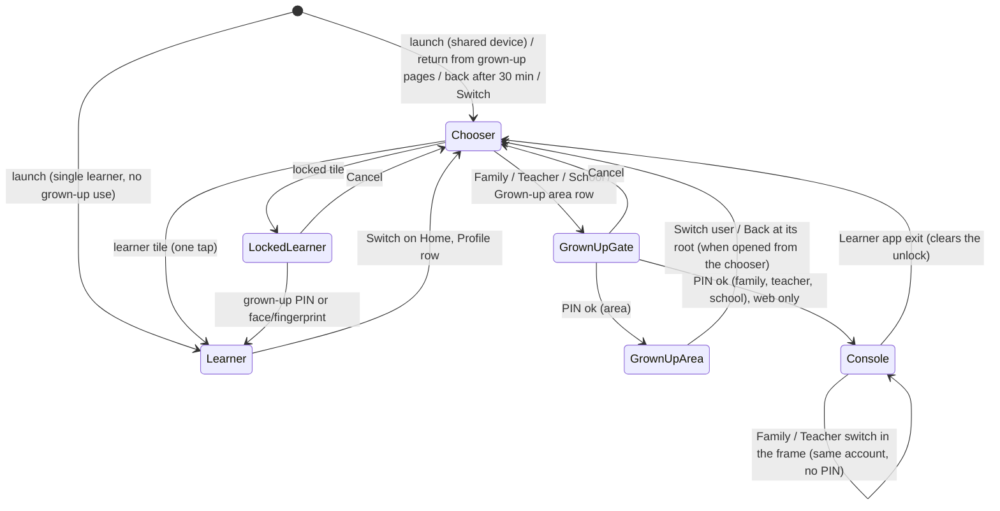

Status: ready (spec only; rows OA-0b to OA-10 implement it)

Design: row OA-0b (agent design pass approved by multi-agent review, CLAUDE.md section 5, 2026-10-12 owner decision). Wireframes in this PR: `design/wireframes/profiles/who-is-using.md` (the chooser, learner app and console exit), `design/wireframes/profiles/pin-entry-v2.md` (longer pauses, reset by signing in, face or fingerprint), `design/wireframes/profiles/people-on-device.md` (People on this device, lock, remove, Who is joining?). `design/wireframes/profiles/picker.md` is superseded by `who-is-using.md`.

# Amendment: one account, many users ("Who is using this?")

> **Owner request of 2026-10-21 (in chat, translated):** "Consider one account used by several people. A person can be a parent and also a teacher, and their child, or several children, may use the same account as learners. Even with one account, the user must be able to switch between uses (child 1, child 2, parent, teacher, ...). Switching to a parent or teacher use must be protected by a PIN-like permission setting."
>
> Every change below is marked **[OA]** where it lands in a spec, test or code comment.
>
> Basis: `origin/main` `a384759ca` (2026-10-21). Every `file:line` below is at that commit.

**Standing rules that apply here:**
- Audience is anyone of any age. No age wording anywhere new. Learners never sign in (OD-2): a learner is a device profile; adults are Clerk accounts.
- UI strings come from `packages/i18n` (`useMessages()`), with English, Spanish and Korean in the same PR (es and ko coverage ratchets), written to the F-I18N-001 section 3.10 style guide. Design-system tokens only. No emoji.
- Anti-shame: a learner tile never shows stars, progress, streaks or a level badge; nothing compares siblings (F-PROF-001 section 3.3, F-APP-001 section 3.8). A PIN pause is a pause, never "failed".
- No PII in URLs, page titles or telemetry. No event in this amendment carries a `profileId`, a name, a space id, an account id or a PIN fact beyond a code.
- D1 changes additive only. **This amendment needs no D1 migration** (section 13). The Worker change is the telemetry allow-list only, and it deploys first (row OA-1).
- `learnerType`, the PIN hash, profile locks and the biometric opt-in never leave the device.
- One language and one text size per device (AMENDMENTS-DISPLAY-NAV DN-D1). Not reopened here.
- Seats count learner memberships only (AMENDMENTS-SEATS-ADMINS SA-D5). Grown-up uses never take a seat.
- Native builds have no billing links and no sign-in (F-AUTH-004 is unwritten).
- Stripe stays in sandbox. Nothing here touches billing.
- Copy never claims review by a native speaker or an expert. The es and ko values below are drafts for the multi-agent review (MAR) of each row.

---

## 0. Summary

One shared device (a family tablet, a teacher's laptop, a parent's phone) is used by several people under one grown-up account: one or more children who learn, a grown-up who may also learn, and the same grown-up as a parent, a teacher and a school administrator. Today these uses are spread over four screens and a sign-in, the app resumes whoever played last, and every adult use shares one weak 4-digit PIN with a flat 30-second pause.

This amendment adds **one model and one screen**:

1. **"Who is using this?"** is the device's one chooser. It lists the learner profiles as large tiles (one tap, no PIN, as F-PROF-001 requires) and the grown-up uses of the account as smaller rows below (Family, Teacher, School, Grown-up area), each behind the grown-up PIN. It opens at launch on a shared device, when someone comes back from the grown-up pages, after a long break, and from a Switch button on Home.
2. **The grown-up PIN protects every move into a grown-up use**, with longer pauses after repeated misses (worst case about 83 days to guess, was about 17 hours), a reset through the account's sign-in on the web (in addition to the Rescue Code and the 24-hour wait), an optional face or fingerprint shortcut on native builds, and a grown-up session that ends whenever the chooser opens.
3. **A learner profile can be locked** with the grown-up PIN (for a grown-up's own "Me" profile), learners can be **removed from a device**, and several learners on one device can **join a family in one step**.
4. **The console's way back** (the Learner app exit) opens the chooser instead of resuming the last learner, so the console and the learner app share one switching model.

Nothing changes on the server except the telemetry allow-list. Seats, memberships, spaces, the device gate marker, the trusted epoch and the console lock keep their rules.

---

## 1. Goals and how they are measured

| # | Goal | Measure (telemetry codes only, section 15) | Target | Baseline source |
|---|---|---|---|---|
| G1 | The right learner plays. A sibling no longer starts on the wrong profile. | Share of learner sessions with a `profile.switch` (`via` `profile` or `home`) in the first 2 minutes (`minutesIn: '0-2'`). This early switch is the proxy for "started on the wrong profile". | Half of baseline within 4 weeks of the flag flip (OA-10) | `profile.switch` is emitted from OA-2 on, at least 7 days before OA-10 flips the chooser on |
| G2 | Reaching a grown-up use is short. | Taps from a learner screen to a persona home, measured in e2e: chooser, grown-up row, PIN. | 2 taps and 4 digits (was 4 or more taps plus a sign-in step: Profile, Grown-up area, PIN, Account pages, router, Family or Teacher switch) | e2e `who-is-using.spec.ts` |
| G3 | Children never reach grown-up surfaces without the PIN. | The child-safety suite (section 9, CS-1 to CS-14) passes on every row; `parent.gate.opened` with `via: 'open'` occurs only on devices whose marker is `none`. | 100 % pass; zero `open` on `pin` or `nopin` devices | e2e and unit tests; telemetry check after OA-10 |
| G4 | The PIN resists guessing by someone holding the device. | Worst-case time to try all 10,000 PINs on the PIN screen under the pause schedule (section 8.3). | At least 30 days (computed: about 83 days) | Unit test over `pin-hash.ts` |
| G5 | Families with several children set up in one sitting. | `space.join.batch` with `joined` of 2 or more, as a share of family joins from devices with 2 or more learner profiles. | At least 50 % of such joins use the batch | OA-7b on |
| G6 | The chooser is not a wall. | `who.picked` count over `who.shown` count (aggregate ratio, no per-session linking). | At least 0.95 | OA-4a on |
| G7 | Switching is fast. | Tile tap to learner Home rendered, measured in e2e on the release build. | At most 300 ms on the CI runner (F-PROF-001 section 3.1) | e2e timing assertion |

**Kill criteria** (any one rolls the chooser back with its kill switch, section 16): G6 below 0.85 for 7 days; a CS test failure in production builds; a support report of a child reaching a grown-up surface without the PIN.

---

## 2. Why: learning-science and safety grounding

- **A learner's history must be theirs alone.** Spaced review (F-VOC-005) schedules each word from that learner's own answers, and the placement check (F-PLC-001) and the Learning Route pick difficulty from that learner's record. A sibling playing on the wrong profile writes their answers into another person's history: intervals stretch for words the owner never saw, and the next lesson is pitched wrong. The distributed-practice literature (for example Cepeda and colleagues' 2006 review of spacing studies) ties retention to the spacing of each person's own retrievals; mixed histories break that link. G1 targets this directly.
- **Ownership and competence drive persistence.** In self-determination theory (Deci and Ryan), autonomy and felt competence sustain practice. Picking "my" tile and seeing "my" meter fill is both. Tiles therefore show no progress (no comparison between siblings; social comparison lowers motivation for the learner who is behind) and the switch stays one tap.
- **Re-entry must be cheap.** A habit depends on a short path from cue to practice. The chooser adds at most one tap for a learner on a shared device and none on a single-learner device without grown-up uses (section 6.2).
- **Grown-up involvement helps when it is easy.** Parents and teachers who can check progress quickly support practice better; today the trip is long enough that most never make it from the learner app. G2 shortens it.
- **Safety by default, least privilege.** Every grown-up use needs the PIN each time it is entered from the chooser; arriving at the chooser ends any grown-up session; a learner lock never opens a grown-up session; the console keeps its own lock (F-APP-001 section 3.9) as the last line.

**Threat model** (unchanged in kind, sharper in scope):

| In scope | Out of scope |
|---|---|
| A child or sibling holding the device, guessing PINs, tapping anything, force-quitting the app | Browser developer tools, a rooted or jailbroken device, reading IndexedDB or AsyncStorage directly (F-PROF-001 section 9.2 accepts this) |
| A student on a classroom device | A grown-up who knows the account's password and shares it |
| A child who knows the device's screen-lock passcode (why native biometrics never fall back to it, section 8.6) | Several grown-up accounts on one device (section 21) |
| A child who creates their own grown-up account (why the reset by sign-in is bound, section 8.5) | |

---

## 3. Where things stand (basis `a384759ca`)

### 3.1 Identity layers

| Layer | Who | Where | Code |
|---|---|---|---|
| Clerk account | grown-ups only (OD-2) | Clerk; D1 `accounts` | `packages/backend/src/lib/auth.ts`; `apps/web/src/components/console/auth-context.tsx` |
| Adult persona | derived from memberships: `parent` (family owner or caregiver), `teacher` (class owner or teacher; school owner, admin or teacher) | pure | `packages/content-schema/src/schemas/app-shell.ts:134` (`personasFor`), `:152` (`homeFor`) |
| Learner (server) | one `learners` row per device profile; the device is the principal (`Device <deviceId>:<secret>`) | D1 `learner_devices` (0002, 0003) | `apps/mobile/src/store/sync-store.ts` |
| Local profile | any number per device | `hr:profiles`, `hr:profiles:active` | `apps/mobile/src/store/profile-store.ts`; `logic/profiles/profile-model.ts` |

### 3.2 Gaps against the request

1. **No single chooser.** Learner switching is a tile row on Profile (`screens/profile/ProfileScreen.tsx:155`, `setActive` with no PIN). A grown-up use is four or more steps away. Child 1, child 2, parent and teacher never appear on one screen.
2. **No picker at launch.** `RootNavigator` resumes the active profile (`navigation/root.tsx:99`, `initialRouteName={hasProfile ? 'Main' : 'Onboarding'}`), although F-PROF-001 section 3.1 and `docs/blueprints/10-app-map.md:152` mark `profiles/picker` shipped. `canSwitchProfileFrom`, `planProfileSwitch` and `canEnterPicker` (`logic/profiles/session.ts:43-67`) are never called; `profile.switch` and `parent.gate.opened` are registered (`telemetry.ts:20-21`) but never emitted.
3. **Grown-up roles as device profiles are dead code.** `ProfileRole` has `parent | teacher | admin`, nothing creates them; `nextOnboardingStep`, `parentProfile` (`profile-model.ts:168,182`) and `profile-store.setParentPin` (`:137`) have no caller.
4. **One flat PIN.** 4 digits, 5 misses in 60 s give a 30 s pause, forever (`logic/profiles/pin-hash.ts:10-14`): about 17 hours to try every PIN. No reset through the account.
5. **A grown-up's own learner profile is open to anyone** on the device.
6. **Several children join one by one.** `JoinSpaceScreen` always joins the active profile (`screens/sync/JoinSpaceScreen.tsx:53,182`).
7. **The legacy device subscription makes every profile premium** (`store/tier-store.ts:81`), past the family cap of 4 (SA-D1).
8. **Leaving the grown-up pages resumes the last learner** instead of asking who is next.
9. **No way to remove a profile** in the app (`profile-store.remove`, `:121`, has no screen; `notifyProfileRemoved` already cleans per-profile stores, `store/profile-removal.ts:17`).
10. **Docs are stale:** F-PROF-001 (README says draft, file says ready; section 3.1 picker; section 3.5 key `parent.<profileId>.pin_hash`, the code uses `account:parentPinHash`), F-PAR-001 section 3.5 ("linked by this parent"; the code and the standing rule show all learners), the app map.

### 3.3 What already works and stays

- A parent who is also a teacher: one Clerk account holds a family and a class or school; the console shows both personas with the frame's switch; a child can be in the family and in the class at once (`LEARNER_CLASS_CAP = 3`, `space.ts:204`).
- The device gate marker, the trusted epoch, secret-proving sign-in and the console lock (F-APP-001 section 3.9).
- Per-profile data under `p/<profileId>/<key>`; one device record for language and text size.

---

## 4. Decisions

| # | Decision | Replaces | Why |
|---|---|---|---|
| OA-D1 | **One chooser, "Who is using this?"**, owned by the learner app, lists every learner profile on the device and every grown-up use of the account known on the device. It is the only place that changes *who* is using the device. The console's persona switch (Family and Teacher in the adult frame) stays for moving between grown-up uses of the same signed-in person. | F-PROF-001 section 3.1 picker (never built); the Profile tile row stays as a second way to switch learners | Owner request; one consistent model |
| OA-D2 | **Grown-up uses come from the account, never from device profiles.** A grown-up use is `family`, `teacher`, `school` or `area` (the device's local Grown-up area). The first three are derived from the signed-in account's memberships (`usesFor`, section 5.2) and cached on the device without names (section 7.1). No `parent`, `teacher` or `admin` device profile is ever created; the dead code goes (OA-10). | F-PROF-001 section 3.2 "parent creates parent profile first" | F-APP-001 section 3.5: adult personas come from memberships. A second, device-side source of adult roles would drift from the account. |
| OA-D3 | **One grown-up PIN per device protects every grown-up use** (default, owner may change, OQ-3). Family, Teacher, School and the Grown-up area all ask the same PIN. | — | Inside the console the same person moves between Family and Teacher without a PIN (same account); separate PINs per use would promise a separation that does not exist. |
| OA-D4 | **A learner switch stays one tap with no PIN**, except into a profile a grown-up has **locked** (OA-D9). | — | F-PROF-001 non-negotiable |
| OA-D5 | **Arriving at the chooser ends the grown-up session** (`ui-store.parentGateOpenedAt` and `lastPinVerifiedAt` cleared) and clears the console unlock of the tab (`clearGrownUpTab`, as every learner boot already does). | — (today the 15-minute session survives a learner switch) | A parent hands the device back through the chooser; the child must not inherit the open session. |
| OA-D6 | **When the chooser opens** (default, owner may change, OQ-1, OQ-2): at launch and on return from the background after **30 minutes** when the device is *shared* (2 or more learner profiles, or any locked profile, or any known grown-up use); always on return from the grown-up pages; on demand from Home (Switch), Profile and the Grown-up area. A single-learner device with no known grown-up use never sees it unasked. | `root.tsx:99` resume | G1 without adding a tap for one-person devices |
| OA-D7 | **Longer pauses after repeated misses**: each round of 5 misses within 60 s starts a pause of 30 s, 1 min, 5 min, 15 min, then 60 min for every further round, until a correct PIN (section 8.3). Default, owner may change (OQ-8). The PIN stays 4 digits (OQ-9). | flat 30 s (`pin-hash.ts:13`) | G4: about 83 days worst case, without a hard lock a child could use to shut a grown-up out (every reset path stays open) |
| OA-D8 | **Reset by signing in** (web): "Forgot PIN?" gains **Sign in to the account**, next to the Rescue Code and the 24-hour wait. It is accepted only for a secret-proving sign-in, fresh within 2 minutes, by the account recorded as this browser's **PIN owner**: the signed-in account that last proved the current PIN in this browser (section 7.2). Default, owner may change (OQ-18). | F-PROF-001 section 3.5 "Phase 2: Clerk email recovery" | Owner task. Bound to an account that knew the PIN, so a child's own new account cannot reset it. |
| OA-D9 | **Locked learner profiles.** A grown-up can lock any learner profile with the grown-up PIN (Edit profile and People on this device). A locked tile shows a lock glyph and asks the PIN; the unlock opens that profile only, never a grown-up session. Locks are local (never synced) and kept in their own key, so older app versions cannot drop them (section 13.2). A lock needs a device PIN; a lock without a PIN is void. Locks use the grown-up PIN (default, owner may change, OQ-4). | — | Gap 5; a grown-up's own spaced review must not be filled in by a child |
| OA-D10 | **Face or fingerprint** (native only, platform permitting, `expo-local-authentication`): a grown-up may turn it on per device, after the PIN, with a warning that anyone whose face or fingerprint is saved on the device can use it. Strong biometrics only, **never the device passcode as fallback**. It stands in for the PIN on the PIN screen; it never sets, changes or resets the PIN, and any PIN change turns it off. Off by default on every device (OQ-6). On the web, the platform's way is a **passkey** through Clerk, which already counts as a secret-proving sign-in; the console lock gains a **Use a passkey** button where the browser offers one (OQ-7). | F-PROF-001 section 4 "Biometric unlock: Phase 2" | Owner task "biometric only if the platform allows it". A web page has no local biometric check that a server does not verify; a passkey is that check. |
| OA-D11 | **School is its own grown-up row** when the account owns or administers a school (it opens the teacher home at the school section). Teacher shows when the account owns or teaches a class or teaches at a school. Default, owner may change (OQ-10). | — | Owner request names school admin as a use |
| OA-D12 | **The console's Learner app exit opens the chooser** (`?who=1` on `learnerHome()`), and so does Open the app on this device without a join code. The label stays **Learner app** (DN-6). Default, owner may change (OQ-5). | F-APP-001 section 3.10 row "family or teacher → learner" | Gap 8 |
| OA-D13 | **Remove from this device** (Grown-up area, People on this device, behind the gate, ConfirmSheet): deletes the local profile and its per-profile keys. It never touches the server: the learner's memberships, seats and saved progress stay, and a Rescue Code brings the learner back. An unsaved profile offers **Save progress first**. Default, owner may change (OQ-14). | — | Gap 9; never lose earned items without a clear choice |
| OA-D14 | **Who is joining?** A **family** code entered on a device with 2 or more learner profiles lists them with check boxes (the active learner checked). Joining only the active learner needs no PIN, as today; joining any other learner needs the gate. One consent step names every picked learner; the Worker receives one `/join` per learner, each taking its seat atomically (SA-D8); a refused seat reads kindly per learner. **Class** codes keep the one-learner flow (each learner picks their roster name and may relink). Default, owner may change (OQ-15). | `JoinSpaceScreen.tsx:53,182` (active only) | Gap 6, G5 |
| OA-D15 | **The legacy device subscription is capped like a family**: it covers every learner profile that exists on the device when OA-8 first runs (grandfathered, recorded once), and new profiles only while fewer than 4 are covered. Nobody loses premium. Default, owner may change (OQ-13). | `tier-store.ts:81` (every profile) | Gap 7; SA-D1 and SA-D7 |
| OA-D16 | **A grown-up session also ends after 5 minutes in the background.** Today it lasts 15 minutes from the PIN however the device is put down. Default, owner may change (OQ-12). | `PARENT_SESSION_MS` only | A tablet put down and picked up by a child |
| OA-D17 | **Tile order**: creation order up to 12 learner profiles (stable places for pre-readers); above 12 (classroom devices), by name in the UI language's collation. Default, owner may change (OQ-11). | — | Spatial memory at home; findability in a class |
| OA-D18 | **No server change** beyond the telemetry allow-list. No D1 migration, no new route. | — | Smallest safe change; Worker-first still holds for the names |

---

## 5. The model

### 5.1 Uses of one device



Every arrow into `Chooser` closes the grown-up session (OA-D5). Every arrow out of `Chooser` into a grown-up state goes through the gate, whatever the session says.

### 5.2 `usesFor` (pure, `packages/content-schema/src/schemas/app-shell.ts`, next to `personasFor`)

```ts
export const GrownUpUseSchema = z.enum(['family', 'teacher', 'school']);
export type GrownUpUse = z.infer<typeof GrownUpUseSchema>;

/** [OA] Grown-up uses of an account, in this fixed order: family, teacher, school. */
export function usesFor(memberships: readonly { kind: SpaceKind; role: SpaceRole }[]): GrownUpUse[];
```

| Use | When the account holds |
|---|---|
| `family` | a `family` as `owner` or `caregiver` |
| `teacher` | a `class` as `owner` or `teacher`, or a `school` as `teacher` |
| `school` | a `school` as `owner` or `admin` |

Archived spaces count (their pages stay reachable, as for personas). `student` rows are ignored. `personasFor` is unchanged; `usesFor(x)` contains `family` exactly when `personasFor(x)` contains `parent`, and contains `teacher` or `school` exactly when `personasFor(x)` contains `teacher` (a unit property test checks this).

### 5.3 Role-switching table (replaces F-APP-001 section 3.10)

| From | To | How | Gate |
|---|---|---|---|
| anyone | the chooser | launch or resume (OA-D6), Home **Switch**, Profile **Who is using this?**, Grown-up area **Switch user**, console **Learner app** | none to open it; it closes the grown-up session |
| chooser | learner | tile | none |
| chooser | locked learner | tile with the lock glyph | grown-up PIN (or face or fingerprint); never opens a grown-up session |
| chooser | Grown-up area (this device) | **Grown-up area** row | PIN as today (`PinEntry { next: 'ParentDashboard' }`, setup allowed when no PIN exists, F-PROF-001 section 10) |
| chooser | Family, Teacher, School (web) | the use's row | fresh PIN (`PinEntry { next: 'GrownUpUse', use }`, verify only, never creates or resets a PIN), then `openGrownUpArea({ via: 'chooser', target })`; Clerk sign-in when signed out |
| chooser | sign in as a grown-up (web, no use known) | **Sign in as a grown-up** row | as above, `target` `/signin` |
| learner | learner | Profile tiles (kept) | none; locked profiles ask the PIN there too |
| learner | Grown-up area | Profile → **Grown-up area** (kept) | PIN as today |
| family | teacher, school (or back) | the frame's persona switch | none (same account) |
| family, teacher | learner | **Learner app** exit | lands on the chooser; clears the unlock and the console session |
| any grown-up page | the same page after 15 idle minutes | console lock | PIN (trusted epoch) or a secret-proving sign-in, or a passkey (OA-D10) |

`target` per use: `family` → `/parent`, `teacher` → `/teach`, `school` → `/teach?focus=school`. Each passes `safeNextPath`. The teacher home reads `focus=school` and moves focus to its first school card (no scroll jump without focus; the query is removed with `history.replaceState`).

---

## 6. "Who is using this?" in the learner app

### 6.1 Screen

Route `WhoIsUsing` (root stack, above `Main`, `gestureEnabled: false`, no Back; wireframe `profiles/who-is-using.md`). Content from top:

1. `ScreenHeader` with only the Display (Aa) control (the device language stays reachable).
2. Title **Who is using this?**
3. **Learning**: one tile per learner profile, `ProfileAvatar` (idle pose) and the display name, at least `touchTarget.hero` square, two columns on a phone, more on wider layouts (F-LAYOUT-001 breakpoints). A locked profile carries a lock glyph and a caption line. No stars, cards, level, streak, space name or "last played" on any tile (CS-6). Then **Add a learner** (dashed tile, gated as today).
4. **Grown-ups**: a list of rows, visually secondary (body size, `surface.paper`, lock glyph at the start), in this order: the known uses (`family`, `teacher`, `school`, section 7.1), then **Grown-up area**. On the web with no known use, a **Sign in as a grown-up** row replaces the use rows. Native shows only **Grown-up area**. A self-only device without a PIN (marker `none`) shows the rows without the lock glyph (they open directly, F-LEARN-001 L7).
5. Offline (web): the Family, Teacher, School and Sign in rows are disabled with **Needs the internet** (the existing `needsInternet` line); Grown-up area stays enabled.

### 6.2 When it opens

| Trigger | Condition | Code |
|---|---|---|
| launch | device is shared (`isSharedDevice`: 2 or more learner profiles, or any locked profile, or any known grown-up use) | `launch` |
| launch with the `who=1` boot intent | at least 1 profile | `return` |
| resume | shared, and the app was in the background for at least `CHOOSER_RESUME_MS` (30 min; web `visibilitychange`, native `AppState`) | `resume` |
| Home **Switch** (avatar corner button, F-PROF-001 section 3.4, wireframe `profiles/switch-button.md`), Profile **Who is using this?** row, Grown-up area **Switch user** | always shown on Home and Profile when the device has 2 or more learner profiles or any grown-up use; Grown-up area always | `manual` |

- The `who=1` intent is parsed by `logic/shell/boot-intent.ts` and removed with `history.replaceState`, like `gate=grown-up`. It is ignored when the chooser flag is off (section 16), so the console can add it before the learner app ships the chooser.
- **Mid-activity**: Switch is not offered inside a quest, minigame, story reader or placement (`canSwitchProfileFrom`, now called). A resume trigger inside one opens the chooser **over** the screen: picking the same learner closes it and the screen continues where it was; picking another runs `planProfileSwitch` (persist first), then switches. The leaving screen's state is never discarded without that persist.
- Empty device (no profile): the chooser never renders; Welcome and onboarding as today.

### 6.3 Behaviour

- Tile tap: `setActive(id)`, close the chooser, render Home within 300 ms (G7; the active-candidate snapshots are pre-warmed while the chooser shows). Emit `profile.switch` and `who.picked`.
- Locked tile: `PinEntry { next: 'LockedProfile', profileId }` in verify mode (no Forgot PIN shortcut to setup; Forgot PIN still offered, it leads to the reset paths). Success: `setActive`, Home. Cancel: back to the chooser.
- Grown-up row: section 5.3. Cancel on the PIN screen returns to the chooser, never to a learner.
- Arrival at the chooser: close the grown-up session (OA-D5), clear `hr:grownup:unlock` and `hr:console:session` in this tab (web), write nothing else.
- Store read failure (`hr:profiles` unreadable): the existing calm error with **Try again**; never wipes data.

### 6.4 Pure modules (100 % covered)

- `logic/profiles/who.ts`: `isSharedDevice`, `chooserTrigger({ event, shared, profiles, backgroundMs, flag })`, `tileOrder(profiles, locale)` (OA-D17), `grownUpRows({ os, uses, online, marker })`.
- `logic/profiles/session.ts`: `closeOnChooser(state)`; `canSwitchProfileFrom` and `planProfileSwitch` get callers.

---

## 7. The console side

### 7.1 Known uses on the device (`hr-shell` / `kv`, key `deviceUses`)

- The adult frame writes `{ v: 1, uses: GrownUpUse[], at }` (`DeviceUsesSchema`, content-schema) whenever a persona home renders, from the `GET /api/spaces` items it already holds (`usesFor`). It holds **no name, email, account id or space id**.
- **Sign out** deletes it. A sign-in as another account overwrites it at that account's first persona home.
- The learner app (web only) reads it read-only through `platform/device-uses.web.ts` (the `hr-shell` database, `SHELL_DB` and `SHELL_KEYS` from content-schema). A record older than 30 days, unreadable or not parsing reads as "no uses" (the chooser then shows Sign in as a grown-up). It is outside the learner `hr:` namespace, so learner backups never carry it.
- The learner app never writes it. The console never reads learner profiles (unchanged).

### 7.2 PIN owner (`hr-shell` / `kv`, key `pinOwner`)

- `{ v: 1, owner: <16 hex>, epoch }`: `owner` is the first 16 hex digits of SHA-256 of the Clerk user id; `epoch` is the marker's `pinEpoch` it was recorded for. Local only, never sent.
- It names the account that **proved the current PIN** in this browser. It is written (or overwritten) in exactly two moments, both with a real marker epoch (`pin`, not `0`):
  1. the console lock opens a grown-up page through the PIN path (a `pin` unlock whose epoch equals the marker's and the trusted epoch) for a signed-in account; or
  2. a secret-proving sign-in completes (`grantSignInUnlock`, `lib/console/signin-flow.ts`) in a tab that still holds a `pin` unlock, written by the learner app's hand-off after a fresh PIN, whose epoch equals the marker's (the usual path: PIN in the app, then Sign in). `grantSignInUnlock` reads the earlier unlock before it writes the `signin` one.
- A sign-in alone, without the PIN, never writes it; nor does any sign-in on the reset leg (`next` = `/account/pin-reset`), which also writes no trusted epoch.
- A new PIN (new epoch) makes the record stale; the next moment above writes a new one.

### 7.3 Learner app exit and Open the app on this device

- `clearGrownUpTab()` then `learnerHome(origin, locale)` with `who=1` (OA-D12). Open the app on this device **with** a join code keeps today's hand-off (`hr:shell:joinCode`) and lands on Join, where Who is joining? applies (section 10.3).

### 7.4 Lock screen: Use a passkey (OA-D10)

- Shown on `GrownUpLock` when `PublicKeyCredential.isUserVerifyingPlatformAuthenticatorAvailable()` resolves true. It runs Clerk reverification with the passkey first factor (`useReverification`, as F-BILL-002 section 4.4); success writes the `signin` unlock (a passkey is secret-proving, F-APP-001 section 3.9). Hidden when the API is missing or resolves false. Clerk decides whether the account has a passkey; a refusal returns to the lock with its existing line.

### 7.5 Reset page `/account/pin-reset` (section 8.5)

A grown-up page under the existing `/account` prefix, behind the lock (the forgotten PIN leaves **Sign in again**, which is the point). No API call.

---

## 8. The grown-up PIN

### 8.1 What stays

- 4 digits, salted SHA-256 (`expo-crypto`), device-level `account:parentPinHash`, dots only, the attempt state persisted (`account:pinAttempts`) so a force-quit keeps a pause.
- The marker, the epoch (`account:pinSetAt`), the fingerprint (`account:pinHashSeen`), the trusted epoch and every rule of F-APP-001 section 3.9.
- `GrownUpArea` and the new `GrownUpUse` and `LockedProfile` destinations never create or reset a PIN.

### 8.2 Set-up

- As today: a child profile's creation asks for a PIN when the device has none (F-LEARN-001); the first entry into the Grown-up area on a device without a PIN runs setup; **Change PIN** in the Grown-up area. Locks and the face or fingerprint switch are disabled with **Set a grown-up PIN first.** while no PIN exists.
- Every new PIN (set, change, reset) moves the epoch (existing), turns the face or fingerprint shortcut off (OA-D10) and keeps locks.

### 8.3 Pauses (OA-D7)

`AttemptState` gains `strikes: number` (0 when absent). On the 5th miss within `ATTEMPT_WINDOW_MS` (60 s) a pause starts of `PIN_PAUSE_STEPS_MS[min(strikes, 4)]` = `[30 s, 60 s, 5 min, 15 min, 60 min]`, and `strikes` grows by one. A correct PIN (or face or fingerprint, or a completed reset) sets `strikes` to 0. The pause survives a restart (persisted with `lockedUntil`).

- Worst case to try all 10,000 PINs: 2,000 rounds of 5; the first four rounds cost 30 s + 1 min + 5 min + 15 min, every later round 60 min: about 1,996 hours, **about 83 days** (G4; a unit test computes it from the constants).
- Copy: seconds under a minute (existing `cooldown(seconds)`), minutes above (`cooldownMinutes(minutes)`), and from the 3rd round a second line pointing at Forgot PIN?. The countdown is announced politely, once per minute.
- **No hard lock.** Every reset path stays open during a pause (the Rescue Code shares the attempt counter, as today; the sign-in reset does not, Clerk throttles it).
- An older bundle in another tab writes the attempt state without `strikes`, which resets the step to the first. Bounded (it still pauses) and ends when that tab updates.

### 8.4 Lapse

- The learner app's grown-up session: 15 minutes from the PIN (`PARENT_SESSION_MS`, unchanged), **and** closed by arriving at the chooser (OA-D5) and by 5 minutes in the background (`GROWN_UP_BACKGROUND_MS`, OA-D16). `use-gate-lapse.ts` already re-renders at a lapse; it now also checks the background time on focus.
- The console: 15 idle minutes, 2-minute freshness for the hand-off (unchanged).

### 8.5 Reset (OA-D8)

| Path | Where | Needs |
|---|---|---|
| Rescue Code | all builds (existing) | the code stored on the device |
| 24-hour wait | all builds (existing) | 24 hours; the old PIN keeps working |
| **Sign in to the account** | web, online, flag on | a secret-proving sign-in by the PIN owner (section 7.2), fresh within 2 minutes |

Sign-in reset flow:

1. PinReset (learner app) shows **Sign in to the account** as the first option when `os === 'web'`, online, and the flag is on. Tap: `location.assign('/signin?next=/account/pin-reset')` (no unlock written).
2. The console signs in (or the lock asks **Sign in again**). A sign-in on this leg writes the `signin` unlock but no trusted epoch and no `pinOwner` (section 7.2).
3. `/account/pin-reset` checks, in order: a `signin` unlock with `at` within `GROWN_UP_FRESH_PIN_MS` (2 minutes), else runs Clerk reverification; the marker is readable and `pin`; `pinOwner.epoch === marker.pinEpoch` and `pinOwner.owner` equals the signed-in account's fingerprint (no record for this epoch shows `pinReset.firstSignIn`; another account shows `pinReset.notOwner`). Any check failing shows the matching line (section 17.5) and **Back to learning**; nothing is written.
4. Success: write `sessionStorage` `hr:shell:pinReset` = `{ v: 1, at: now, epoch: marker.pinEpoch }` (`PinResetTicketSchema`), clear the console session, `location.assign('/?gate=pin-reset')`.
5. The learner app's boot intent `gate=pin-reset` reads the ticket once and deletes it. It is accepted when `now - at` is in `[0, 120 s)` and `epoch` equals the current marker epoch. Accepted: `PinEntry` in `setup-1` with the title **Choose a new grown-up PIN**; a completed setup emits `pin.reset_completed { method: 'sign_in' }` and sets `strikes` to 0. Refused or absent: the line **That took a while. Sign in again to set a new PIN.** over the normal start.
6. The new PIN moves the epoch, so the next grown-up page asks one sign-in again (the existing "The grown-up PIN changed on this device" line). This is deliberate: no new trust rule in the lock.

Why it is no weaker than today: the 24-hour wait already lets anyone holding the device set a new PIN after a day; the sign-in path is faster only for an account that has already entered this very PIN in this browser, and it needs that account's sign-in again.

### 8.6 Face or fingerprint (native, OA-D10)

- `platform/biometric.native.ts` over `expo-local-authentication` (an added Expo module; a stub on the web that reports unavailable). Offered only when `hasHardwareAsync()` and `isEnrolledAsync()` are true and the platform reports a strong biometric class (`supportedAuthenticationTypesAsync` and, on Android, the strong security level).
- Turned on in the Grown-up area after a PIN entry in this session; stored as `account:biometricShortcut` = `{ v: 1, enabledAt, epoch }`. Valid only while `epoch` equals the current PIN epoch (any PIN change turns it off).
- On every PIN screen in verify mode, **Use face or fingerprint** appears above the pad and the prompt runs with `disableDeviceFallback: true`; a cancel or a failure leaves the pad, and counts as **no** PIN miss. A success counts as a correct PIN for every destination (it never opens setup or reset).
- Residual risk recorded: the module does not tell when the set of enrolled faces or fingerprints changes, so a child enrolled later can use the shortcut. The warning says so; a grown-up can turn it off.

---

## 9. Child safety (tests in section 20 name these)

| # | Invariant |
|---|---|
| CS-1 | No path from a learner profile or the chooser reaches the Grown-up area, a persona home, billing, All lessons, another learner's report or the console without a correct PIN, face or fingerprint (native), a secret-proving sign-in, or a self-only device without a PIN (marker `none`). |
| CS-2 | Arriving at the chooser closes the grown-up session and clears the tab's unlock; a grown-up row opened right after still asks the PIN. |
| CS-3 | A locked profile opens only with the grown-up PIN (or face or fingerprint); the unlock never opens a grown-up session and never counts as a fresh PIN for `openGrownUpArea`. |
| CS-4 | `GrownUpUse` and `LockedProfile` never create or reset a PIN; with no PIN stored, `GrownUpUse` shows the existing no-PIN line and Continue to `/signin`; a lock without a PIN is void (the profile opens like any other, and the lock control asks for a PIN first). |
| CS-5 | The chooser has no Back, swallows the hardware back on Android, and cannot be skipped by a deep link or a boot intent other than `gate=grown-up`, `gate=browse` and `gate=pin-reset` (each of which ends on a PIN screen, and Cancel there returns to the chooser). |
| CS-6 | No tile shows progress, stars, cards, level, streak, a space name or a time; no copy compares learners. A snapshot test rejects any of these keys in the chooser tree. |
| CS-7 | Grown-up rows show only the generic labels (Family, Teacher, School, Grown-up area, Sign in as a grown-up), never an account name or email. |
| CS-8 | Pauses grow as in section 8.3 and survive a restart; a face or fingerprint cancel never counts as a miss and never shortens a pause. |
| CS-9 | The sign-in reset is accepted only through the full check of section 8.5; a ticket older than 2 minutes, for another epoch, or read twice is refused. |
| CS-10 | A child's own new account cannot reset the PIN by signing in: `pinOwner` is written only for an account that proved the current PIN (section 7.2), and a sign-in alone never writes it; covered by unit tests of the writer and of the page decision. |
| CS-11 | Who is joining?: a learner other than the active one joins only after the gate. |
| CS-12 | Remove from this device is behind the gate and a ConfirmSheet; it never calls the server. |
| CS-13 | Native biometrics never fall back to the device passcode. |
| CS-14 | The 5-minute background rule closes the session on both web and native. |

---

## 10. Several learners, several spaces

### 10.1 Learners in different spaces

- Unchanged and confirmed: a learner is one server learner with its own memberships. A child can be in the parent's family and in another teacher's class (up to 3 classes, `LEARNER_CLASS_CAP`). When the parent is also that class's teacher, the console shows the child on the Family home and on the class roster; each space counts its own seat (SA-D5); premium follows whichever space covers the learner.
- The chooser shows no space. A learner sees their own spaces in Settings, Classes & family (existing).
- The Grown-up area lists **every** learner on the device (standing rule: parents and teachers see all learner info). F-PAR-001 section 3.5 "linked by this parent profile" is replaced by this line (OA-0).

### 10.2 Seats

- Unchanged: a seat is a learner membership row (SA-D5). Grown-up uses never take one. A device learner that never joined a family takes none and stays on the free tier (all of Stage 1).
- No new seat line on the device: the learner app cannot know the account's families without a sign-in (section 21). The console's seat lines (SA section 3.7) stay the place for counts.

### 10.3 Who is joining? (OA-D14, row OA-7b)

- Family code, device with 2 or more learner profiles, after the lookup finds the family: a checklist of the learner profiles (avatar and name, active one checked), then the existing name confirmation for each picked learner in turn (the first-run fields of `confirmName`), then one consent step naming every picked learner, then the joins in sequence (`membership-store.join` per learner). A pick that includes anyone other than the active learner opens the gate first (CS-11).
- Results: one line per learner: joined, already a member, or the cap line (`caregiver.join.errors.familyFull(cap)`, SA). A refused learner is never shown as an error. Emit `space.join.batch`.
- The console's **Add a learner** keeps its code; **Open the app on this device** with the code lands here.

### 10.4 Remove from this device (OA-D13, row OA-7a)

- People on this device → a learner → **Remove from this device** → ConfirmSheet: the name, then one of two lines: saved (the learner has a sync registration: "Their progress is saved. Their Rescue Code brings it back on any device.") or unsaved ("Their progress is only on this device. Save it first to keep it." with **Save progress first**). Always the line "Their place in a family or class stays. A grown-up can change it in the account pages." when the learner has memberships.
- Remove: `profile-store.remove(id)` (the existing reducer and `notifyProfileRemoved` clean-up), the lock entry, and the per-profile keys under `p/<id>/`. Removing the active learner opens the chooser; removing the last learner opens Welcome.
- The PIN, consent and device settings stay.

### 10.5 The legacy device subscription (OA-D15, row OA-8)

- On first run after OA-8, when `account:subscription` is premium, the app records `account:subscriptionCovers` = `{ v: 1, ids: [every learner profile id now], at }` once. `effectiveTier` then gives premium through the legacy subscription to a learner whose id is in `ids`, or, for a newer profile, while `ids.length` plus the newer profiles already covered is below `FAMILY_LIFETIME_LEARNERS` (4), in creation order. Nobody who had premium loses it. A device with no legacy subscription is unaffected.

---

## 11. Per device and per profile

| Setting or data | Scope | Note |
|---|---|---|
| UI language, text size (`hr:device:settings`) | device | DN-D1, not reopened (section 21) |
| Sound (`device:audio`), layout, device id | device | unchanged |
| Grown-up PIN, attempt state with `strikes`, PIN epoch, fingerprint | device | section 8 |
| Face or fingerprint shortcut (`account:biometricShortcut`) | device | native only |
| Guardian and self consent, parent email | device | unchanged (section 21) |
| Chooser trigger state (last background time) | device, memory only | — |
| Profile locks (`hr:profiles:locks`) | per profile, stored in one device key | local only, never synced |
| Known grown-up uses (`hr-shell` `deviceUses`), PIN owner (`hr-shell` `pinOwner`) | browser | written by the console only |
| Progress, Rescue Code, sync secret, tier cache, memberships, notes, romanization mode, bookmarks | per profile | unchanged |

---

## 12. Offline

- The chooser, learner tiles, locks, the PIN, pauses, the Rescue Code, the 24-hour wait, the face or fingerprint shortcut and Remove from this device all work offline.
- The known uses are read from IndexedDB; the Family, Teacher, School and Sign in rows are disabled offline with **Needs the internet** (grown-up pages are online-only, F-APP-001 section 3.12). The Grown-up area stays available.
- Reset by signing in and Who is joining? need the network; offline they are hidden or disabled with the same line.
- A resume trigger counts background time from local clocks only; a device clock change can open the chooser early, never skip a PIN.

---

## 13. Data model and migration

### 13.1 Storage (all additive; no D1 change)

| Key or schema | Package | Contents |
|---|---|---|
| `GrownUpUseSchema`, `usesFor` | content-schema `app-shell.ts` | section 5.2 |
| `DeviceUsesSchema` `{ v: 1, uses, at }`, `SHELL_KEYS.deviceUses` | content-schema | section 7.1 |
| `PinOwnerSchema` `{ v: 1, owner, epoch }`, `SHELL_KEYS.pinOwner` | content-schema | section 7.2 |
| `PinResetTicketSchema` `{ v: 1, at, epoch }`, `PIN_RESET_TICKET_KEY = 'hr:shell:pinReset'` | content-schema | section 8.5 |
| `ProfileLocksSchema` `{ v: 1, ids: string[] }`, learner key `profiles:locks` (stored as `hr:profiles:locks`) | content-schema | section 6, OA-D9 |
| `AttemptState.strikes` (optional, default 0) | mobile `pin-hash.ts` | section 8.3 |
| `account:biometricShortcut` `{ v: 1, enabledAt, epoch }` | mobile `account-store.ts` | section 8.6 |
| `account:subscriptionCovers` `{ v: 1, ids, at }` | mobile `account-store.ts` | section 10.5 |
| Constants `CHOOSER_RESUME_MS` (30 min), `GROWN_UP_BACKGROUND_MS` (5 min), `PIN_PAUSE_STEPS_MS`, `PIN_RESET_TICKET_MS` (2 min), `DEVICE_USES_TTL_MS` (30 days), `CHOOSER_NAME_ORDER_FROM` (13) | content-schema `app-shell.ts` | — |

`ProfileSchema` is **not** changed. The F-SYNC-001 PATCH already refuses unknown fields; no lock or biometric fact can reach it.

### 13.2 Migration of existing devices

- **No data is rewritten.** Profiles, the active profile, progress, the PIN, its epoch and the attempt state are read as they are. A missing `strikes` reads as 0, a missing locks key as "no locks", a missing `deviceUses` as "no known uses".
- **Locks live in their own key** because `ProfileSchema` is a zod object that strips unknown keys: an older bundle (a cached service worker in another tab) rewriting `hr:profiles` would drop a lock stored inside a profile. Older bundles never touch `hr:profiles:locks`. An older bundle cannot honour a lock; this ends when it updates (the service-worker update path, F-PWA-001), and the console lock is unaffected.
- A locks read that fails is retried once on a fresh connection; if it fails again, every learner tile is treated as locked while a PIN exists (fail closed), with the line **Tap a name, then a grown-up enters the PIN.**, until a read succeeds. With no PIN stored, locks are void anyway.
- Removing a profile removes its id from the locks key in the same write sequence; a stray id is ignored.
- **The first launch with the chooser on** opens it only on shared devices (OA-D6); the active profile is pre-selected visually (focus only, no highlight that compares).

### 13.3 Existing accounts

- Nothing on the server changes. `deviceUses` appears at the account's next persona home render; until then the web chooser shows **Sign in as a grown-up**, which leads to the same persona home as today.
- `pinOwner` appears the next time a grown-up opens the grown-up pages with the PIN (section 7.2). Until then the sign-in reset shows `pinReset.firstSignIn` and the Rescue Code and the 24-hour wait remain.

### 13.4 The current grown-up gate

- Every existing route, destination and line stays. New destinations: `GrownUpUse` (with `use`) and `LockedProfile` (with `profileId`), appended to `GrownUpDestination` (append-only list, `navigation/types.ts:31`). `openGrownUpArea`'s `via` gains `'chooser'`; `shell.grown_up_handoff` keeps its payload shape with the new code.
- The boot intents gain `who=1` and `gate=pin-reset`; `gate=grown-up` is unchanged.
- The console lock decision table is unchanged; the lock screen gains one optional button (Use a passkey).

---

## 14. Accessibility

- Tiles at least `touchTarget.hero`; grown-up rows at least `touchTarget.min`; the Switch button on Home at least 44 x 44 dp (F-PROF-001 section 3.4).
- Reading order: title, learners (in tile order), Add a learner, grown-ups. The tile's accessible name is the learner's name and the action ("Mina. Tap to start learning."); a locked tile adds "locked, a grown-up PIN opens it". The lock is a glyph **and** a caption, never colour alone.
- Web keyboard: the tile grid is one tab stop with arrow-key roving and Home and End; Enter or Space picks. Rows are buttons in order. Focus starts on the title.
- Text sizes Standard to Largest (DN): tiles wrap to one column before a name truncates; a name never truncates below two lines.
- Reduced motion: no pose animation on tiles.
- The PIN pause line is a polite live region updated once a minute; the face or fingerprint button never replaces the pad (the pad stays for anyone who cannot use it).
- The chooser has no time limit.

---

## 15. Telemetry (Worker-first, no PII)

New names go into `TELEMETRY_EVENT_NAMES` (append-only, `packages/content-schema/src/schemas/telemetry.ts`) and the Worker's allow-list in row OA-1, before any client sends them. **Every event below is sent without `profileId`**, so no event links two profiles of one device. Payloads are codes, booleans and bucketed counts only.

| Event | New or existing | Payload | Row |
|---|---|---|---|
| `profile.switch` | existing, now emitted | `{ via: 'chooser' \| 'profile' \| 'home', locked: boolean, minutesIn: '0-2' \| '2-10' \| '10+' }` (minutes since the session start) | OA-2 (Profile tiles), OA-4a (chooser) |
| `parent.gate.opened` | existing, now emitted | `{ dest: 'area' \| 'use' \| 'locked_profile' \| 'action', via: 'pin' \| 'biometric' \| 'session' \| 'open' }` | OA-2 |
| `who.shown` | new | `{ trigger: 'launch' \| 'return' \| 'resume' \| 'manual', learners: '1' \| '2' \| '3-4' \| '5-12' \| '13+', grownUps: 0 \| 1 \| 2 \| 3 \| 4, anyLocked: boolean }` | OA-4a |
| `who.picked` | new | `{ kind: 'learner' \| 'locked_learner' \| 'grown_up' \| 'add', use?: 'family' \| 'teacher' \| 'school' \| 'area' \| 'signin' }` | OA-4a, OA-4b |
| `pin.paused` | new | `{ step: 1 \| 2 \| 3 \| 4 \| 5 }` | OA-2 |
| `pin.reset_requested`, `pin.reset_completed` | existing | `method` gains `'sign_in'` | OA-6 |
| `pin.biometric_changed` | new | `{ on: boolean }` | OA-9 |
| `profile.lock_changed` | new | `{ locked: boolean }` | OA-5 |
| `profile.removed` | new | `{ saved: boolean, wasActive: boolean }` | OA-7a |
| `space.join.batch` | new | `{ picked: number, joined: number, refused: number }` (each 1 to 12, capped) | OA-7b |
| `shell.grown_up_handoff` | existing | `via` gains `'chooser'` | OA-4b |

No console event is added (the console's existing server-side events are enough). The dashboards for G1, G5 and G6 are D1 queries over these names, by day.

---

## 16. Rollout and kill switches

| Switch | Where | Default when its row lands | After OA-10 | Off means |
|---|---|---|---|---|
| `EXPO_PUBLIC_WHO_CHOOSER` | learner app (`parseKillSwitch`) | off | **on** | no chooser triggers, no Switch button, `who=1` ignored; the Profile tile row as today. Locks stay enforced on the Profile tiles (fail safe); the lock control is hidden. |
| `EXPO_PUBLIC_PIN_PAUSE_STEPS` | learner app | on | on | the flat 30 s pause of today |
| `EXPO_PUBLIC_PIN_RESET_SIGNIN` / `NEXT_PUBLIC_PIN_RESET_SIGNIN` | learner app / console | off | **on** | the option is hidden; the page answers the "not available" line |
| `EXPO_PUBLIC_MULTI_JOIN` | learner app | off | **on** | the one-learner join of today |
| `EXPO_PUBLIC_BIOMETRIC_SHORTCUT` | native learner app | on (every device opt-in is off) | on | the switch is hidden and a stored opt-in is ignored |
| `NEXT_PUBLIC_LOCK_PASSKEY` | console | on | on | no Use a passkey button |

- Order: OA-1 (Worker) reaches production first; each client row ships dark where the table says off; OA-10 flips the defaults after the child-safety e2e passes on the merged build. No owner action is needed. Each kill switch is an environment value (Cloudflare Pages for the PWA, the Xcode build for native).
- Rollback: set the switch off and redeploy the bundle; no data needs repair (every new key is ignored when its feature is off).
- Bundle: the chooser and its logic add an estimated 6 to 9 KB gzip to the learner bundle (measured in OA-4a against the bundle budget; the lesson JSON budget is not touched). `expo-local-authentication` is native only and not in the web bundle.

---

## 17. Strings (en, es, ko)

Drafts. es neutral, "tú"; ko 해요체, no particle attached to a variable (colon forms where a name leads). Glossary: grown-up 어른 / adultos; Grown-up area 어른 공간 / Zona de adultos (existing); learner 학습자 / estudiante; Family 가족 / Familia; Teacher 선생님 / Docente; School 학교 / Escuela. Each row's MAR may improve these; the ledger is re-signed in that row.

### 17.1 Chooser (`learner.who.*`, OA-4a, OA-4b)

| Key | en | es | ko |
|---|---|---|---|
| `title` | Who is using this? | ¿Quién lo usa ahora? | 지금 누가 쓰나요? |
| `learning` | Learning | Aprender | 배우기 |
| `grownUps` | Grown-ups | Adultos | 어른 |
| `add` | Add a learner | Agregar estudiante | 학습자 추가 |
| `use.family` | Family | Familia | 가족 |
| `use.teacher` | Teacher | Docente | 선생님 |
| `use.school` | School | Escuela | 학교 |
| `use.signIn` | Sign in as a grown-up | Entrar como adulto | 어른으로 로그인 |
| `lockedCaption` | A grown-up opens this one. | Lo abre un adulto. | 어른이 열어 줘요. |
| `locksUnread` | Tap a name, then a grown-up enters the PIN. | Toca un nombre y un adulto escribe el PIN. | 이름을 누르면 어른이 PIN을 입력해요. |
| `switch` | Switch | Cambiar | 바꾸기 |
| `profileRow` | Who is using this? | ¿Quién lo usa ahora? | 지금 누가 쓰나요? |
| `switchUser` (Grown-up area) | Switch user | Cambiar de persona | 사용자 바꾸기 |

### 17.2 Accessibility (`a11y.who.*`)

| Key | en | es | ko |
|---|---|---|---|
| `tile(name)` | {name}. Tap to start learning. | {name}. Toca para empezar a aprender. | {name}: 눌러서 배우기 시작해요. |
| `lockedTile(name)` | {name}, locked. A grown-up PIN opens it. | {name}, con candado. Se abre con el PIN de adultos. | {name}: 잠겨 있어요. 어른용 PIN으로 열어요. |
| `grownUpRow(label)` | {label}, for grown-ups, needs the PIN | {label}, para adultos, requiere PIN | {label}: 어른용, PIN 필요 |

### 17.3 PIN (`caregiver.pin.*`, OA-2, OA-6, OA-9)

| Key | en | es | ko |
|---|---|---|---|
| `cooldownMinutes(n)` | Let's take a short break. Try again in {n} min. | Tomemos un descanso. Reintenta en {n} min. | 잠깐 쉬어요. {n}분 뒤에 다시 해 보세요. |
| `cooldownHelp` | You can also set a new PIN with Forgot PIN? | También puedes crear un PIN nuevo con Olvidé el PIN. | 'PIN을 잊었나요?'에서 새 PIN을 만들 수도 있어요. |
| `reset.signIn.heading` | Sign in to the account | Entra a la cuenta | 계정으로 로그인하기 |
| `reset.signIn.caption` | Sign in as the grown-up who uses this device. Then choose a new PIN. | Entra como el adulto que usa este dispositivo. Luego elige un PIN nuevo. | 이 기기를 쓰는 어른 계정으로 로그인해요. 그다음 새 PIN을 골라요. |
| `reset.signIn.button` | Sign in | Entrar | 로그인 |
| `reset.signIn.newPinTitle` | Choose a new grown-up PIN | Elige un PIN de adultos nuevo | 새 어른용 PIN 고르기 |
| `reset.signIn.expired` | That took a while. Sign in again to set a new PIN. | Pasó un rato. Entra otra vez para crear un PIN nuevo. | 시간이 조금 지났어요. 새 PIN을 만들려면 다시 로그인해요. |
| `biometric.cta` | Use face or fingerprint | Usar rostro o huella | 얼굴이나 지문 쓰기 |
| `biometric.toggle` | Face or fingerprint for grown-ups | Rostro o huella para adultos | 어른용 얼굴·지문 열기 |
| `biometric.warning` | Anyone whose face or fingerprint is saved on this device can use it. | Cualquier persona con su rostro o huella guardados en este dispositivo podrá usarlo. | 이 기기에 얼굴이나 지문이 저장된 사람은 누구나 쓸 수 있어요. |
| `needsPinFirst` | Set a grown-up PIN first. | Primero crea un PIN de adultos. | 먼저 어른용 PIN을 만들어요. |

### 17.4 People on this device and joining (`caregiver.people.*`, `caregiver.join.who.*`, OA-5, OA-7a, OA-7b)

| Key | en | es | ko |
|---|---|---|---|
| `people.title` | People on this device | Personas en este dispositivo | 이 기기를 쓰는 사람 |
| `people.lock` | Lock with the grown-up PIN | Bloquear con el PIN de adultos | 어른용 PIN으로 잠그기 |
| `people.lockHint` | Good for a grown-up's own profile, so nobody else plays on it. | Útil para el perfil propio de un adulto, para que nadie más juegue en él. | 어른의 자기 프로필에 좋아요. 다른 사람이 대신 하지 않아요. |
| `people.remove` | Remove from this device | Quitar de este dispositivo | 이 기기에서 빼기 |
| `people.removeAsk(name)` | Remove {name} from this device? | ¿Quitar a {name} de este dispositivo? | {name}: 이 기기에서 뺄까요? |
| `people.removeSaved` | Their progress is saved. Their Rescue Code brings it back on any device. | Su progreso está guardado. Su código de rescate lo trae de vuelta en cualquier dispositivo. | 진도는 저장돼 있어요. 복구 코드로 어느 기기에서나 다시 불러올 수 있어요. |
| `people.removeUnsaved` | Their progress is only on this device. Save it first to keep it. | Su progreso solo está en este dispositivo. Guárdalo primero para conservarlo. | 진도가 이 기기에만 있어요. 남기려면 먼저 저장해요. |
| `people.saveFirst` | Save progress first | Guardar el progreso primero | 먼저 진도 저장하기 |
| `people.spacesStay` | Their place in a family or class stays. A grown-up can change it in the account pages. | Su lugar en una familia o clase se mantiene. Un adulto puede cambiarlo en las páginas de la cuenta. | 가족이나 반 자리는 그대로예요. 어른이 계정 페이지에서 바꿀 수 있어요. |
| `join.who.title` | Who is joining? | ¿Quién se une? | 누가 들어가나요? |
| `join.who.hint` | Pick each learner on this device who should join. | Elige a cada estudiante de este dispositivo que se unirá. | 이 기기에서 함께 들어갈 학습자를 모두 골라요. |
| `join.who.result(joined, total)` | {joined} of {total} joined. | Se unieron {joined} de {total}. | {total}명 중 {joined}명이 들어갔어요. |
| `join.who.already(name)` | {name} is already in this family. | {name} ya está en esta familia. | {name}: 이미 이 가족에 있어요. |

The per-learner cap line reuses `caregiver.join.errors.familyFull(cap)` (SA section 9.1), prefixed by the name in the colon form.

### 17.5 Console (`console.lock.*`, `console.pinReset.*`, OA-3, OA-6)

| Key | en | es | ko |
|---|---|---|---|
| `lock.passkey.cta` | Use a passkey | Usar una llave de acceso | 패스키 쓰기 |
| `pinReset.title` | New grown-up PIN | PIN de adultos nuevo | 새 어른용 PIN |
| `pinReset.going` | Opening the app so you can choose a new PIN. | Abriendo la app para que elijas un PIN nuevo. | 새 PIN을 고를 수 있게 앱을 열고 있어요. |
| `pinReset.notOwner` | Only the grown-up account that last used this PIN here can do this. In the app, use the Rescue Code or the 24-hour wait. | Solo la cuenta de adulto que usó este PIN aquí por última vez puede hacerlo. En la app, usa el código de rescate o la espera de 24 horas. | 이 기기에서 이 PIN을 마지막으로 쓴 어른 계정만 할 수 있어요. 앱에서 복구 코드나 24시간 기다리기를 써 주세요. |
| `pinReset.firstSignIn` | This works after a grown-up has opened the grown-up pages here with the PIN. In the app, use the Rescue Code or the 24-hour wait. | Esto funciona cuando un adulto ya abrió aquí las páginas para adultos con el PIN. En la app, usa el código de rescate o la espera de 24 horas. | 어른이 이 기기에서 PIN으로 어른용 페이지를 연 적이 있어야 쓸 수 있어요. 앱에서 복구 코드나 24시간 기다리기를 써 주세요. |
| `pinReset.noPin` | This device has no grown-up PIN to reset. | Este dispositivo no tiene un PIN de adultos que restablecer. | 이 기기에는 다시 만들 어른용 PIN이 없어요. |
| `pinReset.unavailable` | This isn't available right now. Use Forgot PIN? in the app. | Esto no está disponible ahora. Usa Olvidé el PIN en la app. | 지금은 쓸 수 없어요. 앱의 'PIN을 잊었나요?'를 써 주세요. |

---

## 18. Risks

| Risk | Likelihood | Impact | Mitigation |
|---|---|---|---|
| The chooser annoys single-person households | medium | G6 drops, churn | OA-D6 shows it only on shared devices; G6 kill criterion; OQ-1 |
| A child learns the PIN by watching | medium | adult surfaces open | out of the PIN's reach; the console's trusted-epoch rule and lock stay; face or fingerprint reduces typing in view |
| A child locks a grown-up out by guessing | medium | grown-up waits up to 60 min | every reset path stays open during a pause; sign-in reset on the web |
| Older cached bundle ignores locks or `strikes` | low | a lock not honoured for a while | locks in their own key; service-worker update path; console unaffected |
| Background timing differs across browsers (WebKit suspends timers) | medium | chooser too early or late | compare wall-clock times at `visibilitychange`, not timers; e2e with a fake clock |
| Biometric enrolment by a child | medium | shortcut usable by the child | off by default, explicit warning, no passcode fallback, off on every PIN change |
| `deviceUses` stale after an account leaves a space | low | a row leads to a "not set up yet" home | the home's existing state; record refreshed on every persona home |
| Multi-join consent wording for several learners | low | legal text drift | the existing consent text with names listed; no new legal claim; MAR in OA-7b |
| Legacy subscription accounting surprises a family | low | a 5th new profile is free tier | grandfathering keeps everyone covered today; calm plan line on the Plan screen (existing) |

---

## 19. Edits to the amended specs

Applied in this PR (OA-0) as notes at the top of each file: F-PROF-001, F-APP-001, F-PAR-001, `docs/specs/README.md`, `docs/blueprints/10-app-map.md` (the picker marked "planned, OA-4a"). In-body edits land with the row named:

| Spec | Section | Change | Row |
|---|---|---|---|
| F-PROF-001 | 3.1 | The picker is "Who is using this?" (this amendment section 6) | OA-10 |
| F-PROF-001 | 3.2 | No parent profile; grown-up uses come from the account (OA-D2) | OA-10 |
| F-PROF-001 | 3.5 | The PIN key is `account:parentPinHash` (device-level); pauses of section 8.3; reset paths of section 8.5 | OA-2, OA-6 |
| F-PROF-001 | 3.6, 4 | Delete lives in People on this device; biometrics per section 8.6 | OA-7a, OA-9 |
| F-PROF-001 | header | Status `ready` in the README index (the file already says ready) | OA-0 |
| F-APP-001 | 3.9 | `pinOwner`; the reset leg writes no trusted epoch; Use a passkey | OA-3, OA-6 |
| F-APP-001 | 3.10 | Replaced by section 5.3 here | OA-10 |
| F-PAR-001 | 3.5 | All learners on the device are listed (standing rule) | OA-7a |
| F-LEARN-001 | 3.5 | Sign in to the account as a third reset path (web) | OA-6 |
| F-SPACE-001 | join | Who is joining? for family codes | OA-7b |
| `10-app-map.md` | screens, flow | `profiles/who-is-using`, `profiles/people-on-device` | OA-10 |

---

## 20. Tests (per row)

| Row | Unit (pure, 100 % on new logic modules) | Component or integration | e2e (Playwright, learner and console exports) |
|---|---|---|---|
| OA-1 | `usesFor` table and the property against `personasFor`; every new schema parses and rejects junk; the telemetry names are in the list and accepted by the Worker route test | Worker `POST /api/telemetry` accepts the new names and refuses an unknown one | — |
| OA-2 | pause steps and the 83-day worst case from the constants; `strikes` reset; legacy state without `strikes`; `profile.switch` and `parent.gate.opened` payload builders | PinEntry shows minutes and the help line; a restart keeps the pause | `pin-pauses.spec.ts`: 10 misses give 30 s then 60 s (fake clock) |
| OA-3 | `deviceUses` writer and Sign out delete; `pinOwner` written only in the two PIN-proving moments, never by a sign-in alone or the reset leg; the passkey button's availability check | AdultFrame writes on a persona home; the Learner app exit adds `who=1`; lock shows Use a passkey when available | console export: the exit URL; no names in the record |
| OA-4a | `isSharedDevice`, `chooserTrigger`, `tileOrder` (12 and 13 profiles, ko and es collation), `closeOnChooser`, `grownUpRows` | the chooser renders no progress keys (CS-6); hardware back swallowed; the same learner returns to the screen under it | `who-is-using.spec.ts`: launch on a shared device, one tap to Home within 300 ms (G7), resume after 30 min, single-learner device not asked, CS-2, CS-5 |
| OA-4b | targets per use pass `safeNextPath`; offline rows disabled | rows from `deviceUses`; Sign in as a grown-up without it; teacher home `focus=school` moves focus | `who-grown-up.spec.ts`: chooser, Teacher, PIN, teacher home (G2: 2 taps); Cancel returns to the chooser; CS-1, CS-7 |
| OA-5 | locks read and write, fail-closed read, void without a PIN | Edit profile lock switch; the locked tile asks the PIN; the unlock opens no grown-up session (CS-3) | `who-locked.spec.ts` |
| OA-6 | the page decision (fresh sign-in, marker, `pinOwner` match), ticket age and epoch, single read | PinReset shows the sign-in option only on web, online, flag on | `pin-reset-signin.spec.ts` on the console export with the dev sign-in: success, expired ticket, other account (CS-9, CS-10) |
| OA-7a | removal plan (saved, unsaved, active, last), lock id removal | People on this device; ConfirmSheet; Save progress first opens Save my progress | `people-remove.spec.ts` (CS-12) |
| OA-7b | batch plan (gate needed when a non-active learner is picked), per-learner result lines | Who is joining? with the mocked Worker: two join, one refused at the cap | `join-batch.spec.ts` (CS-11) |
| OA-8 | `subscriptionCovers` recording once; coverage of old and new profiles; no loss | Plan screen line for a 5th new profile | — |
| OA-9 | opt-in validity by epoch; cancel is not a miss; no fallback flag | the switch and warning in the Grown-up area; PinEntry button | native unit only (no web) (CS-13) |
| OA-10 | — | — | the full child-safety suite CS-1 to CS-14 on the release build with every switch on; G2 and G7 timing; WebKit run locally as DN section 15 records |

Every row also runs the locale matrix and the es and ko coverage ratchets for its strings.

---

## 21. Out of scope and open items

- **Different languages per person on one device**: DN-D1 keeps one device language (owner decision 2026-10-16). Recorded again here; reopen only on the owner's word.
- **Several grown-up accounts on one device** (two parents with separate accounts): `deviceUses` and `pinOwner` follow the last qualifying account. A per-account list is a later amendment.
- **Native sign-in** (F-AUTH-004): native builds keep only the Grown-up area as a grown-up use until it exists.
- **Consent per learner**: guardian consent stays device-level (F-LEARN-001). The self branch's "13 or older" attestation conflicts with the no-age-wording rule in spirit but is a legal attestation; it is listed for the owner (OQ-17) and not changed here.
- **Showing a learner's seat status on the device** (needs the account's spaces on the device; not without a sign-in).
- **Longer PINs** (6 digits): OQ-9.
- **Console-created learners** ("Add a learner" that creates a device profile): the console never writes learner data; unchanged.

---

## 22. PR table (Worker first)

Sizes: S up to about 300 changed lines, M up to about 800, L above. Every row: tests in the same commit as the code (TDD), en, es and ko strings with MAR, tokens only.

| Row | Type and contents | Size | Depends on | Flag |
|---|---|---|---|---|
| OA-0 | `docs(specs,design)`: this amendment; wireframes `profiles/who-is-using.md`, `profiles/pin-entry-v2.md`, `profiles/people-on-device.md`; `profiles/picker.md` marked superseded; [OA] notes in F-PROF-001, F-APP-001, F-PAR-001, README (F-PROF-001 index status `ready`), app map | M | — | — |
| OA-0b | `design(profiles,shell)`: agent design pass approved by MAR: mocks for the chooser (phone, tablet, 13+ classroom grid, offline, locks unreadable), PIN v2 states (minutes, help line, sign-in reset, face or fingerprint), People on this device, Who is joining?, the console lock with Use a passkey and `/account/pin-reset` states | M | OA-0 | — |
| OA-1 | `feat(content-schema,backend)`: `GrownUpUseSchema`, `usesFor`, `DeviceUsesSchema`, `PinOwnerSchema`, `PinResetTicketSchema`, `ProfileLocksSchema`, constants; telemetry names and payload codes (section 15) in the shared list; the Worker allow-list deploys | S | — | — |
| OA-2 | `feat(mobile)`: PIN pause steps (`pin-hash.ts`, `account-store`), PinEntry minutes and help line; emit `profile.switch` from the Profile tiles and `parent.gate.opened` from every gate (G1 baseline starts); background rule (OA-D16) | M | OA-1 | `EXPO_PUBLIC_PIN_PAUSE_STEPS` (on) |
| OA-3 | `feat(web)`: `deviceUses` writer and Sign out delete; `pinOwner` in `grantSignInUnlock`; Learner app exit and Open the app on this device add `who=1`; lock **Use a passkey** | M | OA-1 | `NEXT_PUBLIC_LOCK_PASSKEY` (on) |
| OA-4a | `feat(mobile)`: `WhoIsUsing` screen, `logic/profiles/who.ts`, triggers (launch, `who=1`, resume, Switch on Home, Profile row, Grown-up area Switch user), session close on arrival, tile order, `who.*` events; only the Grown-up area row | L | OA-0b, OA-1, OA-2 | `EXPO_PUBLIC_WHO_CHOOSER` (off) |
| OA-4b | `feat(mobile,web)`: grown-up use rows from `deviceUses` (web), `GrownUpUse` destination, hand-off targets with `via: 'chooser'`, offline rows; teacher home `focus=school` | M | OA-3, OA-4a | same |
| OA-5 | `feat(mobile)`: profile locks (`hr:profiles:locks`), locked tiles on the chooser and Profile, `LockedProfile` destination, the lock switch in Edit profile, fail-closed read | M | OA-4a | same (locks always enforced) |
| OA-6 | `feat(web,mobile)`: reset by signing in: PinReset option, `/account/pin-reset` page and decision, ticket, `gate=pin-reset` boot intent, `method: 'sign_in'` | M | OA-2, OA-3 | `EXPO_PUBLIC_PIN_RESET_SIGNIN`, `NEXT_PUBLIC_PIN_RESET_SIGNIN` (off) |
| OA-7a | `feat(mobile)`: People on this device in the Grown-up area (every learner, lock switch, Remove from this device with Save progress first) | M | OA-5 | `EXPO_PUBLIC_WHO_CHOOSER` |
| OA-7b | `feat(mobile)`: Who is joining? for family codes (checklist, gate for non-active learners, one consent naming each learner, sequential joins, per-learner results, `space.join.batch`) | M | OA-4a | `EXPO_PUBLIC_MULTI_JOIN` (off) |
| OA-8 | `fix(mobile)`: legacy subscription coverage capped at 4 with grandfathering (`account:subscriptionCovers`) | S | OA-1 | — |
| OA-9 | `feat(mobile)`: face or fingerprint shortcut (native, `expo-local-authentication`, strong only, no passcode fallback, opt-in, off on PIN change, `pin.biometric_changed`) | M | OA-2 | `EXPO_PUBLIC_BIOMETRIC_SHORTCUT` (on, opt-in off) |
| OA-10 | `test(e2e)`, `chore(flags)`, `docs(specs)`: the child-safety suite on the release build; flip `WHO_CHOOSER`, `PIN_RESET_SIGNIN` and `MULTI_JOIN` on; in-body spec edits of section 19; dead code (`parentProfile`, `nextOnboardingStep`, `setParentPin`) removed | M | OA-2 to OA-9 | flips |

Shared files (append-only, expect mechanical rebases): `telemetry.ts` (OA-1 only), `navigation/types.ts` (`GrownUpDestination`, OA-4b and OA-5), `packages/i18n` namespaces, `i18n-migrated.json`, `review-ledger.json`.

---

## 23. Defaults the owner may change

| # | Question | Default (applies until the owner answers) | Gates |
|---|---|---|---|
| OQ-1 | When does the chooser open at launch? | Only on a shared device: 2 or more learner profiles, any locked profile, or any known grown-up use | OA-4a |
| OQ-2 | After how long in the background does it open again? | 30 minutes | OA-4a |
| OQ-3 | One grown-up PIN for every grown-up use, or a PIN per use? | One PIN per device | — |
| OQ-4 | Do locked profiles use the grown-up PIN, or their own PIN? | The grown-up PIN | OA-5 |
| OQ-5 | Does the console's Learner app exit open the chooser (label kept)? | Yes, label stays "Learner app" | OA-3 |
| OQ-6 | Face or fingerprint on native builds? | Built; off on every device until a grown-up turns it on | OA-9 |
| OQ-7 | Use a passkey on the console lock? | On where the browser offers it | OA-3 |
| OQ-8 | Pause schedule after repeated misses | 30 s, 1 min, 5 min, 15 min, then 60 min per round of 5 misses | OA-2 |
| OQ-9 | PIN length | Stays 4 digits | — |
| OQ-10 | School as its own grown-up row | Yes, when the account owns or administers a school | OA-4b |
| OQ-11 | Tile order | Creation order up to 12; by name from 13 | OA-4a |
| OQ-12 | Grown-up session ends after time in the background | 5 minutes | OA-2 |
| OQ-13 | Legacy device subscription | Capped at 4, every existing profile grandfathered | OA-8 |
| OQ-14 | Remove from this device keeps the server membership and seat | Yes (a grown-up removes from a space in the console) | OA-7a |
| OQ-15 | Who is joining? scope | Family codes only; class codes stay one learner at a time | OA-7b |
| OQ-16 | One language per device (DN-D1) | Kept | — |
| OQ-17 | The self branch's "13 or older" attestation | Unchanged here (legal); listed for a later decision | — |
| OQ-18 | Reset by signing in: who may | Only the PIN owner: the account that last opened the grown-up pages in this browser with the current PIN (section 7.2) | OA-3, OA-6 |

---

## 24. Review log

- 2026-10-21, OA-0 (this PR): spec written from a read-only research pass on `a384759ca` (identity layers, gate, PIN, join, seats, language, telemetry); every `file:line` checked at that commit. Strings are drafts for the MAR of each row.
