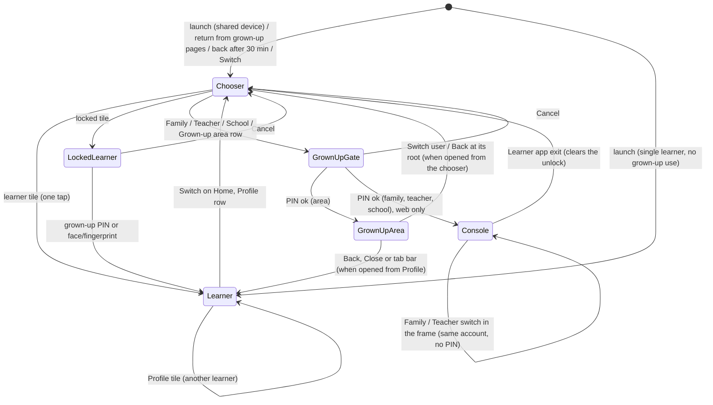

Status: ready (spec only; rows OA-0b to OA-11 implement it; every open question decided by the owner 2026-10-21, section 23)

Design: row OA-0b (agent design pass approved by multi-agent review, CLAUDE.md section 5, 2026-10-12 owner decision). Wireframes in this PR: `design/wireframes/profiles/who-is-using.md` (the chooser, learner app and console exit), `design/wireframes/profiles/pin-entry-v2.md` (longer pauses, reset by signing in, face or fingerprint), `design/wireframes/profiles/people-on-device.md` (People on this device, lock, remove, Who is joining?). `design/wireframes/profiles/picker.md` is superseded by `who-is-using.md`.

# Amendment: one account, many users ("Who is using this?")

> **Owner request of 2026-10-21 (in chat, translated):** "Consider one account used by several people. A person can be a parent and also a teacher, and their child, or several children, may use the same account as learners. Even with one account, the user must be able to switch between uses (child 1, child 2, parent, teacher, ...). Switching to a parent or teacher use must be protected by a PIN-like permission setting."
>
> Every change below is marked **[OA]** where it lands in a spec, test or code comment.
>
> Basis: `origin/main` `a384759ca` (2026-10-21). Every `file:line` below is at that commit.

**Standing rules that apply here:**
- Audience is anyone of any age. No age wording anywhere new. Learners never sign in (OD-2): a learner is a device profile; adults are Clerk accounts.
- UI strings come from `packages/i18n` (`useMessages()`), with English, Spanish and Korean in the same PR (es and ko coverage ratchets), written to the F-I18N-001 section 3.10 style guide. Design-system tokens only. No emoji.
- Anti-shame: a learner tile never shows stars, progress, streaks or a level badge; nothing compares siblings (F-PROF-001 section 3.3, F-APP-001 section 3.8). A PIN pause is a pause, never "failed".
- No PII in URLs, page titles or telemetry. No event in this amendment carries a `profileId`, a name, a space id, an account id or a PIN fact beyond a code.
- D1 changes additive only. **This amendment adds one additive D1 migration**, `0015_telemetry_daily.sql` (a table of anonymous daily counters, section 15.1), and no route. The Worker change is the telemetry rules and those counters, and it deploys first (row OA-1).
- `learnerType`, the PIN hash, profile locks and the biometric opt-in never leave the device.
- One language and one text size per device (AMENDMENTS-DISPLAY-NAV DN-D1). Not reopened here.
- Seats count learner memberships only (AMENDMENTS-SEATS-ADMINS SA-D5). Grown-up uses never take a seat.
- Native builds have no billing links and no sign-in (F-AUTH-004 is unwritten).
- Stripe stays in sandbox. Nothing here touches billing.
- Copy never claims review by a native speaker or an expert. The es and ko values below are drafts for the multi-agent review (MAR) of each row.

---

## 0. Summary

One shared device (a family tablet, a teacher's laptop, a parent's phone) is used by several people under one grown-up account: one or more children who learn, a grown-up who may also learn, and the same grown-up as a parent, a teacher and a school administrator. Today these uses are spread over four screens and a sign-in, the app resumes whoever played last, and every adult use shares one weak 4-digit PIN with a flat 30-second pause.

This amendment adds **one model and one screen**:

1. **"Who is using this?"** is the device's one chooser. It lists the learner profiles as large tiles (one tap, no PIN, as F-PROF-001 requires) and the grown-up uses of the account as smaller rows below (Family, Teacher, School, Grown-up area), each behind the grown-up PIN. It opens at launch on a shared device, when someone comes back from the grown-up pages, after a long break, and from a Switch button on Home.
2. **The grown-up PIN protects every move into a grown-up use**, with longer pauses after repeated misses (on the PIN pad alone, about 83 days to try every PIN, was about 17 hours; for someone holding the device, never faster than the 24-hour wait, which the chooser now shows while it runs), a reset through the account's sign-in on the web (in addition to the Rescue Code and the 24-hour wait), an optional face or fingerprint shortcut on native builds, and a grown-up session that ends whenever the chooser opens, a learner is switched, or the grown-up pages are left.
3. **A learner profile can be locked** with the grown-up PIN (for a grown-up's own "Me" profile), learners can be **removed from a device**, and several learners on one device can **join a family in one step**.
4. **The console's way back** (the Learner app exit) opens the chooser instead of resuming the last learner, so the console and the learner app share one switching model.

On the server only telemetry changes: per-name payload rules and one additive table of anonymous daily counters, so the goals below can be measured. Seats, memberships, spaces, the device gate marker, the trusted epoch and the console lock keep their rules.

**On native builds (iOS, Android) the grown-up uses are the Grown-up area only** until F-AUTH-004 (native sign-in, no billing links) exists. The Family, Teacher and School rows are web-only. A parent who is also a teacher on a native build therefore switches between the children and the Grown-up area there, and uses the console on the web for family and class tools. The native Grown-up area already gives a teacher, for every learner on the device, the learner report, the level-check report, the notes zone and Lecture mode; it has no roster, plans, join codes or seat tools. Scheduling F-AUTH-004 is OQ-19 (decided 2026-10-21: the spec is written after OA-10, row OA-11).

---

## 1. Goals and how they are measured

| # | Goal | Measure (telemetry codes only, section 15) | Target | Baseline source |
|---|---|---|---|---|
| G1 | The right learner plays. A sibling no longer starts on the wrong profile. | Corrective early switches per learner session, by day: `profile.switch` with `minutesIn: '0-2'` and either `via` `profile` or `home`, or `via: 'chooser'` with `trigger: 'manual'` (a switch someone asked for, not one the chooser offered at launch or resume), over the day's `session.start` count. This early, asked-for switch is the proxy for "started on the wrong profile"; the `trigger` field keeps the measure on the same channel across the flag flip. | Half of baseline within 4 weeks of the flag flip (OA-10) | `profile.switch` is emitted from OA-2 on (only `profile` and `home` exist then), at least 7 days before OA-10 flips the chooser on |
| G2 | Reaching a grown-up use is short. | Taps from a learner screen to a persona home, measured in e2e: chooser, grown-up row, PIN. | 2 taps and 4 digits (was 4 or more taps plus a sign-in step: Profile, Grown-up area, PIN, Account pages, router, Family or Teacher switch) | e2e `who-is-using.spec.ts` |
| G3 | Children never reach grown-up surfaces without the PIN. | The child-safety suite (section 9, CS-1 to CS-21) passes on every row; `parent.gate.opened` with `via: 'open'` occurs only with `marker: 'none'`. | 100 % pass; zero `open` with `marker` `pin` or `nopin` | e2e and unit tests; daily counters after OA-10 |
| G4 | The PIN resists guessing by someone holding the device. | (a) Worst-case time to try all 10,000 PINs on the PIN pad under the pause schedule (section 8.3); (b) no path for someone holding the device is faster than the 24-hour wait, and that wait is shown on the chooser while it runs (section 8.5). | (a) at least 30 days (computed: about 83 days); (b) holds | Unit test over `pin-hash.ts`; CS-8 and the pending-wait tests |
| G5 | Families with several children set up in one sitting. | `space.join.batch` with `joined` of 2 or more, as a share of family joins from devices with 2 or more learner profiles. | At least 50 % of such joins use the batch | OA-7b on |
| G6 | The chooser is not a wall. | `who.picked` count over `who.shown` count, by day (aggregate counters, no per-session linking). | At least 0.95 | OA-4a on |
| G7 | Switching is fast. | Tile tap to learner Home rendered, on the release build, p95 over 20 runs in the nightly `switch-on-e2e.yml` (a per-PR hard assertion on a shared runner would be flaky). | p95 at most 300 ms (F-PROF-001 section 3.1) | nightly e2e timing |

Every telemetry measure above is computed from the Worker's daily counters (section 15.1), which keep no profile id, device id or time finer than a day.

**Kill criteria** (any one rolls the chooser back with its kill switch, section 16): G6 below 0.85 for 7 days in the daily counters; a CS test failure in production builds; a support report of a child reaching a grown-up surface without the PIN.

---

## 2. Why: learning-science and safety grounding

- **A learner's history must be theirs alone.** Spaced review (F-VOC-005) schedules each word from that learner's own answers, and the placement check (F-PLC-001) and the Learning Route pick difficulty from that learner's record. A sibling playing on the wrong profile writes their answers into another person's history: intervals stretch for words the owner never saw, and the next lesson is pitched wrong. The distributed-practice literature (for example Cepeda and colleagues' 2006 review of spacing studies) ties retention to the spacing of each person's own retrievals; mixed histories break that link. G1 targets this directly.
- **Ownership and competence drive persistence.** In self-determination theory (Deci and Ryan), autonomy and felt competence sustain practice. Picking "my" tile and seeing "my" meter fill is both. Tiles therefore show no progress (no comparison between siblings; social comparison lowers motivation for the learner who is behind) and the switch stays one tap.
- **Re-entry must be cheap.** A habit depends on a short path from cue to practice. The chooser adds at most one tap for a learner on a shared device and none on a single-learner device without grown-up uses (section 6.2).
- **Grown-up involvement helps when it is easy.** Parents and teachers who can check progress quickly support practice better; today the trip is long enough that most never make it from the learner app. G2 shortens it.
- **Safety by default, least privilege.** Every grown-up use needs the PIN each time it is entered from the chooser; arriving at the chooser, switching learners by any path, and leaving the grown-up pages each end any grown-up session (OA-D5, OA-D5b); the controls that change who is on the device (remove, lock, join others) need a PIN entered within the last 2 minutes; a learner lock never opens a grown-up session; the console keeps its own lock (F-APP-001 section 3.9) as the last line.

**Threat model** (unchanged in kind, sharper in scope):

| In scope | Out of scope |
|---|---|
| A child or sibling holding the device, guessing PINs, tapping anything, force-quitting the app, opening several browser tabs (section 8.3, OA-D19) | Browser developer tools, a rooted or jailbroken device, reading IndexedDB or AsyncStorage directly (F-PROF-001 section 9.2 accepts this) |
| A student on a classroom device | A grown-up who knows the account's password and shares it |
| A child who knows the device's screen-lock passcode: native biometrics never fall back to it and a changed enrolment voids the shortcut (section 8.6); on the web a passkey (which the platform may unlock with that passcode) never resets the PIN and does not unlock the console on a browser whose marker is `pin` (section 7.4) | Several grown-up accounts on one device (section 21) |
| A child who creates their own grown-up account (why the reset by sign-in is bound to the PIN owner, and why only a fresh PIN plus a sign-in in the same tab can make a new owner, section 7.2) | |
| A child who waits out the 24-hour reset unseen (why the wait is shown on the chooser and can be cancelled by the PIN, section 8.5) | |

**In scope, accepted** (recorded so the trade-off is visible):

| Risk | Why accepted | Mitigation |
|---|---|---|
| A learner opens another unlocked learner's tile and writes into that learner's spaced-review history | F-PROF-001 makes a learner switch one tap with no PIN; a PIN per child would block pre-readers and break re-entry | G1 telemetry watches early corrective switches; a grown-up can lock any profile (OA-D9); a learner-owned picture code for class devices is OQ-20 |
| On a device with child profiles but no PIN (marker `nopin`), whoever opens the Grown-up area first sets the PIN | Setup on first entry is F-PROF-001 section 10 and F-LEARN-001; refusing it would strand a grown-up offline | the Grown-up area row says "A grown-up sets a PIN here." (section 6.1); the console asks once, calmly, for a PIN to be set (section 7.6); locks and remove need a PIN, so nobody can lock others out before one exists |
| Up to 24 hours after a Forgot PIN wait starts, anyone holding the device can set a new PIN | Without it a grown-up with no Rescue Code and no web sign-in would be locked out for good | the pending wait is shown on the chooser with a cancel by PIN, and a PIN set by the wait is announced at the next Grown-up area entry (section 8.5) |

---

## 3. Where things stand (basis `a384759ca`)

### 3.1 Identity layers

| Layer | Who | Where | Code |
|---|---|---|---|
| Clerk account | grown-ups only (OD-2) | Clerk; D1 `accounts` | `packages/backend/src/lib/auth.ts`; `apps/web/src/components/console/auth-context.tsx` |
| Adult persona | derived from memberships: `parent` (family owner or caregiver), `teacher` (class owner or teacher; school owner, admin or teacher) | pure | `packages/content-schema/src/schemas/app-shell.ts:134` (`personasFor`), `:152` (`homeFor`) |
| Learner (server) | one `learners` row per device profile; the device is the principal (`Device <deviceId>:<secret>`) | D1 `learner_devices` (0002, 0003) | `apps/mobile/src/store/sync-store.ts` |
| Local profile | any number per device | `hr:profiles`, `hr:profiles:active` | `apps/mobile/src/store/profile-store.ts`; `logic/profiles/profile-model.ts` |

### 3.2 Gaps against the request

1. **No single chooser.** Learner switching is a tile row on Profile (`screens/profile/ProfileScreen.tsx:155`, `setActive` with no PIN). A grown-up use is four or more steps away. Child 1, child 2, parent and teacher never appear on one screen.
2. **No picker at launch.** `RootNavigator` resumes the active profile (`navigation/root.tsx:99`, `initialRouteName={hasProfile ? 'Main' : 'Onboarding'}`), although F-PROF-001 section 3.1 and `docs/blueprints/10-app-map.md:152` mark `profiles/picker` shipped. `canSwitchProfileFrom`, `planProfileSwitch` and `canEnterPicker` (`logic/profiles/session.ts:43-67`) are never called; `profile.switch` and `parent.gate.opened` are registered (`telemetry.ts:20-21`) but never emitted.
3. **Grown-up roles as device profiles are dead code.** `ProfileRole` has `parent | teacher | admin`, nothing creates them; `nextOnboardingStep`, `parentProfile` (`profile-model.ts:168,182`) and `profile-store.setParentPin` (`:137`) have no caller.
4. **One flat PIN.** 4 digits, 5 misses in 60 s give a 30 s pause, forever (`logic/profiles/pin-hash.ts:10-14`): about 17 hours to try every PIN. No reset through the account.
5. **A grown-up's own learner profile is open to anyone** on the device.
6. **Several children join one by one.** `JoinSpaceScreen` always joins the active profile (`screens/sync/JoinSpaceScreen.tsx:53,182`).
7. **The legacy device subscription makes every profile premium** (`store/tier-store.ts:81`), past the family cap of 4 (SA-D1).
8. **Leaving the grown-up pages resumes the last learner** instead of asking who is next.
9. **No way to remove a profile** in the app (`profile-store.remove`, `:121`, has no screen). `notifyProfileRemoved` (`store/profile-removal.ts:17`) is heard by only six stores (progress, class-update, free-end-seen, story, locale, notes); the sync secret and Rescue Code, memberships, plans, tier cache, placement and route state would stay behind (section 10.4).
10. **Docs are stale:** F-PROF-001 (README says draft, file says ready; section 3.1 picker; section 3.5 key `parent.<profileId>.pin_hash`, the code uses `account:parentPinHash`), F-PAR-001 section 3.5 ("linked by this parent"; the code and the standing rule show all learners), the app map.

### 3.3 What already works and stays

- A parent who is also a teacher: one Clerk account holds a family and a class or school; the console shows both personas with the frame's switch; a child can be in the family and in the class at once (`LEARNER_CLASS_CAP = 3`, `space.ts:204`).
- The device gate marker, the trusted epoch, secret-proving sign-in and the console lock (F-APP-001 section 3.9).
- Per-profile data under `<store>:<id>` keys, one per store (the full list is in section 10.4); one device record for language and text size.

---

## 4. Decisions

| # | Decision | Replaces | Why |
|---|---|---|---|
| OA-D1 | **One chooser, "Who is using this?"**, owned by the learner app, lists every learner profile on the device and every grown-up use of the account known on the device. It is the only place that changes *who* is using the device. The console's persona switch (Family and Teacher in the adult frame) stays for moving between grown-up uses of the same signed-in person. | F-PROF-001 section 3.1 picker (never built); the Profile tile row stays as a second way to switch learners | Owner request; one consistent model |
| OA-D2 | **Grown-up uses come from the account, never from device profiles.** A grown-up use is `family`, `teacher`, `school` or `area` (the device's local Grown-up area). The first three are derived from the signed-in account's memberships (`usesFor`, section 5.2) and cached on the device without names (section 7.1). No `parent`, `teacher` or `admin` device profile is ever created; the dead code goes (OA-10). | F-PROF-001 section 3.2 "parent creates parent profile first" | F-APP-001 section 3.5: adult personas come from memberships. A second, device-side source of adult roles would drift from the account. |
| OA-D3 | **One grown-up PIN per device protects every grown-up use** (owner confirmed 2026-10-21, OQ-3). Family, Teacher, School and the Grown-up area all ask the same PIN. | — | Inside the console the same person moves between Family and Teacher without a PIN (same account); separate PINs per use would promise a separation that does not exist. |
| OA-D4 | **A learner switch stays one tap with no PIN**, except into a profile a grown-up has **locked** (OA-D9). | — | F-PROF-001 non-negotiable |
| OA-D5 | **Arriving at the chooser ends the grown-up session** (`ui-store.parentGateOpenedAt` and `lastPinVerifiedAt` cleared) and clears the console unlock of the tab (`clearGrownUpTab`, as every learner boot already does), and tells the other tabs to drop theirs (section 7.6). | — (today the 15-minute session survives a learner switch) | A parent hands the device back through the chooser; the child must not inherit the open session. |
| OA-D5b | **Every other hand-back path ends it too.** (1) Every `setActive` to a different profile, from any surface (Profile tiles, a locked-tile unlock, the chooser, removal of the active learner), closes the grown-up session through one function, `closeGrownUpSession` (section 6.3). (2) Leaving the Grown-up area stack for any learner screen, by Back, Close or the tab bar, closes it, whatever the area was opened from. (3) The controls that change who is on the device (Remove from this device, lock and unlock, picking a non-active learner in Who is joining?) need a PIN (or face or fingerprint) entered within `GROWN_UP_FRESH_PIN_MS` (2 min), not just an open session. Inside the Grown-up area stack the 15-minute session still lets a grown-up move between its pages without a PIN. | — | A parent who opened the Grown-up area from Profile and then hands over by Back or a Profile tile must not leave the child an open session, least of all one that can remove or lock a sibling. |
| OA-D6 | **When the chooser opens** (decided 2026-10-21, OQ-1, OQ-2): at launch and on return from the background after **30 minutes** when the device is *shared* (2 or more learner profiles, or any locked profile, or any known grown-up use, except a device whose marker is `none` with a single learner profile, where a known use alone does not make it shared); always on return from the grown-up pages; on demand from Home (Switch), Profile and the Grown-up area. When the **active** profile is locked, it opens at every launch and after `GROWN_UP_BACKGROUND_MS` (5 min) in the background, so a grown-up's own profile locks again soon after it is put down. A single-learner device with no known grown-up use never sees it unasked. | `root.tsx:99` resume | G1 without adding a tap for one-person devices (a lone adult learner who also teaches is not asked at every launch) |
| OA-D7 | **Longer pauses after repeated misses**: each round of 5 misses within 24 hours with no correct PIN in between (60 s before OA-2 review round 2, which let a slow guesser through all PINs in about 42 hours) starts a pause of 30 s, 1 min, 5 min, 15 min, then 60 min for every further round (section 8.3). The step falls back by one after 24 hours with no miss (OQ-23), and to the first on a correct PIN. Decided 2026-10-21 (OQ-8). The PIN stays 4 digits (OQ-9). **No hard lock:** during a pause, face or fingerprint (native) still opens the gate and resets the step, the Rescue Code has its own attempt counter and stays usable, and the sign-in reset (web) stays open. | flat 30 s (`pin-hash.ts:13`) | G4: about 83 days on the pad, while a child mashing the pad can never keep a grown-up out |
| OA-D8 | **Reset by signing in** (web): "Forgot PIN?" gains **Sign in to the account**, next to the Rescue Code and the 24-hour wait. It is accepted only for a sign-in with a password, an email code or a phone code (never a passkey, which the platform may unlock with the device passcode), fresh within 2 minutes, by the account recorded as this browser's **PIN owner**: the account that signed in right after a fresh PIN in this browser (section 7.2). Decided 2026-10-21 (OQ-18). | F-PROF-001 section 3.5 "Phase 2: Clerk email recovery" | Owner task. Bound to an account that knew the PIN, so a child's own new account cannot reset it. |
| OA-D9 | **Locked learner profiles.** A grown-up can lock any learner profile with the grown-up PIN (Edit profile and People on this device). A locked tile shows a lock glyph and asks the PIN; the unlock opens that profile only, never a grown-up session. Locks are local (never synced) and kept in their own key, so older app versions cannot drop them (section 13.2). A lock needs a device PIN; a lock without a PIN is void. Locks use the grown-up PIN (decided 2026-10-21, OQ-4). | — | Gap 5; a grown-up's own spaced review must not be filled in by a child |
| OA-D10 | **Face or fingerprint** (native only, platform permitting): a grown-up may turn it on per device, after the PIN, with a warning that anyone whose face or fingerprint is saved on the device can use it. The shortcut is a key in `expo-secure-store` written with `requireAuthentication: true`, which the platform voids when the set of enrolled faces or fingerprints changes (section 8.6); strong biometrics only, **never the device passcode as fallback**. It stands in for the PIN on the PIN screen; it never sets, changes or resets the PIN, and any PIN change or enrolment change turns it off. Off by default on every device (OQ-6). On the web, the platform's way is a **passkey** through Clerk; the console lock gains a **Use a passkey** button where the browser offers one **and the browser's marker is not `pin`** (OQ-7, OQ-21). On a `pin` browser (a shared device with child profiles) a passkey still signs in, but it does not count as the grown-up unlock there, and it never counts on the PIN reset leg. | F-PROF-001 section 4 "Biometric unlock: Phase 2" | Owner task "biometric only if the platform allows it". A web page has no local biometric check that a server does not verify; a passkey is that check, but platform authenticators may fall back to the device passcode, which the threat model puts in a child's reach. |
| OA-D11 | **School is its own grown-up row** when the account owns or administers a school (it opens the teacher home at the school section). Teacher shows when the account owns or teaches a class or teaches at a school. Decided 2026-10-21 (OQ-10). | — | Owner request names school admin as a use |
| OA-D12 | **The console's Learner app exit opens the chooser** (`?who=1` on `learnerHome()`), and so does Open the app on this device without a join code. The label stays **Learner app** (DN-6). Decided 2026-10-21 (OQ-5). | F-APP-001 section 3.10 row "family or teacher → learner" | Gap 8 |
| OA-D13 | **Remove from this device** (Grown-up area, People on this device, a fresh PIN (OA-D5b), ConfirmSheet): deletes the local profile and every per-profile key (section 10.4). It never touches the server: the learner's memberships, seats and saved progress stay, and a Rescue Code brings the learner back. A learner counts as **saved** only when registered **and** nothing is waiting to be pushed; otherwise the app tries to sync first, and an unsaved learner gets **Save progress first** as the main action and a second, explicit step to remove anyway. Decided 2026-10-21 (OQ-14). | — | Gap 9; never lose earned items without a clear choice |
| OA-D14 | **Who is joining?** A **family** code entered on a device with 2 or more learner profiles lists them with check boxes (the active learner checked; a grown-up's own locked profile unchecked, with "Takes a family place."). Joining only the active learner needs no PIN, as today; joining any other learner needs a fresh PIN (OA-D5b). One consent step names every picked learner and covers registering each one that has never synced; the Worker receives one `/join` per learner, each taking its seat atomically (SA-D8); a refused seat reads kindly per learner. **Class** codes keep the one-learner flow (each learner picks their roster name and may relink); on a shared device a class code is held until someone picks who is joining in the chooser (OA-D20). Decided 2026-10-21 (OQ-15). | `JoinSpaceScreen.tsx:53,182` (active only) | Gap 6, G5 |
| OA-D15 | **The legacy device subscription is capped like a family**: it covers every learner profile that exists on the device when OA-8 first runs (grandfathered, recorded once, only after a successful profile read), and new profiles only while fewer than 4 are covered. Nobody loses premium. Decided 2026-10-21 (OQ-13). | `tier-store.ts:81` (every profile) | Gap 7; SA-D1 and SA-D7 |
| OA-D16 | **A grown-up session also ends after 5 minutes in the background**, in the learner app and in the console tab (the console unlock, section 7.6). Today the learner app's session lasts 15 minutes from the PIN however the device is put down, and the console unlock 15 idle minutes, hidden or not. Decided 2026-10-21 (OQ-12). | `PARENT_SESSION_MS` only | A tablet put down and picked up by a child |
| OA-D17 | **Tile order**: creation order up to 12 learner profiles (stable places for pre-readers); above 12 (classroom devices), by name in the UI language's collation. Decided 2026-10-21 (OQ-11). | — | Spatial memory at home; findability in a class |
| OA-D18 | **The only server change is telemetry**: per-name payload rules for every name in section 15 (the Worker drops a `profileId` and any key or value outside the rule, whatever the client sends), and one additive table of anonymous daily counters (`0015_telemetry_daily.sql`, section 15.1). No new route; nothing else on the server changes. | — (today events live only in the Worker's memory, at most 10,000 per isolate, so no goal could be computed) | Measurable goals and kill criteria; privacy enforced by the server, not by client behaviour; Worker-first |
| OA-D19 | **Several tabs share one truth.** On the web, the PIN attempt state (`account:pinAttempts`, `account:rescueAttempts`) and the profile list (`hr:profiles`) are read, changed and written inside `navigator.locks.request` (`hr:pin-attempts`, `hr:profiles`); where Web Locks are missing, the state is re-read just before each change and merged (attempts: the later `lockedUntil`, the larger `strikes`, the union of misses; profiles: by id, a removal recorded in a tombstone set wins). `setActive` writes only `hr:profiles:active`. Changes are posted on a new BroadcastChannel `hr-profiles` (the pattern of `hr-prefs`, `prefs-channel.web.ts`) so other tabs refresh. | today each tab keeps its own copy and writes last-write-wins | Opening tabs must not multiply the PIN tries, lose a newly added learner or bring back a removed one |
| OA-D20 | **A join link or hand-off on a shared device asks who first.** The class join link (`/join#c=<code>`, `join` boot intent) and Open the app on this device with a code hold the code in memory (never in the URL after boot) and open the chooser with the caption **Pick who is joining.**; the learner picked there gets Join prefilled. A family code on a device with 2 or more learners opens Who is joining? instead (OA-D14). A join intent wins over `who=1` (they never arrive together; if they do, the join is kept and the chooser is shown once). On a single-learner, unshared device the link opens Join as today. | `boot-intent.ts` `join` intent opens Join for the active learner | A student must not scan a class code and join as whoever played last |
| OA-D21 | **A pending 24-hour wait is visible.** While a Forgot PIN wait runs, the chooser's Grown-ups section shows **A new grown-up PIN can be set after {time}. Enter the PIN to cancel.** with **Cancel the wait** (it verifies the PIN). A PIN set by the wait is announced once at the next Grown-up area entry. | the wait completes unseen unless a grown-up types the PIN | The wait is the real bound for someone holding the device (G4 b) |

---

## 5. The model

### 5.1 Uses of one device



Every arrow into `Chooser`, every arrow from `GrownUpArea` to `Learner`, and every change of learner (`Learner --> Learner`, `LockedLearner --> Learner`) closes the grown-up session (OA-D5, OA-D5b). Every arrow out of `Chooser` into a grown-up state goes through the gate, whatever the session says. The open session is honoured only inside the Grown-up area stack.

### 5.2 `usesFor` (pure, `packages/content-schema/src/schemas/app-shell.ts`, next to `personasFor`)

```ts
export const GrownUpUseSchema = z.enum(['family', 'teacher', 'school']);
export type GrownUpUse = z.infer<typeof GrownUpUseSchema>;

/** [OA] Grown-up uses of an account, in this fixed order: family, teacher, school. */
export function usesFor(memberships: readonly { kind: SpaceKind; role: SpaceRole }[]): GrownUpUse[];
```

| Use | When the account holds |
|---|---|
| `family` | a `family` as `owner` or `caregiver` |
| `teacher` | a `class` as `owner` or `teacher`, or a `school` as `teacher` |
| `school` | a `school` as `owner` or `admin` |

Archived spaces count (their pages stay reachable, as for personas). `student` rows are ignored. `personasFor` is unchanged; `usesFor(x)` contains `family` exactly when `personasFor(x)` contains `parent`, and contains `teacher` or `school` exactly when `personasFor(x)` contains `teacher` (a unit property test checks this).

### 5.3 Role-switching table (replaces F-APP-001 section 3.10)

| From | To | How | Gate |
|---|---|---|---|
| anyone | the chooser | launch or resume (OA-D6), Home **Switch**, Profile **Who is using this?**, Grown-up area **Switch user**, console **Learner app** | none to open it; it closes the grown-up session |
| chooser | learner | tile | none |
| chooser | locked learner | tile with the lock glyph | grown-up PIN (or face or fingerprint); never opens a grown-up session |
| chooser | Grown-up area (this device) | **Grown-up area** row | PIN as today (`PinEntry { next: 'ParentDashboard' }`, setup allowed when no PIN exists, F-PROF-001 section 10) |
| chooser | Family, Teacher, School (web) | the use's row | fresh PIN (`PinEntry { next: 'GrownUpUse', use }`, verify only, never creates or resets a PIN), then `openGrownUpArea({ via: 'chooser', target })`; Clerk sign-in when signed out |
| chooser | sign in as a grown-up (web, no use known) | **Sign in as a grown-up** row | as above, `target` `/signin` |
| learner | learner | Profile tiles (kept) | none; locked profiles ask the PIN there too; the switch closes the grown-up session (OA-D5b) |
| learner | Grown-up area | Profile → **Grown-up area** (kept) | PIN as today (the session is reused only while it is open and nobody has left the area stack since) |
| Grown-up area | learner | Back, Close or the tab bar, from any page of the area stack | none; closes the grown-up session |
| Grown-up area | Remove, lock or unlock a learner; Who is joining? for a non-active learner | the control | a PIN, face or fingerprint within the last 2 minutes (`GROWN_UP_FRESH_PIN_MS`); an open session alone is not enough |
| family | teacher, school (or back) | the frame's persona switch | none (same account) |
| family, teacher | learner | **Learner app** exit | lands on the chooser; clears the unlock and the console session |
| any grown-up page | the same page after 15 idle minutes, or after 5 minutes hidden (OA-D16) | console lock | PIN (trusted epoch) or a secret-proving sign-in, or a passkey where the marker is not `pin` (OA-D10) |

`target` per use: `family` → `/parent`, `teacher` → `/teach`, `school` → `/teach?focus=school`. Each passes `safeNextPath`. The teacher home reads `focus=school` and moves focus to its first school card (no scroll jump without focus; the query is removed with `history.replaceState`).

---

## 6. "Who is using this?" in the learner app

### 6.1 Screen

Route `WhoIsUsing` (root stack, above `Main`, `gestureEnabled: false`, no Back; wireframe `profiles/who-is-using.md`). Content from top:

1. `ScreenHeader` with only the Display (Aa) control (the device language stays reachable).
2. Title **Who is using this?**
3. **Learning**: one tile per learner profile, `ProfileAvatar` (idle pose) and the display name, at least `touchTarget.hero` square, two columns on a phone, more on wider layouts (F-LAYOUT-001 breakpoints). A locked profile carries a lock glyph and a caption line. No stars, cards, level, streak, space name or "last played" on any tile (CS-6). Then **Add a learner** (dashed tile, gated as today).
   - **Telling tiles apart without reading:** when two or more profiles share an avatar, each of them gets a distinct tile tint from the existing `colors.theme` tints (five; never a stage, rarity, ranking or feedback colour), assigned by creation order and kept stable; past five the tints repeat and the name stays the tell. Create profile and Edit profile offer an unused avatar first.
4. **Grown-ups**: a list of rows, visually secondary (body size, `surface.paper`, lock glyph at the start), in this order: the known uses (`family`, `teacher`, `school`, section 7.1), then **Grown-up area**. On the web with no known use, a **Sign in as a grown-up** row replaces the use rows. **Native shows only Grown-up area** (section 0; F-AUTH-004, OQ-19). A self-only device without a PIN (marker `none`) shows the rows without the lock glyph (they open directly, F-LEARN-001 L7). A device with child profiles but no PIN yet (marker `nopin`) gives the Grown-up area row the caption **A grown-up sets a PIN here.**
   - **Pending reset:** while a Forgot PIN wait runs (`account:pinResetRequestedAt`), the section starts with the calm line **A new grown-up PIN can be set after {time}. Enter the PIN to cancel.** and a **Cancel the wait** button, which opens `PinEntry` in verify mode (`next: 'CancelReset'`); a correct PIN clears the request and returns here. No name, no count of tries (OA-D21).
5. Offline (web): the Family, Teacher, School and Sign in rows are disabled with **Needs the internet** (the existing `needsInternet` line); Grown-up area stays enabled.
6. **Joining** (OA-D20): when a held join code brought the chooser up, a caption under the title reads **Pick who is joining.**; the grown-up rows stay as they are.

### 6.2 When it opens

| Trigger | Condition | Code |
|---|---|---|
| launch | device is shared (`isSharedDevice`: 2 or more learner profiles, or any locked profile, or any known grown-up use; a device with marker `none` and a single learner profile is not shared by a known use alone), or the active profile is locked | `launch` |
| launch with the `who=1` boot intent | at least 1 profile | `return` |
| launch with a `join` boot intent or a held hand-off code (OA-D20) | shared; the code is held in memory, the caption **Pick who is joining.** shows; a family code on a device with 2 or more learners goes to Who is joining? instead (section 10.3) | `join` |
| resume | shared, and the app was in the background for at least `CHOOSER_RESUME_MS` (30 min; web `visibilitychange`, native `AppState`); or the active profile is locked and the app was in the background for at least `GROWN_UP_BACKGROUND_MS` (5 min) | `resume` |
| Home **Switch** (avatar corner button, F-PROF-001 section 3.4, wireframe `profiles/switch-button.md`), Profile **Who is using this?** row, Grown-up area **Switch user** | always shown on Home and Profile when the device has 2 or more learner profiles or any grown-up use; Grown-up area always | `manual` |

- The `who=1` intent is parsed by `logic/shell/boot-intent.ts` and removed with `history.replaceState`, like `gate=grown-up`. It is ignored when the chooser flag is off (section 16), so the console can add it before the learner app ships the chooser.
- **Join codes and the chooser:** the code from `/join#c=<code>` or from `hr:shell:joinCode` is moved into memory at boot (the address is rewritten as today) and handed to Join for the learner picked in the chooser; a grown-up row picked instead keeps it held until the chooser shows again in this run; it is dropped when the app is closed, after the existing 30-minute hand-off life, or when Join consumes it. A join intent and `who=1` together: the join wins and the chooser is shown once.
- **Mid-activity**: Switch is not offered inside a quest, minigame, story reader or placement (`canSwitchProfileFrom`, now called). A resume trigger inside one opens the chooser **over** the screen: picking the same learner closes it and the screen continues where it was; **any other pick, grown-up rows included,** runs `planProfileSwitch('resume', …)`, a new origin that is always allowed and always persists first, then switches or opens the gate. Coming back from a grown-up use picked there lands on the chooser, never on the quest under it. The leaving screen's state is never discarded without that persist.
- Empty device (no profile): the chooser never renders; Welcome and onboarding as today.

### 6.3 Behaviour

- Tile tap: `setActive(id)`, close the chooser, render Home within 300 ms (G7; the active-candidate snapshots are pre-warmed while the chooser shows). Emit `profile.switch` (with the chooser's `trigger`) and `who.picked`.
- **`setActive` closes the grown-up session.** `profile-store.setActive(id)` calls `closeGrownUpSession()` (clears `parentGateOpenedAt` and `lastPinVerifiedAt`, and on the web `clearGrownUpTab()` and the `hr-grownup` lock post, section 7.6) whenever `id` differs from the active profile, whatever surface called it. The Grown-up area stack's navigator listener calls the same function when focus leaves the stack for a learner route (Back, Close, tab bar).
- Locked tile: `PinEntry { next: 'LockedProfile', profileId }` in verify mode (no Forgot PIN shortcut to setup; Forgot PIN still offered, it leads to the reset paths). It uses a separate verify path, `verifyForLockedProfile`, that resets `strikes` and clears a pending 24-hour reset request like any correct PIN, but **does not** call `markPinVerified()` or `openParentGate()` (CS-3); a face or fingerprint success on a locked tile takes the same path. Success: `setActive`, Home. Cancel: back to the chooser.
- Grown-up row: section 5.3. Cancel on the PIN screen returns to the chooser, never to a learner.
- Arrival at the chooser: close the grown-up session (OA-D5), clear `hr:grownup:unlock` and `hr:console:session` in this tab (web), post the `hr-grownup` lock message to other tabs, write nothing else.
- Store read failure (`hr:profiles` unreadable): the existing calm error with **Try again**; never wipes data.

### 6.4 Pure modules (100 % covered)

- `logic/profiles/who.ts`: `isSharedDevice({ profiles, locks, uses, marker })`, `chooserTrigger({ event, shared, activeLocked, profiles, backgroundMs, joinHeld, flag })`, `tileOrder(profiles, locale)` (OA-D17), `tileTints(profiles)`, `grownUpRows({ os, uses, online, marker, resetPending })`.
- `logic/profiles/session.ts`: `closeOnChooser(state)`, `closesSession(prevActiveId, nextActiveId)`, `needsFreshPin(action, lastPinVerifiedAt, now)`; `SwitchOrigin` gains `'resume'` (always allowed, always persists); `canSwitchProfileFrom` and `planProfileSwitch` get callers.

---

## 7. The console side

### 7.1 Known uses on the device (`hr-shell` / `kv`, key `deviceUses`)

- The adult frame writes `{ v: 1, uses: GrownUpUse[], at }` (`DeviceUsesSchema`, content-schema) whenever a persona home renders, from the `GET /api/spaces` items it already holds (`usesFor`). It holds **no name, email, account id or space id**.
- **Sign out** deletes it. A sign-in as another account overwrites it at that account's first persona home.
- The learner app (web only) reads it read-only through `platform/device-uses.web.ts` (the `hr-shell` database, `SHELL_DB` and `SHELL_KEYS` from content-schema). A record older than 30 days, unreadable or not parsing reads as "no uses" (the chooser then shows Sign in as a grown-up). It is outside the learner `hr:` namespace, so learner backups never carry it.
- The learner app never writes it. The console never reads learner profiles (unchanged).

### 7.2 PIN owner (`hr-shell` / `kv`, key `pinOwner`)

- `{ v: 1, owner: <16 hex>, epoch }`: `owner` is the first 16 hex digits of SHA-256 of the Clerk user id; `epoch` is the marker's `pinEpoch` it was recorded for. Local only, never sent.
- It names the account that **proved the current PIN** in this browser. The PIN proves that a grown-up is present, not which account happens to be signed in, so a **new or different owner** is set only when a fresh PIN is followed by that account's own password or code in the same tab (moments 1 and 3), and an existing owner is refreshed in moment 2; all three need a real marker epoch (`pin`, not `0`):
  1. **Set (new or different owner):** a sign-in with a password, an email code or a phone code completes (`grantSignInUnlock`, `lib/console/signin-flow.ts`) in a tab that still holds a `pin` unlock, written by the learner app's hand-off after a fresh PIN, whose epoch equals the marker's (the usual path: PIN in the app, then Sign in, in the same tab). `grantSignInUnlock` reads the earlier unlock before it writes the `signin` one. A passkey sign-in never sets an owner.
  2. **Refresh (same owner only):** the console lock opens a grown-up page through the PIN path (a `pin` unlock whose epoch equals the marker's and the trusted epoch) for a signed-in account whose fingerprint **equals** the stored `owner`; the record's `epoch` moves to the current one. For any other account, or with no record, this moment writes nothing.
  3. **Set, for a grown-up who stays signed in:** the console's Account page offers **Let this account reset the PIN here** in a tab that holds a `pin` unlock less than 2 minutes old (the hand-off after a fresh PIN). It runs Clerk reverification with a password, an email code or a phone code (`useReverification`); success writes the record as in moment 1. Without this, a grown-up who never signs out would never become owner.
- A sign-in alone, without the PIN, never writes it; nor does any sign-in on the reset leg (`next` = `/account/pin-reset`), which also writes no trusted epoch.
- A new PIN (new epoch) makes the record stale; moment 2 refreshes it for the same owner, and only moments 1 and 3 can name someone else.
- Why: a child signed in to their own account in this browser cannot become the owner when a grown-up later types the PIN on a grown-up page; becoming owner needs a fresh PIN **and** that account's own sign-in in the same tab within 2 minutes, which a grown-up sees happen (CS-10).

### 7.3 Learner app exit and Open the app on this device

- `clearGrownUpTab()` then `learnerHome(origin, locale)` with `who=1` (OA-D12). Open the app on this device **with** a join code keeps today's hand-off (`hr:shell:joinCode`) and lands on Join, where Who is joining? applies (section 10.3).

### 7.4 Lock screen: Use a passkey (OA-D10)

- Shown on `GrownUpLock` when `PublicKeyCredential.isUserVerifyingPlatformAuthenticatorAvailable()` resolves true **and the browser's device gate marker is not `pin`** (a shared device with child profiles and a PIN, where a platform authenticator's passcode fallback may be in a child's reach). It runs Clerk reverification with the passkey first factor (`useReverification`, as F-BILL-002 section 4.4); success writes the `signin` unlock (a passkey is secret-proving, F-APP-001 section 3.9). Hidden when the API is missing or resolves false. Clerk decides whether the account has a passkey; a refusal returns to the lock with its existing line.
- On a `pin` browser, `isSecretProvingSignIn` treats a `passkey` first factor as not secret-proving for the grown-up unlock (the sign-in completes; the lock then asks the PIN or another factor). On the reset leg (`next` = `/account/pin-reset`) only `password`, `email_code`, `phone_code` and the Clerk password-reset code factors count, on every browser (OQ-21).

### 7.5 Reset page `/account/pin-reset` (section 8.5)

A grown-up page under the existing `/account` prefix, behind the lock (the forgotten PIN leaves **Sign in again**, which is the point). No API call.

### 7.6 Console tabs and the chooser (OA-D5, OA-D16)

- `GrownUpLock` listens to `visibilitychange`: a tab hidden for at least `GROWN_UP_BACKGROUND_MS` (5 min) drops its unlock when it is shown again (wall-clock comparison, not a timer).
- A new BroadcastChannel, `hr-grownup` (same origin, app.hangulroute.com), carries one message, `{ v: 1, kind: 'lock' }` (`GrownUpLockMessageSchema`, content-schema). The learner app posts it when the chooser opens and when `closeGrownUpSession` runs; every console tab that receives it drops its unlock and shows the lock. No other content is ever posted. Browsers without BroadcastChannel keep the 15-minute and 5-minute rules.
- On a `nopin` browser (child profiles, no PIN), the first persona home after a sign-in shows once a calm card: **Set a grown-up PIN in the app so only grown-ups open these pages.** with **Open the app** (to `/?gate=grown-up`, which runs setup). It is dismissed for this browser with `hr-shell` `kv` `pinPromptSeen` (`true`, no other data).
- No tab channel for grown-up state exists at `a384759ca`; `hr-prefs` carries display settings only and is not reused for lock messages.

---

## 8. The grown-up PIN

### 8.1 What stays

- 4 digits, salted SHA-256 (`expo-crypto`), device-level `account:parentPinHash`, dots only, the attempt state persisted (`account:pinAttempts`) so a force-quit keeps a pause.
- The marker, the epoch (`account:pinSetAt`), the fingerprint (`account:pinHashSeen`), the trusted epoch and every rule of F-APP-001 section 3.9.
- `GrownUpArea` and the new `GrownUpUse` and `LockedProfile` destinations never create or reset a PIN.

### 8.2 Set-up

- As today: a child profile's creation asks for a PIN when the device has none (F-LEARN-001); the first entry into the Grown-up area on a device without a PIN runs setup; **Change PIN** in the Grown-up area. Locks and the face or fingerprint switch are disabled with **Set a grown-up PIN first.** while no PIN exists.
- Every new PIN (set, change, reset) moves the epoch (existing), turns the face or fingerprint shortcut off (OA-D10) and keeps locks.

### 8.3 Pauses (OA-D7)

`AttemptState` gains `strikes: number` (0 when absent) and `lastMissAt` (absent when none). On the 5th miss within `PIN_ROUND_WINDOW_MS` (24 hours, the same length as `PIN_STRIKE_DECAY_MS`; a correct PIN clears the misses at once) a pause starts of `PIN_PAUSE_STEPS_MS[min(strikes, 4)]` = `[30 s, 60 s, 5 min, 15 min, 60 min]`, and `strikes` grows by one. A correct PIN (or face or fingerprint, or a completed reset) sets `strikes` to 0. When `PIN_STRIKE_DECAY_MS` (24 h) has passed since `lastMissAt` with no miss, `strikes` falls by one at the next read (one step per full 24 hours, OQ-23). The pause survives a restart (persisted with `lockedUntil`).

- Worst case to try all 10,000 PINs on the pad: 2,000 rounds of 5; the first four rounds cost 30 s + 1 min + 5 min + 15 min, every later round 60 min: about 1,996 hours, **about 83 days** (G4 a; a unit test computes it from the constants). This holds at any pace: a round window of 60 s let 4 misses a minute through all PINs in about 42 hours without one pause, so the window is 24 hours (OA-2 review round 2; a unit test runs 4 misses every 59 s over all 10,000 PINs). Going slower than 4 misses a day is slower still. Decay never shortens this: it needs 24 hours without a miss. For someone holding the device the real bound is the 24-hour wait (G4 b, section 8.5).
- Copy: seconds under a minute (existing `cooldown(seconds)`), minutes above (`cooldownMinutes(minutes)`). From the 3rd round, **on the Grown-up area destination only**, a second line points at Forgot PIN? (`cooldownHelp`); `LockedProfile`, `GrownUpUse` and `CancelReset` never show it, so the screen a child meets most does not advertise the wait. The countdown is announced politely, once per minute.
- **No hard lock** (OA-D7). During a pause:
  - face or fingerprint (native, when turned on) still runs; a success opens the destination and sets `strikes` to 0 (it is not a guess); a cancel or failure is not a miss and leaves the pause as it is;
  - the Rescue Code has **its own** attempt state, `account:rescueAttempts` (same shape, `RESCUE_MAX_ATTEMPTS` 5 per `RESCUE_WINDOW_MS` 15 min, then a flat `RESCUE_PAUSE_MS` 15 min; a Rescue Code is several words, so this throttle is enough), and stays usable while the PIN pad is paused; `attemptRescueCode` reads that state, not `account:pinAttempts`;
  - the sign-in reset (web) stays open; Clerk throttles it.
- **Several tabs** (OA-D19): `verifyPin`, `attemptRescueCode` and the setup paths read, change and write the attempt state inside `navigator.locks.request('hr:pin-attempts')`, so all tabs share one count. Without Web Locks, the state is re-read just before each verify and merged: the later `lockedUntil`, the larger `strikes`, the union of misses in the window. The PIN is checked against the stored hash read again under the same lock, so a tab left open after another tab changed the PIN never accepts the old one. A stored `lockedUntil` later than now plus the longest pause of its counter (60 min for the PIN, 15 min for the Rescue Code; a damaged record, a clock set back) is cut to that at every read.
- **The kill switch** `EXPO_PUBLIC_PIN_PAUSE_STEPS` off is the pause of before in full: 5 misses within 60 s, 30 s every round, no `strikes` growth and no help line.
- **Choosing a new PIN is not a guess**: the pause holds the check of the PIN only. After a Rescue Code accepted during a pause (CS-8), or the finished wait, the creation pad is usable, and the new PIN clears the attempt state (strikes 0).
- An older bundle in another tab may still write the attempt state without `strikes`. The max merge above keeps the larger value from the next read on, so the step is not lost; the older tab's own count is bounded (it still pauses) and ends when it updates.

### 8.4 Lapse

- The learner app's grown-up session: 15 minutes from the PIN (`PARENT_SESSION_MS`, unchanged), **and** closed by arriving at the chooser (OA-D5), by any change of learner and by leaving the Grown-up area stack (OA-D5b), and by 5 minutes in the background (`GROWN_UP_BACKGROUND_MS`, OA-D16). `use-gate-lapse.ts` already re-renders at a lapse; it now also checks the background time on focus.
- Within the session, Remove, lock and unlock, and joining a non-active learner ask for a PIN entered within `GROWN_UP_FRESH_PIN_MS` (2 min), as the hand-off already does.
- The console: 15 idle minutes, 5 minutes hidden, the `hr-grownup` lock message (section 7.6), 2-minute freshness for the hand-off (unchanged).

### 8.5 Reset (OA-D8)

| Path | Where | Needs |
|---|---|---|
| Rescue Code | all builds (existing) | the code stored on the device; its own attempt counter (section 8.3), usable during a PIN pause |
| 24-hour wait | all builds (existing) | 24 hours; the old PIN keeps working; shown on the chooser while it runs and cancelled by the PIN (OA-D21) |
| **Sign in to the account** | web, online, flag on | a sign-in by the PIN owner (section 7.2) with a password, email code or phone code (never a passkey), fresh within 2 minutes |

**The 24-hour wait, made visible** (OA-D21):

- While `account:pinResetRequestedAt` is set, the chooser shows the pending line and **Cancel the wait** (section 6.1). A correct PIN on any destination clears the request, as today (`PinEntryScreen.tsx:266`); Cancel the wait is the way to do it without opening anything.
- When a PIN is set through the finished wait, the app writes `account:pinResetByWait` = `{ v: 1, at }`. The next Grown-up area entry (after the PIN) shows once: **The grown-up PIN was changed after the 24-hour wait. If that was not you, change it now.** with **Change PIN**; then the key is cleared. A reset by the Rescue Code or by signing in writes nothing.

Sign-in reset flow:

1. PinReset (learner app) shows **Sign in to the account** as the first option when `os === 'web'`, online, and the flag is on. Tap: `location.assign('/signin?next=/account/pin-reset')` (no unlock written).
2. The console signs in (or the lock asks **Sign in again**). A sign-in on this leg writes the `signin` unlock but no trusted epoch and no `pinOwner` (section 7.2).
3. `/account/pin-reset` checks, in order: a `signin` unlock with `at` within `GROWN_UP_FRESH_PIN_MS` (2 minutes) that this leg's sign-in wrote with a factor of section 7.4 (stamped `hr:grownup:resetLeg` with the same `at`; an ordinary-leg unlock never counts), else runs Clerk reverification (no passkey); the marker is readable and `pin`; `pinOwner.epoch === marker.pinEpoch` and `pinOwner.owner` equals the signed-in account's fingerprint (no record for this epoch shows `pinReset.firstSignIn`; another account shows `pinReset.notOwner`). Any check failing shows the matching line (section 17.5) and **Back to learning**; nothing is written.
4. Success: write `sessionStorage` `hr:shell:pinReset` = `{ v: 1, at: now, epoch: marker.pinEpoch }` (`PinResetTicketSchema`), clear the console session, `location.assign('/?gate=pin-reset')`.
5. The learner app's boot intent `gate=pin-reset` reads the ticket once and deletes it. It is accepted when `now - at` is in `[0, 120 s)` and `epoch` equals the current marker epoch. Accepted: `PinEntry` in `setup-1` with the title **Choose a new grown-up PIN**; a completed setup emits `pin.reset_completed { method: 'sign_in' }` and sets `strikes` to 0. Refused or absent: the line **That took a while. Sign in again to set a new PIN.** over the normal start.
6. The new PIN moves the epoch, so the next grown-up page asks one sign-in again (the existing "The grown-up PIN changed on this device" line). This is deliberate: no new trust rule in the lock.

Why it is no weaker than today: the 24-hour wait already lets anyone holding the device set a new PIN after a day (now shown on the chooser while it runs); the sign-in path is faster only for an account that signed in right after this very PIN in this browser, and it needs that account's own password or code again.

### 8.6 Face or fingerprint (native, OA-D10)

- `platform/biometric.native.ts` over `expo-local-authentication` (availability) and `expo-secure-store` (the key); both added Expo modules; a stub on the web that reports unavailable. Offered only when `hasHardwareAsync()` and `isEnrolledAsync()` are true and the platform reports a strong biometric class (`supportedAuthenticationTypesAsync` and, on Android, the strong security level).
- Turned on in the Grown-up area after a fresh PIN; this writes a random token to SecureStore key `hr.biometricShortcut` with `requireAuthentication: true`, and `account:biometricShortcut` = `{ v: 1, enabledAt, epoch }` (no token). On iOS the item is bound to the current biometric set (`biometryCurrentSet`, no passcode fallback); on Android the key is invalidated when a new biometric is enrolled. Valid only while `epoch` equals the current PIN epoch (any PIN change turns it off and deletes the item).
- On every PIN screen in verify mode, **Use face or fingerprint** appears above the pad. Tapping it **reads** the SecureStore item (the system prompt runs; no passcode fallback). The shortcut succeeds only when that read returns the token. A read that fails because the item was invalidated (an enrolment change) turns the shortcut off, deletes the item and shows **Face or fingerprint changed on this device. Enter the PIN.**; the grown-up can turn it on again in the Grown-up area. A cancel or a failed match leaves the pad and counts as **no** PIN miss. A success counts as a correct PIN for every destination (it never opens setup or reset), including during a pause (section 8.3); on `LockedProfile` it takes the locked-profile verify path (section 6.3).
- The Xcode build needs `NSFaceIDUsageDescription` in `Info.plist`, set through the `expo-secure-store` config plugin (`faceIDPermission`) in `app.json` and checked in by OA-9, so a prebuild for Xcode carries it. The string is English with es and ko `InfoPlist.strings` values from the same PR.
- Residual risk, now small: a face or fingerprint enrolled **before** the shortcut was turned on can use it; the warning says so. A later enrolment voids it.

---

## 9. Child safety (tests in section 20 name these)

| # | Invariant |
|---|---|
| CS-1 | No path from a learner profile or the chooser reaches the Grown-up area, a persona home, billing, All lessons, another learner's report or the console without a correct PIN, face or fingerprint (native), a secret-proving sign-in, a self-only device without a PIN (marker `none`), or an open grown-up session (`via: 'session'`), which is honoured **only inside the Grown-up area stack** and is closed by every exit from it (OA-D5b). |
| CS-2 | Arriving at the chooser closes the grown-up session, clears the tab's unlock and tells the other tabs to drop theirs; a grown-up row opened right after still asks the PIN. |
| CS-3 | A locked profile opens only with the grown-up PIN (or face or fingerprint); the unlock uses `verifyForLockedProfile`, never opens a grown-up session and never counts as a fresh PIN for `openGrownUpArea` or for the fresh-PIN controls. |
| CS-4 | `GrownUpUse`, `LockedProfile` and `CancelReset` never create or reset a PIN; with no PIN stored, `GrownUpUse` shows the existing no-PIN line and Continue to `/signin`; a lock without a PIN is void (the profile opens like any other, and the lock control asks for a PIN first). |
| CS-5 | The chooser has no Back, swallows the hardware back on Android, and cannot be skipped by a deep link or a boot intent other than `gate=grown-up`, `gate=browse` and `gate=pin-reset` (each of which ends on a PIN screen, and Cancel there returns to the chooser). A `join` intent or a held join code on a shared device opens the chooser (or Who is joining?), never Join for whoever played last (OA-D20). |
| CS-6 | No tile shows progress, stars, cards, level, streak, a space name or a time; no copy compares learners. A snapshot test rejects any of these keys in the chooser tree. |
| CS-7 | Grown-up rows show only the generic labels (Family, Teacher, School, Grown-up area, Sign in as a grown-up), never an account name or email. |
| CS-8 | Pauses grow as in section 8.3 and survive a restart; a face or fingerprint cancel or failed match never counts as a miss and never shortens a pause; a face or fingerprint success during a pause opens the destination and resets `strikes`; the Rescue Code is accepted during a PIN pause (its own counter). |
| CS-9 | The sign-in reset is accepted only through the full check of section 8.5; a ticket older than 2 minutes, for another epoch, or read twice is refused. |
| CS-10 | A child's own new account cannot reset the PIN by signing in: a new or different `pinOwner` is set only by a fresh PIN followed by that account's own sign-in in the same tab; the console lock's PIN path only refreshes an existing record for the same account; a sign-in alone never writes it. Test sequence: child signs in with their own email code, a grown-up later unlocks a grown-up page with the PIN in that session, the child then tries the sign-in reset: refused with `pinReset.notOwner` or `pinReset.firstSignIn`. Covered by unit tests of the writer and of the page decision, and by `pin-reset-signin.spec.ts`. |
| CS-11 | Who is joining?: a learner other than the active one joins only after a fresh PIN (within 2 minutes). |
| CS-12 | Remove from this device needs a fresh PIN (within 2 minutes) and a ConfirmSheet, and a second explicit step when the learner is not saved; it never calls the server. |
| CS-13 | Native biometrics never fall back to the device passcode. |
| CS-14 | The 5-minute background rule closes the session on both web and native, and drops the console unlock of a tab hidden that long. |
| CS-15 | Every change of the active learner (Profile tiles, chooser, locked-tile unlock, removal) and every exit from the Grown-up area stack to a learner screen closes the grown-up session; re-opening the Grown-up area afterwards asks the PIN. |
| CS-16 | Several tabs share one PIN attempt count and one profile list (OA-D19): 5 misses spread over 2 tabs start the pause in both; a learner added in one tab survives a selection in another; a removed learner does not come back. |
| CS-17 | A passkey never resets the PIN, and on a browser whose marker is `pin` it does not unlock the console (section 7.4). |
| CS-18 | A changed face or fingerprint enrolment voids the shortcut: the SecureStore read fails, the shortcut turns off and the PIN is asked. |
| CS-19 | A locked active profile shows the chooser at every launch and after 5 minutes in the background. |
| CS-20 | After Remove from this device, no stored key containing the removed id remains, and the device secret and Rescue Code of that learner are gone from the device. |
| CS-21 | While a 24-hour wait runs, the chooser shows it with Cancel the wait; `cooldownHelp` appears only on the Grown-up area destination. |

---

## 10. Several learners, several spaces

### 10.1 Learners in different spaces

- Unchanged and confirmed: a learner is one server learner with its own memberships. A child can be in the parent's family and in another teacher's class (up to 3 classes, `LEARNER_CLASS_CAP`). When the parent is also that class's teacher, the console shows the child on the Family home and on the class roster; each space counts its own seat (SA-D5); premium follows whichever space covers the learner.
- The chooser shows no space. A learner sees their own spaces in Settings, Classes & family (existing).
- The Grown-up area lists **every** learner on the device (standing rule: parents and teachers see all learner info). F-PAR-001 section 3.5 "linked by this parent profile" is replaced by this line (OA-0).

### 10.2 Seats

- Unchanged: a seat is a learner membership row (SA-D5). Grown-up uses never take one. A device learner that never joined a family takes none and stays on the free tier (all of Stage 1).
- **A grown-up's own learner profile is a learner.** When a parent's "Me" profile joins the family (through Who is joining? or a join of its own), it takes one of the family's 4 places like any learner. A family with 4 children and a parent who learns reaches the cap; the cap line says so calmly. Who is joining? lists a locked profile (typically "Me") unchecked by default with the hint **Takes a family place.** The legacy device subscription (section 10.5) counts it like any other profile.
- No new seat line on the device: the learner app cannot know the account's families without a sign-in (section 21). The console's seat lines (SA section 3.7) stay the place for counts.

### 10.3 Who is joining? (OA-D14, row OA-7b)

- Family code, device with 2 or more learner profiles, after the lookup finds the family: a checklist of the learner profiles (avatar and name, active one checked, a locked profile unchecked with **Takes a family place.**), then the existing name confirmation for each picked learner in turn (the first-run fields of `confirmName`), then one consent step naming every picked learner, then the joins in sequence (`membership-store.join` per learner). A pick that includes anyone other than the active learner asks a fresh PIN first (CS-11).
- **Registration:** a picked learner that has never synced is registered by `membership-store.join` (a server learner, its device secret and its Rescue Code are created), which links personal data to the family. The one consent step therefore says, per learner, that joining saves their progress to the account, and it covers that registration; no learner is registered without being named in it.
- **Network:** the joins stop at the first network error (offline, timeout, `5xx`); the results show the learners done so far and **Try again** for the rest. A retry is idempotent: a learner already joined answers "already a member" and is shown as joined. A refused seat (`409` cap) is a result, not an error, and the sequence goes on.
- Learners whose device link on this device is class-scoped (section 10.6) are listed disabled with **Linked for a class on this device.**; a family join for them is refused by scope today.
- Results: one line per learner: joined, already a member, or the cap line (`caregiver.join.errors.familyFull(cap)`, SA). A refused learner is never shown as an error. Emit `space.join.batch`.
- The console's **Add a learner** keeps its code; **Open the app on this device** with the code lands here.

### 10.4 Remove from this device (OA-D13, row OA-7a)

- People on this device → a learner → **Remove from this device** → a fresh PIN when the last one is older than 2 minutes (OA-D5b) → ConfirmSheet with the name.
- **Saved or not.** A learner is *saved* only when it is registered (`sync:<id>` has a secret) **and** nothing is waiting to be pushed: no `pendingProfile`, and the last acknowledged push (`lastSyncedAt`) is at or after the progress store's last local write. Otherwise the sheet first runs `syncNow(id)` with a short wait line; if that succeeds the learner is saved, and if it fails or the device is offline the learner is unsaved.
  - Saved: "Their progress is saved. Their Rescue Code brings it back on any device." with **Remove** and **Cancel**.
  - Unsaved: "Their progress is only on this device. Save it first to keep it." with **Save progress first** as the main action (it opens Save my progress for that learner), then **Cancel**, then a quieter **Remove anyway**. Remove anyway opens a second step: **Remove anyway? Their cards and stars on this device will be gone.** with **Remove** in the danger tone that is used only for grown-up confirmations (never on a learner screen, never for a learner's miss) and **Keep**.
  - Always the line "Their place in a family or class stays. A grown-up can change it in the account pages." when the learner has memberships.
- **What is removed.** `profile-store.remove(id)` and `notifyProfileRemoved(id)`, the lock entry, and **every** per-profile key. At `a384759ca` these are: `progress:<id>`, `sync:<id>` (device secret, Rescue Code, pending edits), `memberships:<id>`, `plans:<id>`, `tier:<id>`, `settings:<id>`, `route-ui:<id>`, `route-map-ui:<id>`, `placement-run:<id>`, `placement-ui:<id>`, `notes:<id>`, `class-moves-seen:<id>`, `free-end-seen:<id>`, `transfer-scope:<id>`, `transfers-on:<id>`, `transfer-self-set:<id>`, and the story and bookmark state the story store keeps per learner. Only six stores hear `onProfileRemoved` today; OA-7a makes **every** store that keeps a per-profile key subscribe to it, and each store exports its key template so the removal test can enumerate them.
- **Test (OA-7a, CS-20):** seed every store for one id, remove it, and assert that no stored key containing the id remains (a sweep over the whole storage namespace, so a new store that forgets to subscribe fails the test).
- **The server binding.** The `learner_devices` row for this device stays on the server (no call is made, CS-12); with the device secret deleted, it can no longer be used from this device. A grown-up revokes devices in the console where that exists; the learner comes back on any device with the Rescue Code.
- Removing the active learner opens the chooser; removing the last learner opens Welcome.
- The PIN, consent and device settings stay.

### 10.5 The legacy device subscription (OA-D15, row OA-8)

- On first run after OA-8, when `account:subscription` is premium, the app records `account:subscriptionCovers` = `{ v: 1, ids: [every learner profile id now], at }` once, and only when the profile store is `hydrated`, its strict read succeeded and it holds at least one learner (as `repairProfilePushes` does); otherwise it records nothing and tries again at the next start. Until the record exists, the legacy subscription covers every profile, as today. `effectiveTier` then gives premium through the legacy subscription to a learner whose id is in `ids`, or, for a newer profile, while `ids.length` plus the newer profiles already covered is below `FAMILY_LIFETIME_LEARNERS` (4), in creation order. Nobody who had premium loses it. A device with no legacy subscription is unaffected.

---

### 10.6 Class-scoped learners on a shared device (F-SPACE-002, F-FEEDBACK-001)

Device scope is per learner binding (`transfer-scope:<id>`): a learner whose device was approved through a teacher's re-link has `scope: 'class'` on this device, and the Worker refuses that binding everything except the sync routes (`device-auth.ts:63`). A *class device* here means a device where every learner profile is class-scoped.

- **Chooser:** learner tiles as everywhere; learner-to-learner switching is open by design (section 2, accepted). The grown-up rows come only from what this browser knows: on a class device with no grown-up sign-in, only **Grown-up area** (or **Sign in as a grown-up** on the web). No Family row appears unless a grown-up account with a family has signed in on this browser. The Grown-up area keeps its existing class-scope rules (F-FEEDBACK-001: the notes zone tells where to answer and offers no buttons for a class-scoped learner).
- **Who is joining?:** class-scoped learners are listed disabled (section 10.3); on a class device the checklist never appears, because class codes stay one learner at a time (OA-D14) and family joins are refused by scope.
- **Remove from this device:** local only, as in section 10.4; the class-scoped link is not revoked. To return on this device the learner needs the teacher's re-link again (or a grown-up's Rescue Code, which gives a full-scope link).
- **Locks:** apply as everywhere.
- **Test:** a device with two class-scoped learners: the chooser shows no Family row without a sign-in, Who is joining? is not offered, remove leaves no key and calls no route.

## 11. Per device and per profile

| Setting or data | Scope | Note |
|---|---|---|
| UI language, text size (`hr:device:settings`) | device | DN-D1, not reopened (section 21) |
| Sound (`device:audio`), layout, device id | device | unchanged |
| Grown-up PIN, attempt state with `strikes`, Rescue Code attempt state, PIN epoch, fingerprint, the reset-by-wait notice | device | section 8 |
| Face or fingerprint shortcut (`account:biometricShortcut`) | device | native only |
| Guardian and self consent, parent email | device | unchanged (section 21) |
| Chooser trigger state (last background time) | device, memory only | — |
| Profile locks (`hr:profiles:locks`) | per profile, stored in one device key | local only, never synced |
| Known grown-up uses (`hr-shell` `deviceUses`), PIN owner (`hr-shell` `pinOwner`), the set-a-PIN prompt seen (`hr-shell` `pinPromptSeen`) | browser | written by the console only |
| Progress, Rescue Code, sync secret, tier cache, memberships, notes, romanization mode, bookmarks | per profile | unchanged |

---

## 12. Offline

- The chooser, learner tiles, locks, the PIN, pauses, the Rescue Code, the 24-hour wait, the face or fingerprint shortcut and Remove from this device all work offline.
- The known uses are read from IndexedDB; the Family, Teacher, School and Sign in rows are disabled offline with **Needs the internet** (grown-up pages are online-only, F-APP-001 section 3.12). The Grown-up area stays available.
- Reset by signing in and Who is joining? need the network; offline they are hidden or disabled with the same line.
- A resume trigger counts background time from local clocks only; a device clock change can open the chooser early, never skip a PIN.

---

## 13. Data model and migration

### 13.1 Storage (all additive; one D1 table)

| Key or schema | Package | Contents |
|---|---|---|
| `GrownUpUseSchema`, `usesFor` | content-schema `app-shell.ts` | section 5.2 |
| `DeviceUsesSchema` `{ v: 1, uses, at }`, `SHELL_KEYS.deviceUses` | content-schema | section 7.1 |
| `PinOwnerSchema` `{ v: 1, owner, epoch }`, `SHELL_KEYS.pinOwner` | content-schema | section 7.2 |
| `PinResetTicketSchema` `{ v: 1, at, epoch }`, `PIN_RESET_TICKET_KEY = 'hr:shell:pinReset'` | content-schema | section 8.5 |
| `ProfileLocksSchema` `{ v: 1, ids: string[] }`, learner key `profiles:locks` (stored as `hr:profiles:locks`) | content-schema | section 6, OA-D9 |
| `AttemptState.strikes` (optional, default 0), `AttemptState.lastMissAt` (optional) | mobile `pin-hash.ts` | section 8.3 |
| `account:rescueAttempts` (an `AttemptState`) | mobile `account-store.ts` | section 8.3 |
| `account:pinResetByWait` `{ v: 1, at }` | mobile `account-store.ts` | section 8.5 |
| `hr:profiles:tombstones` `{ v: 1, ids: string[] }` (removed ids, for the cross-tab merge; pruned after 30 days) | mobile `profile-store.ts` | OA-D19 |
| `GrownUpLockMessageSchema` `{ v: 1, kind: 'lock' }`, channel `hr-grownup`; channel `hr-profiles` `{ v: 1, kind: 'changed' }` | content-schema | sections 7.6, OA-D19 |
| `SHELL_KEYS.pinPromptSeen` (`true`) | content-schema | section 7.6 |
| SecureStore `hr.biometricShortcut` (random token, `requireAuthentication: true`) | mobile `platform/biometric.native.ts` | section 8.6 |
| D1 `telemetry_daily` (`0015_telemetry_daily.sql`) | `apps/api/migrations` | section 15.1 |
| `account:biometricShortcut` `{ v: 1, enabledAt, epoch }` | mobile `account-store.ts` | section 8.6 |
| `account:subscriptionCovers` `{ v: 1, ids, at }` | mobile `account-store.ts` | section 10.5 |
| Constants `CHOOSER_RESUME_MS` (30 min), `GROWN_UP_BACKGROUND_MS` (5 min), `PIN_PAUSE_STEPS_MS`, `PIN_STRIKE_DECAY_MS` (24 h), `RESCUE_MAX_ATTEMPTS` (5), `RESCUE_WINDOW_MS` (15 min), `RESCUE_PAUSE_MS` (15 min), `PIN_RESET_TICKET_MS` (2 min), `DEVICE_USES_TTL_MS` (30 days), `CHOOSER_NAME_ORDER_FROM` (13), `TELEMETRY_DAILY_KEEP_DAYS` (400) | content-schema `app-shell.ts` | — |

`ProfileSchema` is **not** changed in OA-1 to OA-9. The F-SYNC-001 PATCH already refuses unknown fields; no lock or biometric fact can reach it. Its legacy `parentPinHash` field (`profile.ts:35,45`) is no longer where the PIN lives (that is `account:parentPinHash`), but backups export whole profiles (`logic/sync/backup.ts`), so a legacy profile carrying a hash could leave the device in a backup file: OA-10 strips `parentPinHash` from every exported profile (with a backup test) and removes it from the schema once nothing reads it.

### 13.2 Migration of existing devices

- **No data is rewritten.** Profiles, the active profile, progress, the PIN, its epoch and the attempt state are read as they are. A missing `strikes` reads as 0, a missing `account:rescueAttempts` as no misses (an existing Rescue Code miss stays counted in `account:pinAttempts`, where it already is), a missing locks key as "no locks", a missing `deviceUses` as "no known uses".
- **Locks live in their own key** because `ProfileSchema` is a zod object that strips unknown keys: an older bundle (a cached service worker in another tab) rewriting `hr:profiles` would drop a lock stored inside a profile. Older bundles never touch `hr:profiles:locks`. An older bundle cannot honour a lock; this ends when it updates (the service-worker update path, F-PWA-001), and the console lock is unaffected.
- A stored locks value that does not parse counts as a failed read, never as a missing key (a repeated or malformed id inside it is dropped on read, so only a broken record fails; a record of more than `PROFILE_LOCKS_MAX_IDS`, 200, ids is broken). A locks read that fails is retried once on a fresh connection; if it fails again, every learner tile is treated as locked while a PIN exists (fail closed), with the line **Tap a name, then a grown-up enters the PIN.**, until a read succeeds. With no PIN stored, locks are void anyway.
- Removing a profile removes its id from the locks key in the same write sequence; a stray id is ignored.
- **The first launch with the chooser on** opens it only on shared devices (OA-D6); the active profile is pre-selected visually (focus only, no highlight that compares).

### 13.3 Existing accounts

- Nothing on the server changes. `deviceUses` appears at the account's next persona home render; until then the web chooser shows **Sign in as a grown-up**, which leads to the same persona home as today.
- `pinOwner` appears the next time a grown-up signs in right after a fresh PIN in this browser, or uses **Let this account reset the PIN here** (section 7.2). Until then the sign-in reset shows `pinReset.firstSignIn` and the Rescue Code and the 24-hour wait remain.

### 13.4 The current grown-up gate

- Every existing route, destination and line stays. New destinations: `GrownUpUse` (with `use`), `LockedProfile` (with `profileId`) and `CancelReset` (verify only; clears the pending 24-hour wait), appended to `GrownUpDestination` (append-only list, `navigation/types.ts:31`). `openGrownUpArea`'s `via` gains `'chooser'`; `shell.grown_up_handoff` keeps its payload shape with the new code.
- The boot intents gain `who=1` and `gate=pin-reset`; `gate=grown-up` is unchanged. The existing `join` intent keeps its parsing; on a shared device its target changes from Join to the chooser with the code held (OA-D20, `joinIntentTarget` gains a `shared` input).
- The console lock decision table is unchanged; the lock screen gains one optional button (Use a passkey).

---

## 14. Accessibility

- Tiles at least `touchTarget.hero`; grown-up rows at least `touchTarget.min`; the Switch button on Home at least 44 x 44 dp (F-PROF-001 section 3.4).
- Reading order: title, learners (in tile order), Add a learner, grown-ups. The tile's accessible name is the learner's name and the action ("Mina. Tap to start learning."); a locked tile adds "locked, a grown-up PIN opens it". The lock is a glyph **and** a caption, never colour alone.
- Web keyboard: the tile grid is one tab stop with arrow-key roving and Home and End; Enter or Space picks. Rows are buttons in order. Focus starts on the title.
- Text sizes Standard to Largest (DN): tiles wrap to one column before a name truncates; a name never truncates below two lines.
- Reduced motion: no pose animation on tiles.
- The chooser's pending-wait line is plain text read in order with the Grown-ups section, not a live region (it is not news to whoever opens the chooser).
- The PIN pause line is a polite live region updated once a minute; the face or fingerprint button never replaces the pad (the pad stays for anyone who cannot use it).
- The chooser has no time limit.

---

## 15. Telemetry (Worker-first, no PII)

New names go into `TELEMETRY_EVENT_NAMES` (append-only, `packages/content-schema/src/schemas/telemetry.ts`) and the Worker's rules in row OA-1, before any client sends them. **Every event below is stored without `profileId`**, so no event links two profiles of one device. Payloads are codes, booleans and bucketed counts only.

**Enforced by the server, not by client behaviour.** OA-1 adds a rule set for every name in this table (`OA_PAYLOAD_RULES` in `server-events.ts`, checked in `keptEventFields` before the ordinary branch, as `browse.*`, `shell.*` and `space.transfer.*` are today). For each name the Worker forces `profileId` to `undefined` and keeps only the documented keys: enum values from their lists, booleans, and integers in their bounds (`picked`, `joined`, `refused` 0 to 12; `grownUps` 0 to 4; `step` 1 to 5). Any other key or value is dropped. This covers the existing `profile.switch` and `parent.gate.opened` too, which are ordinary names today. A Worker test sends each name with a smuggled `profileId`, an extra key and an out-of-range value, and asserts that all three are dropped.

| Event | New or existing | Payload | Row |
|---|---|---|---|
| `profile.switch` | existing, now emitted | `{ via: 'chooser' \| 'profile' \| 'home', trigger: 'launch' \| 'return' \| 'resume' \| 'join' \| 'manual' \| 'none', locked: boolean, minutesIn: '0-2' \| '2-10' \| '10+' }` (`trigger` is the chooser's trigger when `via` is `chooser`, else `none`; minutes since the session start) | OA-2 (Profile tiles), OA-4a (chooser) |
| `parent.gate.opened` | existing, now emitted | `{ dest: 'area' \| 'use' \| 'locked_profile' \| 'action' \| 'cancel_reset', via: 'pin' \| 'biometric' \| 'session' \| 'open', marker: 'none' \| 'pin' \| 'nopin' }` | OA-2 |
| `who.shown` | new | `{ trigger: 'launch' \| 'return' \| 'resume' \| 'join' \| 'manual', learners: '1' \| '2' \| '3-4' \| '5-12' \| '13+', grownUps: 0 \| 1 \| 2 \| 3 \| 4, anyLocked: boolean, resetPending: boolean }` | OA-4a |
| `who.picked` | new | `{ kind: 'learner' \| 'locked_learner' \| 'grown_up' \| 'add' \| 'cancel_reset', use?: 'family' \| 'teacher' \| 'school' \| 'area' \| 'signin' }` | OA-4a, OA-4b |
| `pin.paused` | new | `{ step: 1 \| 2 \| 3 \| 4 \| 5 }` | OA-2 |
| `pin.reset_requested`, `pin.reset_completed` | existing | `method` gains `'sign_in'`; `pin.reset_requested` gains `method: 'wait_cancelled'` for Cancel the wait | OA-6, OA-4a |
| `pin.biometric_changed` | new | `{ on: boolean, reason: 'user' \| 'pin_changed' \| 'enrolment_changed' }` | OA-9 |
| `profile.lock_changed` | new | `{ locked: boolean }` | OA-5 |
| `profile.removed` | new | `{ saved: boolean, wasActive: boolean, anyway: boolean }` | OA-7a |
| `space.join.batch` | new | `{ picked: number, joined: number, refused: number }` (each 0 to 12, capped) | OA-7b |
| `shell.grown_up_handoff` | existing | `via` gains `'chooser'` | OA-4b |

No console event is added (the console's existing server-side events are enough).

### 15.1 Daily counters (row OA-1, `0015_telemetry_daily.sql`)

Today the Worker keeps events only in memory (`appendEvent`, at most 10,000 per isolate, `server-events.ts:290-295`), and the `events` table of `0001` is never written, so no goal could be computed. OA-1 adds one additive table and writes **only counts**:

```sql
CREATE TABLE IF NOT EXISTS telemetry_daily (
  day   TEXT NOT NULL,              -- UTC date, YYYY-MM-DD
  name  TEXT NOT NULL,              -- a name from section 15, or 'session.start'
  dims  TEXT NOT NULL DEFAULT '',   -- the kept payload as canonical JSON (sorted keys), codes only
  n     INTEGER NOT NULL DEFAULT 0 CHECK (n >= 0),
  PRIMARY KEY (day, name, dims)
) WITHOUT ROWID;
```

`WITHOUT ROWID` keeps the primary key as the table's own order, so there is no separate key index: an upsert, a new row included, is one row written in D1 (a rowid table would write two for every new row, the table and its key index).

- After `keptEventFields`, an event whose name is in section 15 (or is `session.start`, counted with `dims` empty, as the G1 denominator) adds one to its (`day`, `name`, `dims`) count, written with `INSERT … ON CONFLICT (day, name, dims) DO UPDATE SET n = n + excluded.n` (a count held past the budget, see below, carries its sum in `n`). No profile id, device id, account id, IP address or time finer than a day is stored; `dims` can only hold the codes the rules kept.
- The write is best effort: a failure never fails `POST /api/telemetry` and is not retried. `day` is the UTC date of the event's `at` (the client time when plausible, as the route already decides), so offline-queued events count on their day.
- The route is anonymous and has no rate limit, and the D1 write quota is shared with every other table (the Workers Free plan allows 100,000 rows written a day), so the counts are trends, not audited numbers, and the writes are bounded per isolate. Each counted event is **written through at once**, together with anything held, as one D1 batch, while the budget allows: at most `TELEMETRY_DAILY_WRITES_PER_MIN` (600) rows per one-minute window (`TELEMETRY_DAILY_WINDOW_MS`) and at most `TELEMETRY_DAILY_WRITES_PER_DAY` (5,000) rows per UTC day. Only past the budget are counts held and summed in memory (an event for a held row only adds to it, at no write cost), at most 600 distinct rows (an event for a new row past that is accepted and not counted); held counts are written when the next window opens, or with the next day's budget (they keep their own `day`). Writing through keeps normal traffic unbiased: an isolate that ends after a short burst holds nothing, so the later events of a sequence (`who.picked` after `who.shown`, `profile.switch` after `session.start`) are not the ones lost. A flood costs at most 5,000 rows written a day per isolate; a failed write, or an isolate that ends while it holds counts (only past the budget), loses those counts (never retried). The bound is per isolate, not global: the residual risk and its answer, the kill switch, are in section 18.
- The daily Cron Trigger (`runScheduledPurge`) deletes rows older than `TELEMETRY_DAILY_KEEP_DAYS` (400 days), at most 200 rows per round, as it does for the other tables.
- Kill switch: `TELEMETRY_DAILY` (Worker variable, on); off, `POST /api/telemetry` holds, writes and reads no counter. The 400-day retention purge runs whether the switch is on or off.
- The goals of section 1 are D1 queries over `telemetry_daily` by day (for example G6: `SUM(n)` of `who.picked` over `SUM(n)` of `who.shown`). Tests: the migration applies on a copy of the schema; the counter adds one per event, keeps only codes, never stores a `profileId`; the purge removes old days.

## 16. Rollout and kill switches

| Switch | Where | Default when its row lands | After OA-10 | Off means |
|---|---|---|---|---|
| `EXPO_PUBLIC_WHO_CHOOSER` | learner app (`parseKillSwitch`) | off | **on** | no chooser triggers, no Switch button, `who=1` ignored; the Profile tile row as today. Locks stay enforced on the Profile tiles (fail safe); the lock control is hidden. |
| `EXPO_PUBLIC_PIN_PAUSE_STEPS` | learner app | on | on | the flat 30 s pause of today |
| `EXPO_PUBLIC_PIN_RESET_SIGNIN` / `NEXT_PUBLIC_PIN_RESET_SIGNIN` | learner app / console | off | **on** | the option is hidden; the page answers the "not available" line |
| `EXPO_PUBLIC_MULTI_JOIN` | learner app | off | **on** | the one-learner join of today |
| `EXPO_PUBLIC_BIOMETRIC_SHORTCUT` | native learner app | on (every device opt-in is off) | on | the switch is hidden and a stored opt-in is ignored |
| `NEXT_PUBLIC_LOCK_PASSKEY` | console | on | on | no Use a passkey button |
| `TELEMETRY_DAILY` | Worker | on | on | no counter writes (events are still accepted); the 400-day retention purge still runs |

Always on, no switch (safety fixes that make no new surface): the session close on every learner change and on leaving the Grown-up area (OA-D5b), the fresh-PIN rule for remove, lock and join, the Rescue Code's own counter, face or fingerprint during a pause, the cross-tab locks (OA-D19), the console's 5-minute hidden rule and lock message.

- Order: OA-1 (Worker rules, the `0015` migration and the counters) reaches production first, the migration applied before the Worker deploy; each client row ships dark where the table says off; OA-10 flips the defaults after the child-safety e2e passes on the merged build. No owner action is needed. Each kill switch is an environment value (Cloudflare Pages for the PWA, the Xcode build for native).
- Rollback: set the switch off and redeploy the bundle; no data needs repair (every new key is ignored when its feature is off).
- Bundle: the chooser and its logic add an estimated 6 to 9 KB gzip to the learner bundle (measured in OA-4a against the bundle budget; the lesson JSON budget is not touched). `expo-local-authentication` is native only and not in the web bundle.

---

## 17. Strings (en, es, ko)

Drafts. es neutral, "tú"; ko 해요체, no particle attached to a variable (colon forms where a name leads). Glossary: grown-up 어른 / adultos; Grown-up area 어른 공간 / Zona de adultos (existing); learner 학습자 / estudiante; Family 가족 / Familia; Teacher 선생님 / Docente; School 학교 / Escuela. Each row's MAR may improve these; the ledger is re-signed in that row.

### 17.1 Chooser (`learner.who.*`, OA-4a, OA-4b)

| Key | en | es | ko |
|---|---|---|---|
| `title` | Who is using this? | ¿Quién lo usa ahora? | 지금 누가 쓰나요? |
| `learning` | Learning | Aprender | 배우기 |
| `grownUps` | Grown-ups | Adultos | 어른 |
| `add` | Add a learner | Agregar estudiante | 학습자 추가 |
| `use.family` | Family | Familia | 가족 |
| `use.teacher` | Teacher | Docente | 선생님 |
| `use.school` | School | Escuela | 학교 |
| `use.signIn` | Sign in as a grown-up | Entrar como adulto | 어른으로 로그인 |
| `lockedCaption` | A grown-up opens this one. | Lo abre un adulto. | 어른이 열어 줘요. |
| `locksUnread` | Tap a name, then a grown-up enters the PIN. | Toca un nombre y un adulto escribe el PIN. | 이름을 누르면 어른이 PIN을 입력해요. |
| `switch` | Switch | Cambiar | 바꾸기 |
| `profileRow` | Who is using this? | ¿Quién lo usa ahora? | 지금 누가 쓰나요? |
| `switchUser` (Grown-up area) | Switch user | Cambiar de persona | 사용자 바꾸기 |
| `joinCaption` | Pick who is joining. | Elige quién se une. | 누가 들어가는지 골라요. |
| `nopinCaption` | A grown-up sets a PIN here. | Aquí un adulto crea un PIN. | 여기서 어른이 PIN을 만들어요. |
| `resetPending(time)` | A new grown-up PIN can be set after {time}. Enter the PIN to cancel. | Se podrá crear un PIN de adultos nuevo después de las {time}. Escribe el PIN para cancelarlo. | {time} 이후에 새 어른용 PIN을 만들 수 있어요. 취소하려면 PIN을 입력해요. |
| `resetCancel` | Cancel the wait | Cancelar la espera | 기다리기 취소 |

### 17.2 Accessibility (`a11y.who.*`)

| Key | en | es | ko |
|---|---|---|---|
| `tile(name)` | {name}. Tap to start learning. | {name}. Toca para empezar a aprender. | {name}: 눌러서 배우기 시작해요. |
| `lockedTile(name)` | {name}, locked. A grown-up PIN opens it. | {name}, con candado. Se abre con el PIN de adultos. | {name}: 잠겨 있어요. 어른용 PIN으로 열어요. |
| `grownUpRow(label)` | {label}, for grown-ups, needs the PIN | {label}, para adultos, requiere PIN | {label}: 어른용, PIN 필요 |

### 17.3 PIN (`caregiver.pin.*`, OA-2, OA-6, OA-9)

| Key | en | es | ko |
|---|---|---|---|
| `cooldownMinutes(n)` | Let's take a short break. Try again in {n} min. | Tomemos un descanso corto. Reintenta en {n} min. | 잠깐 쉬어요. {n}분 뒤에 다시 해 보세요. |
| `cooldownHelp` | You can also set a new PIN with Forgot PIN? | También puedes crear un PIN nuevo con Olvidé el PIN. | 'PIN을 잊었나요?'에서 새 PIN을 만들 수도 있어요. |
| `reset.signIn.heading` | Sign in to the account | Entra a la cuenta | 계정으로 로그인하기 |
| `reset.signIn.caption` | Sign in as the grown-up who uses this device. Then choose a new PIN. | Entra con la cuenta de adulto que usa este dispositivo. Luego elige un PIN nuevo. | 이 기기를 쓰는 어른 계정으로 로그인해 주세요. 그다음 새 PIN을 골라요. |
| `reset.signIn.button` | Sign in | Entrar | 로그인 |
| `reset.signIn.newPinTitle` | Choose a new grown-up PIN | Elige un PIN de adultos nuevo | 새 어른용 PIN 고르기 |
| `reset.signIn.expired` | That took a while. Sign in again to set a new PIN. | Pasó un rato. Entra otra vez para crear un PIN nuevo. | 시간이 조금 지났어요. 새 PIN을 만들려면 다시 로그인해 주세요. |
| `biometric.cta` | Use face or fingerprint | Usar rostro o huella | 얼굴이나 지문 쓰기 |
| `biometric.toggle` | Face or fingerprint for grown-ups | Rostro o huella para adultos | 어른용 얼굴·지문 열기 |
| `biometric.warning` | Anyone whose face or fingerprint is saved on this device can use it. | Cualquier persona con su rostro o huella guardados en este dispositivo podrá usarlo. | 이 기기에 얼굴이나 지문이 저장된 사람은 누구나 쓸 수 있어요. |
| `needsPinFirst` | Set a grown-up PIN first. | Primero crea un PIN de adultos. | 먼저 어른용 PIN을 만들어요. |
| `biometric.changed` | Face or fingerprint changed on this device. Enter the PIN. | El rostro o la huella cambió en este dispositivo. Escribe el PIN. | 이 기기의 얼굴이나 지문이 바뀌었어요. PIN을 입력해요. |
| `resetByWaitNotice` | The grown-up PIN was changed after the 24-hour wait. If that was not you, change it now. | El PIN de adultos se cambió después de la espera de 24 horas. Si no fuiste tú, cámbialo ahora. | 24시간 기다린 뒤 어른용 PIN이 바뀌었어요. 직접 바꾼 게 아니면 지금 바꿔 주세요. |
| `resetByWaitChange` | Change PIN | Cambiar el PIN | PIN 바꾸기 |

### 17.4 People on this device and joining (`caregiver.people.*`, `caregiver.join.who.*`, OA-5, OA-7a, OA-7b)

| Key | en | es | ko |
|---|---|---|---|
| `people.title` | People on this device | Personas en este dispositivo | 이 기기를 쓰는 사람 |
| `people.lock` | Lock with the grown-up PIN | Bloquear con el PIN de adultos | 어른용 PIN으로 잠그기 |
| `people.lockHint` | Good for a grown-up's own profile, so nobody else plays on it. | Útil para el perfil propio de un adulto, para que nadie más juegue en él. | 어른의 자기 프로필에 좋아요. 다른 사람이 대신 하지 않아요. |
| `people.remove` | Remove from this device | Quitar de este dispositivo | 이 기기에서 빼기 |
| `people.removeAsk(name)` | Remove {name} from this device? | ¿Quitar a {name} de este dispositivo? | {name}: 이 기기에서 뺄까요? |
| `people.removeSaved` | Their progress is saved. Their Rescue Code brings it back on any device. | Su progreso está guardado. Su código de rescate lo trae de vuelta en cualquier dispositivo. | 진도는 저장돼 있어요. 복구 코드로 어느 기기에서나 다시 불러올 수 있어요. |
| `people.removeUnsaved` | Their progress is only on this device. Save it first to keep it. | Su progreso solo está en este dispositivo. Guárdalo primero para conservarlo. | 진도가 이 기기에만 있어요. 남기려면 먼저 저장해요. |
| `people.saveFirst` | Save progress first | Guardar el progreso primero | 먼저 진도 저장하기 |
| `people.removeAnyway` | Remove anyway | Quitar de todos modos | 그래도 빼기 |
| `people.removeAnywayAsk` | Remove anyway? Their cards and stars on this device will be gone. | ¿Quitar de todos modos? Sus tarjetas y estrellas de este dispositivo se perderán. | 그래도 뺄까요? 이 기기에 있는 카드와 별이 사라져요. |
| `people.keep` | Keep | Conservar | 그대로 두기 |
| `people.checking` | Checking that their progress is saved... | Comprobando que su progreso esté guardado... | 진도가 저장됐는지 확인하고 있어요... |
| `people.spacesStay` | Their place in a family or class stays. A grown-up can change it in the account pages. | Su lugar en una familia o clase se mantiene. Un adulto puede cambiarlo en las páginas de la cuenta. | 가족이나 반 자리는 그대로예요. 어른이 계정 페이지에서 바꿀 수 있어요. |
| `join.who.title` | Who is joining? | ¿Quién se une? | 누가 들어가나요? |
| `join.who.hint` | Pick each learner on this device who should join. | Elige a cada estudiante de este dispositivo que se unirá. | 이 기기에서 함께 들어갈 학습자를 모두 골라요. |
| `join.who.result(joined, total)` | {joined} of {total} joined. | Se unieron {joined} de {total}. | {total}명 중 {joined}명이 들어갔어요. |
| `join.who.already(name)` | {name} is already in this family. | {name} ya está en esta familia. | {name}: 이미 이 가족에 있어요. |
| `join.who.takesPlace` | Takes a family place. | Ocupa un lugar en la familia. | 가족 자리를 하나 써요. |
| `join.who.classOnly` | Linked for a class on this device. | En este dispositivo está vinculado solo a una clase. | 이 기기에서는 반에만 연결돼 있어요. |
| `join.who.retry` | Try again | Reintentar | 다시 해 보기 |

iOS `NSFaceIDUsageDescription` (OA-9, `InfoPlist.strings`): en "Face ID opens the grown-up area when a grown-up turns it on.", es "Face ID abre la zona de adultos cuando un adulto lo activa.", ko "어른이 켜 두면 Face ID로 어른 공간을 열어요."

The per-learner cap line reuses `caregiver.join.errors.familyFull(cap)` (SA section 9.1), prefixed by the name in the colon form.

### 17.5 Console (`console.lock.*`, `console.pinReset.*`, OA-3, OA-6)

| Key | en | es | ko |
|---|---|---|---|
| `lock.passkey.cta` | Use a passkey | Usar una llave de acceso | 패스키 쓰기 |
| `pinReset.title` | New grown-up PIN | PIN de adultos nuevo | 새 어른용 PIN |
| `pinReset.going` | Opening the app so you can choose a new PIN. | Abriendo la app para que elijas un PIN nuevo. | 새 PIN을 고를 수 있게 앱을 열고 있어요. |
| `pinReset.notOwner` | Only the grown-up account that last used this PIN here can do this. In the app, use the Rescue Code or the 24-hour wait. | Solo la cuenta de adulto que usó este PIN aquí por última vez puede hacerlo. En la app, usa el código de rescate o la espera de 24 horas. | 이 기기에서 이 PIN을 마지막으로 쓴 어른 계정만 할 수 있어요. 앱에서 복구 코드나 24시간 기다리기를 써 주세요. |
| `pinReset.firstSignIn` | This works after a grown-up has opened the grown-up pages here with the PIN. In the app, use the Rescue Code or the 24-hour wait. | Esto funciona después de abrir aquí las páginas para adultos con el PIN. En la app, usa el código de rescate o la espera de 24 horas. | 어른이 이 기기에서 PIN으로 어른용 페이지를 연 적이 있어야 쓸 수 있어요. 앱에서 복구 코드나 24시간 기다리기를 써 주세요. |
| `pinReset.noPin` | This device has no grown-up PIN to reset. | Este dispositivo no tiene un PIN de adultos que restablecer. | 이 기기에는 다시 만들 어른용 PIN이 없어요. |
| `pinOwner.cta` | Let this account reset the PIN here | Permitir que esta cuenta restablezca el PIN aquí | 이 계정으로 여기서 PIN을 다시 만들 수 있게 하기 |
| `pinOwner.hint` | If the grown-up PIN is forgotten, signing in to this account can set a new one on this device. | Si se olvida el PIN de adultos, entrar a esta cuenta permite crear uno nuevo en este dispositivo. | 어른용 PIN을 잊으면 이 계정으로 로그인해서 이 기기에 새 PIN을 만들 수 있어요. |
| `pinOwner.done` | Done. This account can reset the PIN here. | Listo. Esta cuenta puede restablecer el PIN aquí. | 됐어요. 이 계정으로 여기서 PIN을 다시 만들 수 있어요. |
| `pinReset.unavailable` | This isn't available right now. Use Forgot PIN? in the app. | Esto no está disponible ahora. Usa Olvidé el PIN en la app. | 지금은 쓸 수 없어요. 앱의 'PIN을 잊었나요?'를 써 주세요. |
| `pinPrompt.body` | Set a grown-up PIN in the app so only grown-ups open these pages. | Crea un PIN de adultos en la app para que solo los adultos abran estas páginas. | 어른만 이 페이지를 열 수 있게 앱에서 어른용 PIN을 만들어요. |
| `pinPrompt.cta` | Open the app | Abrir la app | 앱 열기 |

---

## 18. Risks

| Risk | Likelihood | Impact | Mitigation |
|---|---|---|---|
| The chooser annoys single-person households | medium | G6 drops, churn | OA-D6 shows it only on shared devices; G6 kill criterion; OQ-1 |
| A child learns the PIN by watching | medium | adult surfaces open | out of the PIN's reach; the console's trusted-epoch rule and lock stay; face or fingerprint reduces typing in view |
| A child locks a grown-up out by guessing | medium | the PIN pad pauses up to 60 min | face or fingerprint (native) still opens during a pause and resets the step; the Rescue Code has its own counter; the sign-in reset (web) stays open; the step decays after 24 h without a miss |
| Older cached bundle ignores locks or `strikes` | low | a lock not honoured for a while | locks in their own key; service-worker update path; console unaffected |
| Background timing differs across browsers (WebKit suspends timers) | medium | chooser too early or late | compare wall-clock times at `visibilitychange`, not timers; e2e with a fake clock |
| Biometric enrolment by a child | low | shortcut usable by the child | SecureStore item bound to the current biometric set: a later enrolment voids it; off by default, explicit warning, no passcode fallback, off on every PIN change |
| A child inherits an open grown-up session after a hand-back that skips the chooser | medium before this revision | Grown-up area, remove and lock in a child's reach | every learner change and every exit from the area closes the session (OA-D5b); remove, lock and joins need a fresh PIN; CS-15 |
| Several tabs multiply PIN tries or lose profiles | medium on the web | pauses defeated, a learner lost or restored | Web Locks and max merge (OA-D19); CS-16 |
| A passkey unlocked with the device passcode opens the console or resets the PIN | medium on the web | grown-up pages in a child's reach | no passkey on the reset leg; no passkey unlock on `pin` browsers (section 7.4); CS-17 |
| A student scans the class join link on a shared tablet | high in classes | joins as whoever played last | the code is held and the chooser asks who is joining (OA-D20); CS-5 |
| The 24-hour wait completes unseen | low | a child sets a new PIN | the wait is shown on the chooser with Cancel the wait, and announced after it is used (OA-D21); CS-21 |
| Remove leaves another learner's secret behind, or loses unpushed progress | medium | credential left on a shared device; earned items lost | every per-profile key removed with a sweep test (CS-20); saved means nothing pending, sync first, two-step remove anyway |
| Counters inflated by anonymous calls | low | goals misread | codes-only rules, per-isolate write budget, goals read as trends |
| A distributed flood on `POST /api/telemetry` across many isolates spends the shared D1 write quota (the per-isolate budget of 15.1 is not a global one: about 20 isolates at 5,000 rows a day reach the Free plan's 100,000) | low (accepted) | every D1 write (sync, sign-up, billing webhooks) fails until UTC midnight | per-isolate bounds; one row written per upsert (`WITHOUT ROWID`); the response to a D1 quota alert is `TELEMETRY_DAILY=disabled` (wrangler.toml note), which stops every counter write at once; a Cloudflare rate-limit rule on the route is an ops option outside the repo |
| `deviceUses` stale after an account leaves a space | low | a row leads to a "not set up yet" home | the home's existing state; record refreshed on every persona home |
| Multi-join consent wording for several learners | low | legal text drift | the existing consent text with names listed; no new legal claim; MAR in OA-7b |
| Legacy subscription accounting surprises a family | low | a 5th new profile is free tier | grandfathering keeps everyone covered today; calm plan line on the Plan screen (existing) |

---

## 19. Edits to the amended specs

Applied in this PR (OA-0) as notes at the top of each file: F-PROF-001, F-APP-001, F-PAR-001, `docs/specs/README.md`, `docs/blueprints/10-app-map.md` (the picker marked "planned, OA-4a"). In-body edits land with the row named:

| Spec | Section | Change | Row |
|---|---|---|---|
| F-PROF-001 | 3.1 | The picker is "Who is using this?" (this amendment section 6) | OA-10 |
| F-PROF-001 | 3.2 | No parent profile; grown-up uses come from the account (OA-D2) | OA-10 |
| F-PROF-001 | 3.5 | The PIN key is `account:parentPinHash` (device-level); pauses of section 8.3; reset paths of section 8.5 | OA-2, OA-6 |
| F-PROF-001 | 3.6, 4 | Delete lives in People on this device; biometrics per section 8.6 | OA-7a, OA-9 |
| F-PROF-001 | header | Status `ready` in the README index (the file already says ready) | OA-0 |
| F-APP-001 | 3.9 | `pinOwner` (set and refresh moments); the reset leg writes no trusted epoch and accepts no passkey; a passkey does not unlock on a `pin` browser; Use a passkey; 5 minutes hidden; the `hr-grownup` lock message | OA-3, OA-6 |
| F-APP-001 | 3.10 | Replaced by section 5.3 here | OA-10 |
| F-PAR-001 | 3.5 | All learners on the device are listed (standing rule) | OA-7a |
| F-LEARN-001 | 3.5 | The Rescue Code's own attempt counter; the pending wait shown on the chooser | OA-2, OA-4a |
| F-LEARN-001 | 3.5 | Sign in to the account as a third reset path (web) | OA-6 |
| F-SPACE-001 | join | Who is joining? for family codes | OA-7b |
| `10-app-map.md` | screens, flow | `profiles/who-is-using`, `profiles/people-on-device` | OA-10 |

---

## 20. Tests (per row)

| Row | Unit (pure, 100 % on new logic modules) | Component or integration | e2e (Playwright, learner and console exports) |
|---|---|---|---|
| OA-1 | `usesFor` table and the property against `personasFor`; every new schema parses and rejects junk; the telemetry names are in the list; `OA_PAYLOAD_RULES` for every name (a smuggled `profileId`, an extra key and an out-of-range value are dropped) | Worker `POST /api/telemetry` accepts the new names and refuses an unknown one; `telemetry_daily` adds one per event with codes only and no profile id; the write budget; the purge of old days; the migration applies | — |
| OA-2 | pause steps and the 83-day worst case from the constants; `strikes` reset and 24-hour decay; legacy state without `strikes`; the max merge of two attempt states; the Rescue Code's own counter (accepted during a PIN pause); `closesSession`, `needsFreshPin`; `profile.switch` (with `trigger`) and `parent.gate.opened` (with `marker`) payload builders | PinEntry shows minutes, and the help line only on the Grown-up area destination; a restart keeps the pause; two tabs share one count (Web Locks, and the re-read fallback); a Profile tile switch closes the session | `pin-pauses.spec.ts`: 10 misses give 30 s then 60 s (fake clock); 5 misses over 2 tabs pause both; `gate-handback.spec.ts`: open the Grown-up area from Profile, Back, re-open asks the PIN; open it, switch with a Profile tile, re-open asks the PIN (CS-15, CS-16) |
| OA-3 | `deviceUses` writer and Sign out delete; `pinOwner` set only after a fresh PIN plus a sign-in in the same tab, refreshed only for the same owner, never by a sign-in alone, a passkey or the reset leg (the CS-10 sequence); the passkey button's availability check and the `pin` marker rule; the 5-minute hidden rule; the `hr-grownup` message schema | AdultFrame writes on a persona home; the Learner app exit adds `who=1`; lock shows Use a passkey only off `pin` browsers; a lock message drops the unlock; the set-a-PIN card once on `nopin` | console export: the exit URL; no names in the record; a second tab locks when the chooser opens (CS-17) |
| OA-4a | `isSharedDevice` (including the single-learner `none` exclusion), `chooserTrigger` (locked active, join held), `tileOrder` (12 and 13 profiles, ko and es collation), `tileTints`, `closeOnChooser`, `grownUpRows` (pending reset, `nopin` caption), `planProfileSwitch('resume')`, `joinIntentTarget` with `shared`; profile-list merge with tombstones | the chooser renders no progress keys (CS-6); hardware back swallowed; the same learner returns to the screen under it; a grown-up pick over a quest persists it and returns to the chooser; the pending-wait line and Cancel the wait; a learner added in one tab survives a pick in another | `who-is-using.spec.ts`: launch on a shared device, one tap to Home, resume after 30 min, single-learner device not asked, the class join link opens the chooser with the caption and Join is prefilled for the picked learner, `who=1` with a join keeps the join, CS-2, CS-5, CS-16, CS-21; G7 p95 in the nightly run |
| OA-4b | targets per use pass `safeNextPath`; offline rows disabled | rows from `deviceUses`; Sign in as a grown-up without it; teacher home `focus=school` moves focus | `who-grown-up.spec.ts`: chooser, Teacher, PIN, teacher home (G2: 2 taps); Cancel returns to the chooser; CS-1, CS-7 |
| OA-5 | locks read and write, fail-closed read, void without a PIN; `verifyForLockedProfile` (no `markPinVerified`, no `openParentGate`, clears a pending wait, resets `strikes`) | Edit profile lock switch (fresh PIN); the locked tile asks the PIN; the unlock opens no grown-up session (CS-3) | `who-locked.spec.ts`: a locked active profile shows the chooser at launch and after 5 min in the background (CS-19) |
| OA-6 | the page decision (fresh sign-in with an allowed factor, marker, `pinOwner` match), ticket age and epoch, single read; a passkey factor refused on the reset leg | PinReset shows the sign-in option only on web, online, flag on | `pin-reset-signin.spec.ts` on the console export with the dev sign-in: success, expired ticket, other account, the CS-10 sequence (a child's account signed in before a grown-up's PIN unlock is refused) (CS-9, CS-10, CS-17) |
| OA-7a | removal plan (saved means registered and nothing pending; sync first; unsaved, active, last), lock id and tombstone; the key sweep: every store seeded for one id, removed, no key with the id remains | People on this device; fresh PIN; ConfirmSheet; Save progress first is the main action for an unsaved learner; Remove anyway's second step; removal with a pending queue tries `syncNow` first | `people-remove.spec.ts` (CS-12, CS-20); a class-scoped learner removed calls no route (section 10.6) |
| OA-7b | batch plan (fresh PIN needed when a non-active learner is picked; a locked profile unchecked with Takes a family place; class-scoped learners disabled), per-learner result lines, stop on the first network error, idempotent retry | Who is joining? with the mocked Worker: two join, one refused at the cap; a never-synced learner registered under the one consent; the network drops after the first join, then Try again | `join-batch.spec.ts` (CS-11): a family hand-off code on a shared device opens the checklist |
| OA-8 | `subscriptionCovers` recording once, only after a successful hydrated read with at least one learner, retried otherwise; coverage of old and new profiles; no loss | Plan screen line for a 5th new profile | — |
| OA-9 | opt-in validity by epoch; cancel is not a miss; no fallback flag; a SecureStore read that is invalidated turns the shortcut off; a success during a pause opens and resets `strikes` | the switch and warning in the Grown-up area; PinEntry button; the enrolment-changed line | native unit only (no web) (CS-13, CS-18); a device check on the Xcode build that `NSFaceIDUsageDescription` is present |
| OA-10 | backups strip `parentPinHash` | — | the full child-safety suite CS-1 to CS-21 on the release build with every switch on; G2 timing; G7 p95 nightly; WebKit run locally as DN section 15 records |

Every row also runs the locale matrix and the es and ko coverage ratchets for its strings.

---

## 21. Out of scope and open items

- **Different languages per person on one device**: DN-D1 keeps one device language (owner decision 2026-10-16). Recorded again here; reopen only on the owner's word.
- **Several grown-up accounts on one device** (two parents with separate accounts): `deviceUses` and `pinOwner` follow the last qualifying account. A per-account list is a later amendment.
- **Native sign-in** (F-AUTH-004): native builds keep only the Grown-up area as a grown-up use until it exists (section 0). Scheduling it is OQ-19 (decided 2026-10-21: written after OA-10, row OA-11).
- **Consent per learner**: guardian consent stays device-level (F-LEARN-001). The self branch's "13 or older" attestation conflicts with the no-age-wording rule in spirit but is a legal attestation; it stays unchanged here by the owner decision of 2026-10-21 (OQ-17); a later change is its own decision.
- **Showing a learner's seat status on the device** (needs the account's spaces on the device; not without a sign-in).
- **Longer PINs** (6 digits): OQ-9.
- **Console-created learners** ("Add a learner" that creates a device profile): the console never writes learner data; unchanged.

---

## 22. PR table (Worker first)

Sizes: S up to about 300 changed lines, M up to about 800, L above. Every row: tests in the same commit as the code (TDD), en, es and ko strings with MAR, tokens only.

| Row | Type and contents | Size | Depends on | Flag |
|---|---|---|---|---|
| OA-0 | `docs(specs,design)`: this amendment; wireframes `profiles/who-is-using.md`, `profiles/pin-entry-v2.md`, `profiles/people-on-device.md`; `profiles/picker.md` marked superseded; [OA] notes in F-PROF-001, F-APP-001, F-PAR-001, README (F-PROF-001 index status `ready`), app map | M | — | — |
| OA-0b | `design(profiles,shell)`: agent design pass approved by MAR: mocks for the chooser (phone, tablet, 13+ classroom grid, offline, locks unreadable), PIN v2 states (minutes, help line, sign-in reset, face or fingerprint), People on this device, Who is joining?, the console lock with Use a passkey and `/account/pin-reset` states | M | OA-0 | — |
| OA-1 | `feat(content-schema,backend,api)`: `GrownUpUseSchema`, `usesFor`, `DeviceUsesSchema`, `PinOwnerSchema`, `PinResetTicketSchema`, `ProfileLocksSchema`, `GrownUpLockMessageSchema`, constants; telemetry names in the shared list; `OA_PAYLOAD_RULES` in `keptEventFields` for every name of section 15 (profile id dropped, codes, booleans, bounded integers); migration `0015_telemetry_daily.sql` and the counter write with its budget; the purge in `runScheduledPurge` | M | — | `TELEMETRY_DAILY` (on) |
| OA-2 | `feat(mobile)`: PIN pause steps with decay (`pin-hash.ts`, `account-store`), the Rescue Code's own counter, cross-tab attempt state (Web Locks and merge), PinEntry minutes and the help line on the Grown-up area only; `closeGrownUpSession` on every `setActive` change and on leaving the Grown-up area stack; the fresh-PIN check helper; emit `profile.switch` from the Profile tiles and `parent.gate.opened` from every gate (G1 baseline starts); background rule (OA-D16) | M | OA-1 | `EXPO_PUBLIC_PIN_PAUSE_STEPS` (on); the session and counter fixes always on |
| OA-3 | `feat(web)`: `deviceUses` writer and Sign out delete; `pinOwner` set and refresh moments and the Account page's Let this account reset the PIN here (section 7.2); Learner app exit and Open the app on this device add `who=1`; lock **Use a passkey** off `pin` browsers and the passkey rule for the unlock; the 5-minute hidden rule and the `hr-grownup` listener; the set-a-PIN card on `nopin` | M | OA-1 | `NEXT_PUBLIC_LOCK_PASSKEY` (on) |
| OA-4a | `feat(mobile)`: `WhoIsUsing` screen, `logic/profiles/who.ts`, triggers (launch, `who=1`, join held, resume, Switch on Home, Profile row, Grown-up area Switch user), session close on arrival and the `hr-grownup` post, tile order and tints, the pending-wait line and `CancelReset`, the `resume` switch origin, the join intent on shared devices (OA-D20), cross-tab profile writes (OA-D19), `who.*` events; only the Grown-up area row | L | OA-0b, OA-1, OA-2 | `EXPO_PUBLIC_WHO_CHOOSER` (off) |
| OA-4b | `feat(mobile,web)`: grown-up use rows from `deviceUses` (web), `GrownUpUse` destination, hand-off targets with `via: 'chooser'`, offline rows; teacher home `focus=school` | M | OA-3, OA-4a | same |
| OA-5 | `feat(mobile)`: profile locks (`hr:profiles:locks`), locked tiles on the chooser and Profile, `LockedProfile` destination with `verifyForLockedProfile`, the lock switch in Edit profile (fresh PIN), fail-closed read, the locked-active relock trigger | M | OA-4a | same (locks always enforced) |
| OA-6 | `feat(web,mobile)`: reset by signing in: PinReset option, `/account/pin-reset` page and decision, ticket, `gate=pin-reset` boot intent, `method: 'sign_in'` | M | OA-2, OA-3 | `EXPO_PUBLIC_PIN_RESET_SIGNIN`, `NEXT_PUBLIC_PIN_RESET_SIGNIN` (off) |
| OA-7a | `feat(mobile)`: People on this device in the Grown-up area (every learner, lock switch, Remove from this device with a fresh PIN, saved check with sync first, Save progress first and Remove anyway); every per-profile store subscribes to `onProfileRemoved`, with the key sweep test | M | OA-5 | `EXPO_PUBLIC_WHO_CHOOSER` |
| OA-7b | `feat(mobile)`: Who is joining? for family codes (checklist, fresh PIN for non-active learners, a locked profile unchecked with Takes a family place, class-scoped learners disabled, one consent naming and registering each learner, sequential joins that stop on a network error, idempotent retry, per-learner results, `space.join.batch`) | M | OA-4a | `EXPO_PUBLIC_MULTI_JOIN` (off) |
| OA-8 | `fix(mobile)`: legacy subscription coverage capped at 4 with grandfathering (`account:subscriptionCovers`) | S | OA-1 | — |
| OA-9 | `feat(mobile)`: face or fingerprint shortcut (native, `expo-local-authentication` and `expo-secure-store` with `requireAuthentication`, strong only, no passcode fallback, opt-in, off on PIN change and on enrolment change, works during a pause, `NSFaceIDUsageDescription` through the config plugin, `pin.biometric_changed`) | M | OA-2 | `EXPO_PUBLIC_BIOMETRIC_SHORTCUT` (on, opt-in off) |
| OA-10 | `test(e2e)`, `chore(flags)`, `docs(specs)`: the child-safety suite CS-1 to CS-21 on the release build; flip `WHO_CHOOSER`, `PIN_RESET_SIGNIN` and `MULTI_JOIN` on; in-body spec edits of section 19; dead code (`parentProfile`, `nextOnboardingStep`, `setParentPin`) removed; backups strip `parentPinHash` | M | OA-2 to OA-9 | flips |
| OA-11 | `docs(specs)`: F-AUTH-004 native sign-in with no billing links, so native builds get the Family, Teacher and School rows; written after OA-10 (OQ-19, decided 2026-10-21) | M | OA-10 | — |

Shared files (append-only, expect mechanical rebases): `telemetry.ts` (OA-1 only), `server-events.ts` (OA-1 only), `apps/api/migrations` (OA-1 only, number `0015`: `0013` and `0014` are taken by the open F-CURR-002 rows CM-2 and CM-70a; recheck at merge), `navigation/types.ts` (`GrownUpDestination`, OA-4a, OA-4b and OA-5), `packages/i18n` namespaces, `i18n-migrated.json`, `review-ledger.json`.

---

## 23. Owner decisions (decided 2026-10-21)

The owner decided every question below on 2026-10-21: OQ-3 was confirmed explicitly (one grown-up PIN per device), and every other default stands as written and is now the decision. A change to any of them is a new owner decision and a new revision of this amendment.

| # | Question | Decision | Decided | Gates |
|---|---|---|---|---|
| OQ-1 | When does the chooser open at launch? | Only on a shared device: 2 or more learner profiles, any locked profile, or any known grown-up use | 2026-10-21 | OA-4a |
| OQ-2 | After how long in the background does it open again? | 30 minutes | 2026-10-21 | OA-4a |
| OQ-3 | One grown-up PIN for every grown-up use, or a PIN per use? | One PIN per device | 2026-10-21 (owner confirmed) | — |
| OQ-4 | Do locked profiles use the grown-up PIN, or their own PIN? | The grown-up PIN | 2026-10-21 | OA-5 |
| OQ-5 | Does the console's Learner app exit open the chooser (label kept)? | Yes, label stays "Learner app" | 2026-10-21 | OA-3 |
| OQ-6 | Face or fingerprint on native builds? | Built; off on every device until a grown-up turns it on | 2026-10-21 | OA-9 |
| OQ-7 | Use a passkey on the console lock? | On where the browser offers it and the browser's marker is not `pin` | 2026-10-21 | OA-3 |
| OQ-8 | Pause schedule after repeated misses | 30 s, 1 min, 5 min, 15 min, then 60 min per round of 5 misses | 2026-10-21 | OA-2 |
| OQ-9 | PIN length | Stays 4 digits | 2026-10-21 | — |
| OQ-10 | School as its own grown-up row | Yes, when the account owns or administers a school | 2026-10-21 | OA-4b |
| OQ-11 | Tile order | Creation order up to 12; by name from 13 | 2026-10-21 | OA-4a |
| OQ-12 | Grown-up session ends after time in the background | 5 minutes | 2026-10-21 | OA-2 |
| OQ-13 | Legacy device subscription | Capped at 4, every existing profile grandfathered | 2026-10-21 | OA-8 |
| OQ-14 | Remove from this device keeps the server membership and seat | Yes (a grown-up removes from a space in the console) | 2026-10-21 | OA-7a |
| OQ-15 | Who is joining? scope | Family codes only; class codes stay one learner at a time | 2026-10-21 | OA-7b |
| OQ-16 | One language per device (DN-D1) | Kept | 2026-10-21 | — |
| OQ-17 | The self branch's "13 or older" attestation | Unchanged here (legal attestation kept); a later change is its own decision | 2026-10-21 | — |
| OQ-18 | Reset by signing in: who may | Only the PIN owner: the account that signed in right after a fresh PIN in this browser (refreshed while the same account keeps using the PIN), with a password, email code or phone code (section 7.2) | 2026-10-21 | OA-3, OA-6 |
| OQ-19 | Schedule F-AUTH-004 (native sign-in, no billing links) so native builds get Family, Teacher and School? | Write the F-AUTH-004 spec after OA-10 (row OA-11); until then native shows Grown-up area only | 2026-10-21 | OA-11 |
| OQ-20 | A learner-owned picture code for class devices, so classmates cannot open each other's tiles? | Not built; learner switching stays one tap; a grown-up can lock any profile | 2026-10-21 | — |
| OQ-21 | Passkeys on a shared device (`pin` browser) | Not counted as the grown-up unlock there and never on the PIN reset leg; still a normal sign-in | 2026-10-21 | OA-3, OA-6 |
| OQ-22 | Rescue Code throttle | Its own counter: 5 wrong codes in 15 min, then a 15 min pause | 2026-10-21 | OA-2 |
| OQ-23 | Pause step decay | One step back per 24 hours without a miss | 2026-10-21 | OA-2 |
| OQ-24 | Keep anonymous daily counters for how long? | 400 days | 2026-10-21 | OA-1 |

---

## 24. Review log

- 2026-10-21, OA-0 (this PR): spec written from a read-only research pass on `a384759ca` (identity layers, gate, PIN, join, seats, language, telemetry); every `file:line` checked at that commit. Strings are drafts for the MAR of each row.
- 2026-10-21, OA-0 review round 1 (two multi-agent reviews, 1 blocker, 16 majors, 18 minors; all adopted, two with a correction): the grown-up session now closes on every learner change and every exit from the Grown-up area, and remove, lock and joins need a fresh PIN (OA-D5b, CS-15); no hard lock is now true (face or fingerprint during a pause, the Rescue Code's own counter, decay, OA-D7); the 24-hour wait is shown on the chooser (OA-D21); the join link on shared devices asks who first (OA-D20); native coverage stated in section 0 with OQ-19 and OA-11; class-scoped learners (10.6); telemetry is enforced and counted by the Worker in an additive `telemetry_daily` table (OA-D18, 15.1); the real per-profile key list and a sweep test (10.4); cross-tab Web Locks (OA-D19); `pinOwner` set only by a fresh PIN plus a sign-in in the same tab (7.2); passkeys never reset the PIN and do not unlock on `pin` browsers (7.4); SecureStore-backed biometrics (8.6); a locked active profile relocks after 5 minutes; saved means nothing pending; minors (G1 `trigger`, G4 restated, G7 p95 nightly, the "Me" seat, two-step remove, same-avatar tints, resume origin, locked-profile verify path, console 5-minute rule, `subscriptionCovers` after hydrate, join registration and network, single-learner `none` devices, test gaps, `parentPinHash` in backups). Corrections: no `hr-tabs` channel exists, so a new `hr-grownup` channel carries the lock message; same-avatar tiles reuse the existing `colors.theme` tints instead of new tokens.
- 2026-10-21, owner decisions: one grown-up PIN per device confirmed (OQ-3); every other default of section 23 stands and is decided (OQ-1 to OQ-24). The "default, owner may change" marks in section 4 now read "decided 2026-10-21"; OA-11 is a scheduled row after OA-10 (OQ-19) instead of a placeholder.
- 2026-10-21, OA-1 review round 1 (two multi-agent reviews of PR #775): the counters are summed per isolate and written at most once a minute, at most 600 rows a flush and 5,000 a UTC day, so a flood on the anonymous route cannot use up the shared D1 write quota (15.1); the retention purge runs whether `TELEMETRY_DAILY` is on or off (15.1, 16); a locks record with a repeated or malformed id keeps its other locks, and a record that does not parse is a failed read (13.2); the migration takes `0015`, because the open F-CURR-002 rows hold `0013` and `0014`.
- 2026-10-21, OA-1 review round 2 (two multi-agent reviews of PR #775, 1 major, 7 minors): the counters are written through under the per-minute and per-day budget instead of held for a fixed minute, so the tail of a short burst is not lost and G1 and G6 are not biased (15.1); the table is `WITHOUT ROWID`, so the stated bounds count real D1 rows written (15.1); 15.1 states one upsert form (`n = n + excluded.n`); the cross-isolate quota risk is accepted in section 18 with the kill switch as its answer; a locks record holds at most 200 ids (13.2).
- 2026-10-21, OA-2 review round 2 (two multi-agent reviews of PR #788, 1 blocker, 5 majors, 9 minors; all adopted, and the es and ko strings passed the language review unchanged): a closed session never leaves a Grown-up area page usable underneath a learner screen either: the area routes under it are taken off the stack, and the dashboard checks the gate whenever it comes into focus (CS-1, CS-15); a change of learner leaves the area only after the screen that made it has navigated, and only when a session was open (a restore on a fresh device, a retake for another learner, Add a learner); a PIN round is 5 misses within 24 hours, not 60 s, so the 83-day worst case (G4 a) holds for a slow guesser too (OA-D7, 8.3); the pause holds the check of the PIN only, so the new-PIN pad after a Rescue Code works (CS-8); the kill switch off grows no strikes and shows no help line; a stored pause is bounded by the longest step; the PIN is checked against the stored hash under the lock; the gated link on a learner screen uses the session up; the hand-off into the grown-up pages and the no-PIN Continue send `parent.gate.opened`; Change PIN on the notice returns to the dashboard.
- 2026-10-21, OA-6 review round 1 (two multi-agent reviews of PR #794): `/account/pin-reset` counts only the reset leg's own sign-in (a `signin` unlock stamped `hr:grownup:resetLeg` by a password, a code, a Clerk password-reset code or the passkey-refusing router reverification); any other unlock runs the reverification (8.5 step 3). A new-PIN screen a reset opened closes on a back/forward-cache restore and after 5 minutes hidden. The expired line belongs to the boot that raised it. Both switches take the same words. Strings: the shipped es and ko values replace the drafts in 17.3 (`reset.signIn.caption`, `reset.signIn.expired`) and 17.5 (`pinReset.firstSignIn`) on purpose: es avoids the gendered *el adulto* and uses the singular *cuenta de adulto* of the console copy; ko asks with 해 주세요 for an instruction to the reader.
